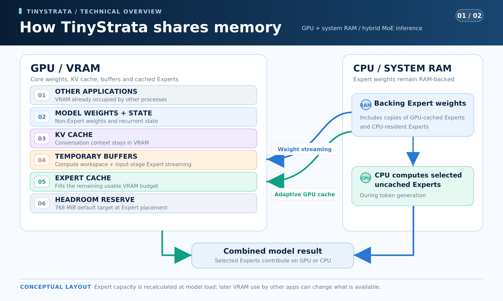

# TinyStrata

[English](README.md) · [简体中文](README.zh-CN.md) · [日本語](README.ja.md) · **Deutsch** · [Français](README.fr.md) · [Español](README.es.md) · [Português](README.pt-BR.md)

**TinyStrata ist eine schnelle Inferenz-Engine für MoE-Modelle der 30B-Klasse, die ausschließlich für Windows entwickelt wird.** Sie richtet sich vor allem an PCs, die mit gängigen Grafikkarten mit **8–24 GB VRAM** ausgestattet sind und über **höchstens 32 GB Arbeitsspeicher** verfügen. Sie bietet eine API und eine optionale Chat-Oberfläche.

**NVIDIA-GPUs ab der Ampere-Generation (CUDA) und AMD-RDNA-4-GPUs (HIP/ROCm) werden unterstützt.**

**Einschränkung der AMD-Bildausgabe:** Bei AMD-Prozessoren mit integrierter Grafik und einer separaten Radeon für die Inferenz muss der Monitor **vor dem Windows-Start an die Radeon angeschlossen sein**. Die Bildausgabe über das Mainboard bzw. die integrierte GPU wird vorerst nicht unterstützt: Ein anderer Nutzer meldete Neustarts des gesamten PCs, die wir auf unserem Testsystem reproduziert haben. Ein Umstecken nach dem Start verhinderte das erneute Auftreten nicht. Die Ursache ist ungeklärt; siehe [Issue #10](https://github.com/kbc20f11/TinyStrata/issues/10).

## Warum wir TinyStrata entwickeln

Angesichts steigender Preise für PC-Komponenten wird es für viele Menschen immer schwieriger, einen High-End-PC zusammenzustellen.

Deshalb wurde TinyStrata entwickelt, um KI lokal mit hoher Geschwindigkeit auf PCs mit gängigen Grafikkarten der RTX 3060-Klasse oder besser auszuführen. Unser Schwerpunkt liegt darauf, vergleichsweise kleine MoE-Modelle der 30B-Klasse so schnell wie möglich auszuführen.

Unsere Hauptzielgruppe sind PCs mit **8–24 GB VRAM und höchstens 32 GB Arbeitsspeicher**. Wir glauben, dass dieser Bereich die häufigsten Konfigurationen von PCs mit gängigen Grafikkarten abdeckt.

TinyStrata baut auf Strata auf und nutzt GPU-Speicher effizient, damit MoE-Modelle der 30B-Klasse auch mit begrenztem VRAM schnell laufen können. Unser Ziel ist es, lange Unterhaltungen und Dokumente auf Ihrem eigenen PC nutzbar zu machen.

Die Entwicklung konzentriert sich auf lokale Inferenz unter Windows und deren Bereitstellung über eine API.

TinyStrata wählt Inferenz- und Speichereinstellungen automatisch passend zu Ihrer Hardware, sodass Sie die API ohne komplizierte Konfiguration oder manuelle Feinabstimmung nutzen können.

## Modellschwerpunkt

[Qwen3.6-35B-A3B](https://huggingface.co/Qwen/Qwen3.6-35B-A3B) bleibt das Standardmodell und bietet auf PCs mit gängigen Grafikkarten ein ausgewogenes Verhältnis von Geschwindigkeit, Speicherbedarf und Antwortqualität. TinyStrata konzentriert sich auf kompakte MoE-Modelle und unterstützt zusätzlich **Gemma 4 26B-A4B-it, LFM2.5-24B-A2B und Clover-35B-A3B-Preview**.

**Qwen3.6-35B-A3B UD-IQ3_XXS** verwendet den festgelegten [Unsloth-MTP-GGUF](https://huggingface.co/unsloth/Qwen3.6-35B-A3B-MTP-GGUF/blob/5bc3e238d916f48a861bac2f8a1990a0e9b7e98d/Qwen3.6-35B-A3B-UD-IQ3_XXS.gguf). Die zwei Downloads umfassen zusammen etwa **15.0 GB**: Sprachmodell einschließlich MTP-Gewichten **14.1 GB** und Vision-Projektor (`mmproj-F16.gguf`) **0.9 GB**.

**Gemma 4 26B-A4B-it QAT Q4_0** verwendet [Googles offizielles Modell und den Vision-Projektor](https://huggingface.co/google/gemma-4-26B-A4B-it-qat-q4_0-gguf) mit dem [passenden Unsloth-QAT-MTP-Assistenten](https://huggingface.co/unsloth/gemma-4-26B-A4B-it-qat-GGUF/blob/7b92b5b28818151e8669af2e45e88d6086f490dd/mtp-gemma-4-26B-A4B-it.gguf). Die drei Downloads umfassen **15.886 GB**: Modell **14.439 GB**, Projektor **1.195 GB** und Assistent **0.252 GB**.

**LFM2.5-24B-A2B Q4_K_M** verwendet den offiziellen [LiquidAI-GGUF](https://huggingface.co/LiquidAI/LFM2.5-24B-A2B-GGUF). Der einzelne Sprachmodell-Download ist **14.53 GB** groß.

**Clover-35B-A3B-Preview IQ3_XXS** verwendet standardmäßig den [GGUF von AtomicChat](https://huggingface.co/AtomicChat/Clover-35B-A3B-Preview-GGUF/blob/4f7e2918e5315634d9d9720ea4f6e8a9a627a875/Clover-35B-A3B-Preview-AD-IQ3_S-IQ3_XXS.gguf) mit **IQ3_XXS für Gate/Up und IQ3_S für Down** der Experten. Das Sprachmodell mit **15.515 GB** behält Clovers eigenen Tokenizer und die gelernten bidirektionalen GDN-Parameter bei. TinyStrata erweitert die Kontextkapazität auf **256K**. [Das offizielle Clover gibt 128K an](https://huggingface.co/Diffuspace/Clover-35B-A3B-Preview/blob/main/config.json); die allgemeine Antwortqualität oberhalb von 128K wurde noch nicht bewertet. Das offizielle Clover ist textbasiert; TinyStrata ergänzt Bildeingaben über den Qwen3.6-Projektor (**0.899 GB**, insgesamt **16.414 GB**). Ein bereits für Qwen geladener Projektor wird wiederverwendet. Die Auswahl erfolgt mit `run-api.bat --model-family clover`; ein neues eigenständiges Profil verwendet Port **18083** und speichert seine Einstellungen in `config-clover.json`.

Verwaltete Clover-Profile verwenden standardmäßig kausale Dekodierung ohne Drafts, D0, mit INT8-KV (`--clover-mode causal --clover-draft 0 --kv-type int8`) und MT1 (`STRATA_IQ_MT_MIN=1`). Exakte Selbstspekulation D3 bleibt optional (`--clover-mode self-spec --clover-draft 3 --clover-accept exact`); vergleichen Sie vor der Aktivierung die Geschwindigkeit mit kausaler Dekodierung auf Ihrer Hardware. Der Bildencoder bleibt standardmäßig auf der GPU; `--vision cpu` wählt die CPU und `--vision no` deaktiviert ihn. Vision unterstützt kausale oder exakte selbstspekulative Dekodierung; Blockdiffusion und Schwellenwertannahme erfordern `--vision no`. LowConfidence-Blockdiffusion und approximative Schwellenwertannahme bleiben ausdrücklich zu aktivierende experimentelle Optionen; siehe [Dekodierungsoptionen](benchmark/README.md#english).

Clover bietet außerdem eine optionale Wiederholungssuche: `--clover-lookup N` schlägt höchstens **0–7 Tokens** vor; **0/aus bleibt der Standard**. Bekannte Fortsetzungen aus Prompt oder Verlauf werden kopiert und vom vollständigen kausalen Modell mit denselben Penalties geprüft. Erfordert kausales D0 und Temperatur 0; Bilder werden unterstützt. Testen Sie **3** und **7** mit Ihrer Arbeitslast; siehe [Messungen und Grenzen der Übereinstimmung](benchmark/results/clover-lookup-20261107.md). Bei Übereinstimmungen unter acht Tokens werden höchstens drei vorgeschlagen; vier bis sieben erfordern mindestens acht übereinstimmende Tokens.

Die Qwen-, Gemma- und LFM-Engines verwenden einen automatischen VRAM-Expertencache, CPU-Expertenberechnung aus dem Arbeitsspeicher, Gewichtsstreaming bei der Eingabe und CUDA Graphs. Sie nutzen dieselbe API und unterstützen Modellwechsel im laufenden Betrieb; die Einstellungen werden pro Modell gespeichert. Ausgewählte Experten werden nicht ausgelassen. Sie unterstützen außerdem automatisches Wachstum des physischen KV-Speichers, ohne die maximale Kontextkapazität zu ändern.

**Die GPT-OSS-Unterstützung wurde eingestellt.** Das Modell gehört nicht mehr zu den aktuellen Download-, Start- oder Benchmark-Zielen. [Historische Messungen](benchmark/results/gptoss-adoption-20261110.md) bleiben erhalten; siehe [Status und Voraussetzungen für eine Wiederaufnahme](docs/gpt-oss-reintroduction.md).

| Funktion | [Qwen3.6](https://huggingface.co/Qwen/Qwen3.6-35B-A3B) | [Gemma 4](https://huggingface.co/google/gemma-4-26B-A4B-it) | [LFM2.5](https://huggingface.co/LiquidAI/LFM2.5-24B-A2B) | [Clover](https://huggingface.co/Diffuspace/Clover-35B-A3B-Preview) |
| --- | --- | --- | --- | --- |
| Maximaler Kontext | 256K | 256K | 128K | 256K (Erweiterung) |
| Bildeingabe | Ja; Bildencoder standardmäßig auf der GPU | Ja; Bildencoder standardmäßig auf der GPU | Nein | Ja (TinyStrata-Erweiterung; standardmäßig GPU-resident) |
| MTP | 3 | 3 | Nein | Nein (exakte Selbstspekulation D3 optional) |
| KV-Formate | FP32 / INT8 / natives FP8 | FP16 / INT8 / natives FP8 (experimentell) | FP16 / INT8 / natives FP8 | FP32 / INT8 / natives FP8 |
| Automatische KV-Auswahl (Standard) | FP8 → INT8 | INT8 | FP8 → INT8 | INT8 |

Clover-Bildeingaben sind eine TinyStrata-Erweiterung, keine offizielle Clover-Funktion.

Die Spaltenüberschriften verlinken auf die offiziellen Modellkarten. **FP8 → INT8** bedeutet FP8-KV und native FP8-Attention (Tensor Cores bei NVIDIA, WMMA bei AMD RDNA 4), wenn GPU und kompilierte Kernel dies unterstützen, andernfalls INT8. KV-Präzision und GGUF-Gewichtsquantisierung sind unabhängig; niedriger präzises KV kann die Ausgabe gegenüber FP32 (Qwen) beziehungsweise FP16 (Gemma/LFM) verändern.

Gemma verwendet standardmäßig INT8. Natives FP8 ist experimentell und kann mit `run-api.bat --model-family gemma4 --kv-type fp8-mma` ausdrücklich gewählt werden.

Die **automatische Kontextkapazität** richtet sich wie unten gezeigt nach dem gesamten VRAM der GPU; der freie VRAM bestimmt die Größe des Expertencaches. Ein explizites `--max-context N` hat Vorrang.

| Gesamter VRAM (Beispiele) | Qwen3.6 / Gemma 4 / Clover | LFM2.5 |
| --- | ---: | ---: |
| 8 GB | 64K | 64K |
| 12 GB | 128K | 128K |
| 16 GB oder mehr | 256K | 128K |

Die Kapazitätsklassen berücksichtigen Unterschiede bei den Treiberangaben, sodass eine 16-GB-Karte auch bei gemeldeten 15.x GiB für Qwen, Gemma und Clover 256K auswählt.

Fehlt die Programmdatei eines zusätzlichen Modells, siehe die [Anleitung zum manuellen Build](README.md#model-focus).

## Installation

Führen Sie einen der beiden Installer in 64-Bit-PowerShell aus:

**Mit Oberfläche** ([Installer](install-ui.ps1)): Chat unter `http://127.0.0.1:3000`, API unter `http://127.0.0.1:18080/v1`.

```powershell
irm 'https://raw.githubusercontent.com/kbc20f11/TinyStrata/refs/heads/main/install-ui.ps1' | iex
```

**Nur API** ([Installer](install.ps1)): dieselbe API ohne Oberfläche.

```powershell
irm 'https://raw.githubusercontent.com/kbc20f11/TinyStrata/refs/heads/main/install.ps1' | iex
```

**AMD-Laufzeitstandard:** Automatische Installationen und Updates verwenden das private **ROCm-SDK `10.2.0a20260930` (HIP 7.17)** im Arbeitsverzeichnis statt eines älteren globalen `HIP_PATH` oder System-SDKs. Ein ausdrücklich angegebenes `-HipDirectory` wählt weiterhin ein eigenes SDK. Modell-Engines und Vision verwenden zusammenpassende HIP-/COMGR-/Kpack-Dateien und geprüfte SDK-Mathematikbibliotheken; Updates bereiten eine separate native Generation vor, bevor die Einstellungen veröffentlicht werden. Treiber, System32 und der dauerhafte System-PATH bleiben unverändert.

Windows HIP verwendet die vom Treiber gemeldete minimale VMM-Granularität nur nach Prüfung der drei lokalen Kernbibliotheken, der tatsächlich geladenen Laufzeit und der passenden kompilierten HIP-Version (ab 7.17). Ältere, abweichende oder ungeprüfte Laufzeiten behalten eine **Mindestgröße von 4 MiB**. Zur Wiederherstellung setzen Sie vor dem Start `$env:TINYSTRATA_HIP_VMM_COARSE='1'`; **jeder nichtleere Wert erzwingt grobe Blöcke**. Entfernen Sie die Variable für die automatische Auswahl. Nur bei **verifiziertem HIP mit Blöcken unter 4 MiB** wartet die native Entladung bis zu **60 Sekunden** auf ein reguläres Ende; andere Pfade behalten ihr Zeitlimit. Die obige AMD-Bildausgabebeschränkung gilt weiter. Siehe [Validierung und verbleibende Grenzen](benchmark/results/hip-runtime-vmm-20261107.md).

Die optionale grüne Oberfläche unterstützt die sieben README-Sprachen, Bildeingaben und Live-Statistiken zur Generierung. Unter **Info → Einstellungen → Erscheinungsbild** wählen Sie **System folgen** (Standard), **Hell** oder **Dunkel**. Dieser Browser behält Ihre Auswahl auch nach Neustarts bei.

Der Windows-UI-Installer erstellt eine **TinyStrata**-Verknüpfung auf dem Desktop. Sie startet die lokale API und Oberfläche oder verwendet die bereits laufenden Prozesse und öffnet den Chat im Browser. Der reine API-Installer erstellt diese Verknüpfung nicht. Alternativ diesen Befehl ausführen oder `run-ui.bat` doppelklicken:

```powershell
& "$env:LOCALAPPDATA\TinyStrata\run-ui.bat"
```

Für die reine API-Installation verwenden Sie `run-api.bat`:

```powershell
& "$env:LOCALAPPDATA\TinyStrata\run-api.bat" --port 18080
```

### UI-Suche und Python

Im Tab **Modelle** können Sie Modelle herunterladen oder ihre heruntergeladenen Dateien entfernen. Die Modellauswahl im Chat zeigt nur installierte Modelle. Vor dem Löschen ist eine Bestätigung erforderlich. Wechseln Sie zu einem anderen Modell, bevor Sie das aktive löschen. Gemeinsam genutzte Dateien, die ein anderes Modell benötigt, bleiben erhalten.

Die Denkoptionen richten sich nach dem Modell: Qwen3.6, Clover und Gemma 4 bieten **Ein / Aus**, anfangs **Ein**; LFM2.5 bleibt immer **Ein**. Tiel Coder bietet **Aus / Niedrig / Mittel / Hoch**, anfangs **Mittel** (`xhigh` für Hoch). Die UI merkt sich die Auswahl für jedes Modell getrennt. Tiels [Sharp-Vorlage](https://huggingface.co/peculiar-ragdoll/Qwen-Sharp-Chat-Templates#setting-reasoning-effort) steuert diese Stufen durch Prompt-Anweisungen. Sie sind kein numerisches Token-Budget, und Hoch garantiert keine bessere Antwort.

In einer neuen UI ist die Websuche **standardmäßig eingeschaltet**. Ohne gespeicherten Suchanbieter wird **DDGS ohne API-Schlüssel** verwendet. Über das Kontrollkästchen **Websuche** neben **Chat-Einstellungen** lässt sie sich ausschalten; dieser Browser behält die Auswahl auch nach Neustarts für alle unterstützten Modelle bei. Bereits gespeicherte Ein-/Aus-Einstellungen, Suchanbieter und API-Schlüssel bleiben erhalten. Suchanbieter, API-Schlüssel und Parallelität werden in den Chat-Einstellungen festgelegt. Python im isolierten Browserbereich steht dem Modell bei Bedarf immer zur Verfügung. Fertig generierte Python-Codeblöcke lassen sich auch über **Python ausführen** manuell starten.

### Automatische Kontextkomprimierung

**Kontext automatisch komprimieren** ist in den Chat-Einstellungen der optionalen UI standardmäßig aktiviert. Vor Antworten und zwischen lokalen Werkzeugrunden zählt die UI den Prompt mit dem Tokenizer des aktuellen Modells. Sobald Prompt und reservierter Ausgaberaum **85 %** des Kontextlimits erreichen, fasst das aktuelle Modell ältere Gespräche zusammen. Mindestens die letzten zwei Benutzerbeiträge bleiben mit ihren vollständigen Antworten erhalten; Werkzeugaufrufe und Ergebnisse bleiben zusammen. Systemanweisungen und verfügbare Werkzeuge werden beibehalten.

Die Zusammenfassung wird als fortlaufender Prüfpunkt mit dem Chat in SQLite gespeichert; der vollständige Originalverlauf bleibt in der UI sichtbar. Änderungen oder Zurückspringen innerhalb des zusammengefassten Bereichs machen den Prüfpunkt ungültig. Fehler oder Abbruch löschen keine Nachrichten. Zusammenfassungen können Details verlieren und sind von der KV-Quantisierung unabhängig. Ein neuer zusammengefasster Präfix muss einmal neu verarbeitet werden, bevor spätere Beiträge seinen KV-Cache wiederverwenden.

Ein Klick auf **KV** unter dem Chat öffnet ein Ringdiagramm der Kontextnutzung und **Jetzt komprimieren**. Die manuelle Komprimierung funktioniert auch bei ausgeschalteter Automatik. Die letzten zwei Benutzerbeiträge mit ihren Antworten bleiben vollständig erhalten; Originalnachrichten und Anhänge bleiben in SQLite. Der komprimierte Kontext wird sofort geladen, ohne eine Nachricht zum Gespräch hinzuzufügen.

Über **Expertenverteilung** daneben wählen Sie **Auto** oder die **Anzahl der auf der GPU gehaltenen gerouteten Experten**. Die Schrittweite passt zum Modell; der Prozentsatz wird zur Orientierung angezeigt. Anwenden lädt das Modell neu und speichert die Auswahl für dieses Modell. Die tatsächliche Verteilung hängt vom verfügbaren VRAM und den Expertengrößen ab. Bei null Experten werden keine gerouteten Experten auf der GPU vorgehalten; gemeinsame Gewichte, KV und der Bildencoder verwenden weiterhin die GPU.

Ohne ausdrückliches Ausgabelimit werden bis zu **8K Tokens**, höchstens ein Viertel des Kontexts, reserviert. Zusammenfassungen sind auf **2K Ausgabetokens** und ein Achtel des Kontexts begrenzt. Für Bilder mit unbekannter kodierter Größe wird eine vorsichtige Tokenobergrenze verwendet. Eine einzelne zu große Nachricht muss gekürzt werden. `POST /v1/chat/token-count` erzeugt keinen Text und verändert keinen KV-Cache; reine API-Clients werden nicht automatisch komprimiert.

Grundlagen: [Open WebUI](https://docs.openwebui.com/troubleshooting/context-window/) und [Anthropic](https://www.anthropic.com/research/effective-context-engineering-for-ai-agents).


### Modell ohne Neustart wechseln

Das Installationsprogramm startet standardmäßig Qwen. Laden Sie Gemma für denselben laufenden API-Server herunter und prüfen Sie den Fortschritt:

```powershell
$api = 'http://127.0.0.1:18080'
Invoke-RestMethod "$api/v1/model/download" -Method Post -ContentType 'application/json' -Body '{"model":"gemma-4-26b-a4b-it"}'
Invoke-RestMethod "$api/v1/model/download?model=gemma-4-26b-a4b-it"
```

Wiederholen Sie die Fortschrittsabfrage bis `state` den Wert `ready` hat und wechseln Sie dann ausdrücklich. Der Download eines inaktiven Modells bereitet es nur vor und aktiviert es nicht:

```powershell
Invoke-RestMethod "$api/v1/model/switch" -Method Post -ContentType 'application/json' -Body '{"model":"gemma-4-26b-a4b-it"}'
Invoke-RestMethod "$api/v1/model/switch"
```

Mit `run-api.bat --model-family gemma4` starten Sie direkt mit Gemma unter `http://127.0.0.1:18082/v1`. Für LFM ersetzen Sie `gemma-4-26b-a4b-it` in den obigen Download-, Fortschritts- und Wechselanfragen durch `lfm2.5-24b-a2b`; mit `run-api.bat --model-family lfm2` starten Sie LFM direkt unter `http://127.0.0.1:18081/v1`.

Für Clover verwenden Sie in denselben Download-, Fortschritts- und Wechselanfragen `clover-35b-a3b-preview`. Der Port der laufenden API bleibt unverändert.

Fragen Sie `GET /v1/model/switch` bis `state: ready` ab. Zum Zurückwechseln senden Sie dieselbe Wechselanfrage mit `{"model":"qwen3.6-35b-a3b"}`. Der Start eines Downloads oder Wechsels liefert `202`; ein Wechsel während einer Generierung liefert `409`, daher nach deren Ende erneut versuchen. Inferenzanfragen während des Wechsels liefern `503`. Port und Authentifizierung bleiben unverändert. Die Auswahl gilt für die aktuelle Serversitzung; nach einem Neustart wird das im Launcher gewählte Modell verwendet.

## Gemessene Geschwindigkeit — Qwen3.6

Gemessen am **2026-11-03** unter Windows mit einer RTX PRO 4000 Blackwell SFF Edition (24 GB), einem Ryzen 9 7945HX3D, 64 GB Arbeitsspeicher und dem festgelegten Unsloth-MTP-UD-IQ3_XXS-Modell. Der Bildencoder blieb bei den API-Anfragen auf der GPU. Thinking, die Sampling-Standardwerte des Modells (Temperatur 0.7) und MTP 3 waren aktiv. Prompt-Chunks und Expertenplatzierung wurden automatisch gewählt; die Kontextkapazität wurde entsprechend der VRAM-Klasse festgelegt. Der hybride CUDA-Graph-Pfad blieb standardmäßig aus, die normalen CUDA Graphs bei vollständigem GPU-Betrieb blieben aktiv.

| Verfügbarer Speicher | Kontextkapazität | INT8-Generierung | Native FP8-Generierung | Anmerkungen |
| --- | ---: | ---: | ---: | --- |
| 24 GB | 256K | 141.52 tok/s | 134.41 tok/s | Alle Gewichte im VRAM |
| ca. 16 GB | 256K | 103.69 tok/s | 105.15 tok/s | 8 GiB separat belegt; Experten auf CPU und GPU |
| ca. 12 GB | 128K | 92.89 tok/s | 94.74 tok/s | 12 GiB separat belegt; Experten auf CPU und GPU |
| ca. 8 GB | 64K | 67.17 tok/s | 69.95 tok/s | Expertenberechnung auf GPU und CPU |

Dieselben drei Eingabetexte wurden je zweimal pro FP8-/INT8-Konfiguration mit den Sampling-Standardwerten des Modells verwendet und jeweils 128 Token einschließlich Thinking generiert. Die Geschwindigkeit ergibt sich aus der gesamten Tokenzahl geteilt durch die gesamte Decodierzeit, ohne Laden und Eingabeverarbeitung; Kontextwerte sind Cachekapazitäten. Die Zeilen mit weniger Speicher reservieren 8, 12 oder 16 GiB auf derselben 24-GB-GPU und verwenden die Kontextkapazität der jeweiligen VRAM-Klasse; sie sind keine Benchmarks physischer 16-/12-/8-GB-GPUs.

INT8 und FP8 wurden in wechselnder Reihenfolge mit jeweils vier unabhängigen Starts gemessen, wobei jeder Start die drei Eingaben je zweimal mit 128 Ausgabetoken pro Anfrage verarbeitete; Einzelheiten stehen im [direkten Vergleich](benchmark/results/qwen-kv-direct-20261103.md).

Die [Basalt-basierten Vergleiche für CPU, Clover-GPU und Checkpoints](benchmark/results/basalt-adoption-20261105.md#english) verwenden gesonderte kontrollierte Einstellungen und ersetzen die historischen Benchmark-Tabellen nicht.

Die [Messungen zur Clover-GDN-Fusion](benchmark/results/gdn-chain-20261105.md#english) vergleichen wiederholt vollständige GPU-Ausführung und Hybridbetrieb mit festem Expert-Budget; Qwens Standardpfad bleibt erhalten.

[Zusammenführung der CPU-Ergebnisse im Hybridbetrieb und Abstimmung der Worker-Zahl anhand von Messungen](benchmark/results/basalt-remaining-20261105.md#english)
sind gesondert dokumentiert; die historischen Benchmark-Tabellen bleiben unverändert.

[Kapazitätsabhängige Staging-Puffer bei knappem VRAM](benchmark/results/portable-hybrid-20261105.md#english)
werden in separaten kontrollierten Messungen beschrieben.

## Gemessene Geschwindigkeit — Gemma 4

Gemessen auf demselben Windows-PC mit 64 GB Arbeitsspeicher, Gemma 4 26B-A4B-it QAT Q4_0 und dem passenden QAT-MTP-Assistenten. Bei den API-Anfragen blieb der Bildencoder auf der GPU. MTP 3, CUDA Graphs sowie die modellspezifischen Thinking- und Sampling-Standardwerte waren aktiv; die Kontextkapazität wurde entsprechend der VRAM-Klasse festgelegt, Prompt-Chunks und Expertenplatzierung wurden automatisch gewählt.

Natives FP8 und INT8 wurden am **2026-10-27** gemessen.

| Verfügbarer VRAM | Kontextkapazität | INT8 (Standard) | Natives FP8 (experimentell) | Hinweise |
| --- | ---: | ---: | ---: | --- |
| 24 GB | 256K | 115.89 tok/s | 115.46 tok/s | INT8 / FP8: Expertenberechnung auf der GPU |
| Ungefähr 16 GB | 256K | 102.83 tok/s | 100.86 tok/s | INT8 / FP8: Expertenberechnung auf GPU und CPU |
| Ungefähr 12 GB | 128K | 85.53 tok/s | 91.71 tok/s | INT8 / FP8: Expertenberechnung auf GPU und CPU |
| Ungefähr 8 GB | 64K | 52.98 tok/s | 55.09 tok/s | INT8 / FP8: Expertenberechnung auf GPU und CPU |

Dieselben drei Eingabetexte wurden je zweimal pro FP8-/INT8-Konfiguration mit den Sampling-Standardwerten des Modells verwendet und jeweils 128 Token einschließlich Thinking generiert. Die Geschwindigkeit ergibt sich aus der gesamten Tokenzahl geteilt durch die gesamte Decodierzeit, ohne Laden und Eingabeverarbeitung; Kontextwerte sind Cachekapazitäten. Die Zeilen mit weniger Speicher reservieren 8, 12 oder 16 GiB auf derselben 24-GB-GPU und verwenden die Kontextkapazität der jeweiligen VRAM-Klasse; sie sind keine Benchmarks physischer 16-/12-/8-GB-GPUs.

## Gemessene Geschwindigkeit — LFM2.5

Gemessen auf demselben Windows-PC mit 64 GB Arbeitsspeicher und dem offiziellen LFM2.5-24B-A2B Q4_K_M, ohne MTP oder Vision. CUDA Graphs sowie die modellspezifischen Thinking- und Sampling-Standardwerte waren aktiv; die Kontextkapazität wurde entsprechend der VRAM-Klasse festgelegt, Prompt-Chunks und Expertenplatzierung wurden automatisch gewählt.

Natives FP8 und INT8 wurden am **2026-10-27** gemessen.

| Verfügbarer VRAM | Kontextkapazität | INT8 | Natives FP8 (Standard) | Hinweise |
| --- | ---: | ---: | ---: | --- |
| 24 GB | 128K | 143.85 tok/s | 148.61 tok/s | INT8 / FP8: Expertenberechnung auf der GPU |
| Ungefähr 16 GB | 128K | 138.14 tok/s | 139.22 tok/s | INT8 / FP8: Expertenberechnung auf GPU und CPU |
| Ungefähr 12 GB | 128K | 115.61 tok/s | 117.90 tok/s | INT8 / FP8: Expertenberechnung auf GPU und CPU |
| Ungefähr 8 GB | 64K | 79.74 tok/s | 81.39 tok/s | INT8 / FP8: Expertenberechnung auf GPU und CPU |

Dieselben drei Eingabetexte wurden je zweimal pro FP8-/INT8-Konfiguration mit den Sampling-Standardwerten des Modells verwendet und jeweils 128 Token einschließlich Thinking generiert. Die Geschwindigkeit ergibt sich aus der gesamten Tokenzahl geteilt durch die gesamte Decodierzeit, ohne Laden und Eingabeverarbeitung; Kontextwerte sind Cachekapazitäten. Die Zeilen mit weniger Speicher reservieren 8, 12 oder 16 GiB auf derselben 24-GB-GPU und verwenden die Kontextkapazität der jeweiligen VRAM-Klasse; sie sind keine Benchmarks physischer 16-/12-/8-GB-GPUs.

## Gemessene Geschwindigkeit — Clover

Gemessen am **2026-11-02** unter Windows mit einer RTX PRO 4000 Blackwell SFF Edition (24 GB), Ryzen 9 7945HX3D und 64 GB Arbeitsspeicher mit Clover Preview IQ3_XXS. Kausales D0, Thinking und ein GPU-residenter Bildencoder waren aktiv. CPU-Worker, Eingabe-Chunks und Expert-Platzierung waren automatisch; die Umgebungsvariablen waren `STRATA_IQ_MT_MIN=1` und `STRATA_EXP_MODE=8`.

| Verfügbare VRAM | Kontextkapazität | INT8-Generierung | Native FP8-Generierung | Hinweise |
| --- | ---: | ---: | ---: | --- |
| 24 GB | 256K | 91.61 tok/s | 94.67 tok/s | Experten-GiB — INT8: 12.34 → 12.34; FP8: 12.34 → 12.34 |
| Etwa 16 GB | 256K | 58.16 tok/s | 58.17 tok/s | Experten-GiB — INT8: 6.55–6.60 → 6.07–6.22; FP8: 6.55–6.60 → 6.11–6.19 |
| Etwa 12 GB | 128K | 51.31 tok/s | 50.89 tok/s | Experten-GiB — INT8: 3.08–3.18 → 2.80–3.04; FP8: 2.94–3.18 → 2.80–3.04 |
| Etwa 8 GB | 64K | Instabil (3/4 Starts) | 39.75 tok/s | Experten-GiB — INT8: 0.00 → 0.00 (3/4); FP8: 0.00 → 0.00; INT8/FP8: Decode-Experten auf CPU; Dense-/Prompt-Streaming auf GPU |

Für jede KV-/VRAM-Konfiguration wurden vier unabhängige Starts mit den v1-Eingaben, Samplingwerten und der v1-Zeitmessung versucht. Zahlenwerte erfordern vier erfolgreiche Starts; Startfehler und gemischte Ergebnisse sind ausdrücklich markiert. Dies ist eine kontrollierte Variante, getrennt vom Standard-v1-Profil und vom verwalteten kausalen D0-/INT8-Standard. Der Expertencache zeigt die tatsächliche Belegung erfolgreicher Starts: Start → nach der 16K-Eingabe. [Vollständige Ergebnisse und Bedingungen](benchmark/results/rtx-pro-4000-blackwell-sff.md).

Die reduzierten Speicherstufen reservieren und beschreiben 8, 12 oder 16 GiB auf derselben 24-GB-GPU; die Kontextkapazitäten betragen 256K / 256K / 128K / 64K. Dies sind keine Benchmarks physischer 16-/12-/8-GB-GPUs. Die automatische Chunkwahl unterscheidet diese Messung von der zuvor gezeigten lokalen Optimierung mit festem 2.048-Token-Chunk.

## Gemessene Geschwindigkeit — AMD Radeon (HIP)

Geschwindigkeit auf Radeon-Karten, gemessen mit [tinystrata-bench-v1](benchmark/README.md#english). Jede Karte hat eine eigene Seite mit Hardware, Treiber, Engine-Commit, Einstellungen und allen Spalten: [`benchmark/results/`](benchmark/results/). Werte: Generierung / 4K-Eingabe / 16K-Eingabe in tok/s. Die Clover-Werte verwenden die Variante exact D3.

**Aktuelle gespeicherte Einstellungen:** [RX 9060 XT, 2026-11-09 (fünf Modelle, ein Durchlauf)](benchmark/results/rx-9060-xt.md#current-saved-settings--2026-11-09-one-pass). Die folgende Tabelle behält den historischen Vergleich mit festem v1-Profil bei.

| GPU | Qwen3.6 UD-IQ3_XXS | Gemma 4 QAT Q4_0 | LFM2.5 Q4_K_M | Clover IQ3_XXS (exact D3, Vision GPU) |
| --- | ---: | ---: | ---: | ---: |
| [RX 9060 XT](benchmark/results/rx-9060-xt.md) | 82.95 / 895.98 / 808.59 | 78.07 / 2482.20 / 2338.68 | 93.14 / 2062.80 / 1694.56 | 41.67 / 942.27 / 892.94 |
| [RX 9070 XT](benchmark/results/rx-9070-xt.md) | 89.11 / 1056.20 / 1383.33 | 87.81 / 2977.93 / 3667.40 | 102.67 / 2601.75 / 2531.47 | 39.86 / 888.74 / 1215.40 |

Diese Clover-Messung verwendet exact D3/INT8/MT1 mit GPU-residentem Bildencoder; D3 ist nicht mehr der App-Standard. Erstes Bild-Token / Antwortende: **2.43 / 4.54 s** (RX 9060 XT), **2.61 / 5.47 s** (RX 9070 XT); Expertencache: **7.32–8.10 → 7.18–7.95 GiB** (RX 9060 XT), **6.84 → 6.70 GiB** (RX 9070 XT) (Start → nach 16K-Eingabe). [Bedingungen und Bildprüfungen](benchmark/results/rx-9060-xt.md#clover-vision-with-exact-d3-2026-11-01).

**Clover IQ3_XXS — RX 9060 XT (2026-11-01; historische Werte vor gemeinsamer Attention)**

Dieselben festgelegten Eingaben wurden mit 128K Kontext, wachsendem physischem KV-Speicher, aktivem Thinking, automatischen CPU-Workern/Chunks und vier unabhängigen API-Starts je Profil gemessen. Die historischen Exact-Zeilen waren separate Varianten; kausales INT8 ist die feste v1-Kontrolle mit den ursprünglichen Einstellungen ohne Vision. Expertencache: Start → nach 16K, in GiB.

| Profil | KV | Generierung, kurze Eingabe tok/s | 4K-Eingabe tok/s | Generierung nach 4K tok/s | 16K-Eingabe tok/s | Generierung nach 16K tok/s | Expertencache GiB |
| --- | --- | ---: | ---: | ---: | ---: | ---: | --- |
| Kausal, Standardregeln (Kontrolle) | INT8 | 41.27 | 962.29 | 38.05 | 877.43 | 35.68 | 9.98 → 9.83 |
| Kausal, MT1 (Kontrolle) | INT8 | 40.64 | 962.21 | 36.99 | 877.58 | 35.77 | 9.98 → 9.83 |
| Exakte Selbstspekulation D3 (optional) | INT8 | 49.39 | 963.95 | 33.06 | 878.30 | 33.83 | 9.98 → 9.83 |
| Exakte Selbstspekulation D3 | FP8 (optional) | 46.11 | 959.49 | 28.94 | 872.02 | 18.00 | 9.98 → 9.83 |

Dies sind historische Kontrollmessungen vor der gemeinsamen Attention. Clover verwendet jetzt standardmäßig kausales D0, INT8-KV und MT1; exact D3 ist optional. Diese historischen D3-Werte messen nicht den aktuellen Standard. Blockdiffusion und Schwellenwertannahme bleiben experimentell. [Einstellungen und Qualitätsprüfungen](benchmark/results/rx-9060-xt.md#clover-hip-int8-query-sharing-2026-11-01) / [Früherer IQ3-Vergleich](benchmark/results/rx-9060-xt.md#clover-iq3-2026-10-31) / [Frühere Q4_0-Messungen](benchmark/results/rx-9060-xt.md#clover-causal-and-native-block-diffusion-2026-10-31).

**Clover HIP INT8: gemeinsame Attention-Abfragen — RX 9060 XT (2026-11-01; vor Vision, historisch)**

INT8-KV; vier unabhängige API-Starts je Profil in abwechselnder Reihenfolge. Kurze Eingaben haben maximal 128 Ausgabetokens, die 4K-/16K-/64K-Proben maximal 32. Die Kontrolle des früheren kausalen Standards nutzt normale CPU-Expertenarithmetik (MT2), beide D3-Zeilen nutzen MT1. Diese Messungen stammen aus der Zeit vor Vision; der Bildencoder war nicht resident. Die D3-Zeilen verwenden D3/INT8/MT1, weiterhin ein optionales Profil. [Bedingungen, Qualitätsprüfungen und Ergebnisse](benchmark/results/rx-9060-xt.md#clover-hip-int8-query-sharing-2026-11-01).

| Profil | Kurze Generierung tok/s | Generierung nach 4K tok/s | Generierung nach 16K tok/s | Generierung nach 64K tok/s | 64K-Eingabe tok/s | Expertencache GiB: Start → 64K |
| --- | ---: | ---: | ---: | ---: | ---: | ---: |
| Kausal MT2 (früherer Standard/Kontrolle) | 41.16 | 38.04 | 36.40 | 24.11 | 662.52 | 9.98 → 9.35 |
| Exact D3 MT1 (ohne gemeinsame Attention/Kontrolle) | 49.78 | 33.35 | 34.11 | 17.51 | 663.12 | 9.98 → 9.35 |
| Exact D3 MT1 (vor Vision) | 49.49 | 34.87 | 39.30 | 26.62 | 664.65 | 9.98 → 9.35 |

## Welches Projekt sollte ich verwenden?

| Ihr Ziel und Ihre Hardware | Projekt |
| --- | --- |
| Sie möchten Qwen3.6 / Gemma 4 / LFM2.5 / Clover-Inferenz unter **Windows**, mit **8–24 GB VRAM und höchstens 32 GB Arbeitsspeicher**, etwa auf einem PC mit einer gängigen Grafikkarte. | TinyStrata (**nur Windows**, in Entwicklung) |
| Sie verfügen sowohl über **eine GPU der RTX 3060-Klasse oder besser** als auch über **mindestens 64 GB Arbeitsspeicher**. | Wir empfehlen [Strata (Upstream)](https://github.com/Niko1221/Strata). |
| Sie möchten eine **Chat-Oberfläche mit Live-Statistiken**. | TinyStrata mit dem [optionalen UI-Installer](install-ui.ps1). |

## So wird der Speicher aufgeteilt — Qwen3.6

Ein MoE-Modell enthält viele **Experten**: kleinere neuronale Netze, die für jedes Token ausgewählt werden. TinyStrata hält so viele Experten wie möglich im GPU-Speicher (VRAM). Während der Generierung kann es ausgewählte, nicht zwischengespeicherte Experten auf der CPU unter Verwendung des Arbeitsspeichers berechnen. Bei der Verarbeitung größerer Eingabestapel kann es stattdessen Expertengewichte aus dem RAM durch temporäre GPU-Puffer streamen. Die vom Modell ausgewählten Experten bleiben Teil der Berechnung.

Die heruntergeladenen Modelldateien umfassen insgesamt etwa **15.0 GB**: **14.1 GB** für das Sprachmodell (einschließlich MTP-Gewichten) und **0.9 GB** für den Vision-Projektor (`mmproj-F16.gguf`). Das Sprachmodell muss nicht vollständig in den VRAM passen. Der GPU-Speicher benötigt außerdem Platz für den Vision-Encoder und Bildverarbeitungspuffer, den **KV-Cache** der Unterhaltung, die übrigen Gewichte des Modells und temporäre Berechnungspuffer:



Dies ist ein Schema der Speicheraufteilung im standardmäßigen GPU-Bildmodus, keine Partitionierung mit festen Größen. Bei jedem Laden des Modells startet TinyStrata den GPU-Vision-Encoder und lässt ihn warmlaufen, bevor es das Sprachmodell lädt; seine Gewichte und aufgewärmten Arbeitspuffer bleiben im Speicher. Anschließend weist es die ersten KV-Seiten sowie Speicher für die übrigen Gewichte und Arbeitspuffer zu und bemisst den Experten-Cache nach dem verbleibenden freien VRAM. Unter Windows verwendet es den kleineren Wert aus dem freien CUDA-Speicher und dem vom NVIDIA-Treiber gemeldeten freien dedizierten VRAM, wenn beide verfügbar sind.

Der Cache-Inhalt ändert sich mit den verwendeten Experten. Beim standardmäßigen KV-Wachstum lassen kurze Unterhaltungen mehr VRAM für Experten; wächst die Sequenz, gibt der Expertencache Speicher an KV zurück. Neue kürzere Anfragen können ungenutzte KV-Seiten an den Expertencache zurückgeben. `run-api.bat --kv-whole` reserviert die gesamte KV-Kapazität vorab; `run-api.bat --kv-grow` stellt das Wachstum wieder her. Andere Anwendungen können weiterhin VRAM belegen.

Die Expertenplatzierung strebt normalerweise 768 MiB Reserve an. Im Qwen-Modus `--kv-whole` kann sie wie Strata bei knappem Platz gepackte Q8-Gewichtskopien freigeben, einen vorhandenen Attention-Score-Puffer verkleinern und die Reserve auf 256 MiB senken, damit alle Experten des Hauptmodells in den VRAM passen; MTP-Experten können auf der CPU laufen. `--vram-reserve-mib N` legt die Reserve ausdrücklich fest. Dies ist ein Ziel bei der Platzierung, keine dauerhafte Garantie für freien Speicher.

Mehr Experten im GPU-Speicher bedeuten normalerweise weniger CPU-Arbeit. Im Hybridmodus hält der Arbeitsspeicher auch Sicherungskopien der im VRAM zwischengespeicherten Experten vor. Zusätzlicher VRAM verringert den RAM-Verbrauch daher nicht Byte für Byte. Lassen Sie auch RAM für das Betriebssystem und andere Anwendungen frei. Mehr **RAM-Kapazität** ermöglicht es, Modelldaten vorzuhalten, doch die Geschwindigkeit hängt auch von CPU, RAM-Bandbreite und GPU ab. Der „gemeinsam genutzte GPU-Speicher“ von Windows unterscheidet sich davon, dass TinyStrata Experten gezielt auf der CPU berechnet.

Der KV-Cache bleibt im VRAM; für diesen Auslagerungsmechanismus hält der Arbeitsspeicher die Expertendaten vor. Eine lange Unterhaltung benötigt daher weiterhin genügend GPU-Speicher für ihren KV-Cache.

## Automatische Einstellungen — Qwen3.6

Neue Konfigurationen wählen KV/Attention und Kontextkapazität automatisch. Sie müssen kein Profil für 8 GB, 12 GB oder 16 GB auswählen.

Bei Qwen3.6 und LFM2.5 wählt eine RTX 3060 INT8. Unterstützte Umgebungen mit GPUs der RTX 40/50-Serie oder AMD RDNA 4 wählen natives FP8 automatisch; die Engine prüft neben der Hardwaregeneration auch die kompilierten Kernel und die GPU-Fähigkeiten. Falls natives FP8 nicht verfügbar ist, verwendet der automatische Modus INT8. Gemma verwendet bei NVIDIA und AMD standardmäßig INT8. So wird ein unterstützter Pfad gewählt, ohne beim Start einen Geschwindigkeits- oder Qualitätsbenchmark auszuführen.

Die native Engine schätzt beim Start anhand des freien VRAM, der Kontextkapazität und des Platzbedarfs der GPU-Experten eine Blockgröße von 512, 1024, 2048 oder 4096 Token. Größere Blöcke können wiederholte Gewichtstransfers vom RAM zur GPU während der Eingabeverarbeitung reduzieren. `run-api.bat --chunk N` legt die Größe fest; `run-api.bat --chunk auto` stellt die native automatische Auswahl wieder her.

Die Kontextkapazität ist die logische Obergrenze für Eingabe und generierte Ausgabe zusammen. Standardmäßig wird physischer KV-Speicher mit wachsender Unterhaltung zugewiesen, statt bei einer kurzen Unterhaltung die gesamte Kapazität vorab zu belegen. Lange Dokumente erfordern weiterhin mehr Berechnungen und schließlich mehr KV-Speicher.

Bei voller Kapazität benötigt Qwens INT8-KV einschließlich der MTP-Schicht etwa **0.71 GiB bei 64K, 1.42 GiB bei 128K und 2.84 GiB bei 256K**; weitere Gewichte und Arbeitspuffer kommen hinzu. Natives FP8 benötigt in dieser Implementierung ungefähr ebenso viel KV-Speicher wie INT8; sein Vorteil liegt in einem anderen Berechnungspfad und nicht in einem wesentlich kleineren Cache.

Die Kontextkapazität wird anhand des gesamten GPU-VRAM gewählt; der Expertencache wird anschließend in den beim Laden verbleibenden freien VRAM eingepasst. Andere Anwendungen mit VRAM-Bedarf lassen weniger Platz für GPU-gecachte Experten. Die API weist Eingaben zurück, die die Kontextkapazität überschreiten, anstatt sie stillschweigend zu kürzen.

Die Quantisierung der GGUF-Gewichte und die KV-Präzision sind voneinander unabhängig. Das ausgewählte UD-IQ3_XXS-Modell hat komprimierte Gewichte; INT8 oder FP8 beschreibt den Unterhaltungscache und seinen Attention-Pfad. KV mit geringerer Präzision kann Antworten verändern, daher versprechen diese Modi keine mit FP32-KV identischen Ausgaben. Die Implementierung behält alle sichtbaren Kontextpositionen und jeden vom Modell ausgewählten Experten bei.

Neue Launcher-Konfigurationen verwenden MTP 3, das mehrere Token im Voraus vorschlägt und sie mit dem Hauptmodell überprüft. Das kann die Generierung beschleunigen, doch der Gewinn hängt davon ab, wie viele Vorschläge akzeptiert werden. Die Überprüfung soll das Dekodierverhalten des Hauptmodells bewahren; Unterschiede in numerischen Ausführungspfaden können dennoch Token verändern. Deshalb verspricht aktiviertes MTP keine mit deaktiviertem MTP identischen Ausgaben.

MTP unterstützt sowohl Greedy-Generierung als auch temperaturbasiertes Sampling, einschließlich Wiederholungs-, Häufigkeits- und Präsenzstrafen. Bei Sampling-Anfragen zieht das Hauptmodell für jede Überprüfungszeile eine Stichprobe, und nur das übereinstimmende Präfix des Entwurfs wird akzeptiert.

Qwen und Gemma bieten außerdem optional `--lookup-draft N` (**0–7**, maximale Anzahl vorgeschlagener Tokens) und experimentell `--mtp-auto 0|1`; **beide sind standardmäßig 0/aus**. Lookup kopiert bekannte Fortsetzungen aus Prompt oder Verlauf und prüft jedes Token mit dem bestehenden Sampler des Hauptmodells und denselben Penalties, auch bei normalen Temperaturen. Alle ausgewählten Experten werden berechnet; es gibt weder approximative Annahme noch übersprungene Endstücke. **MTP 3** und die Temperaturen (**Qwen 0.7 / Gemma 1.0**) bleiben Standard. Automatisches MTP beschleunigt nicht jede Aufgabe und bleibt aus. Siehe die [kontrollierten Entwicklungsmessungen und Grenzen](benchmark/results/qwen-gemma-speculation-20261107.md), getrennt vom festen v1-Benchmark.

Explizite Einstellungen überschreiben die automatische Auswahl, und bereits manuell gewählte Einstellungen bleiben wirksam. Beispielsweise legt `run-api.bat --kv-type int8` INT8 fest; `run-api.bat --kv-type auto --max-context auto --expert-vram auto` stellt die automatische Auswahl von KV, Kontext und Expertenplatzierung wieder her.

## API-Server

TinyStrata stellt OpenAI-kompatible APIs für Chat Completions (`/v1/chat/completions`) und Responses (`/v1/responses`) sowie eine Anthropic-kompatible Messages-API (`/v1/messages`) bereit, einschließlich gestreamter Generierung. Nutzen Sie die optionale TinyStrata-Oberfläche, einen API-Client oder ein externes Frontend.

Neue Konfigurationen verwenden modellspezifische Sampling-Standardwerte. Werte pro Anfrage haben Vorrang; gespeicherte benutzerdefinierte Einstellungen bleiben erhalten.

| Einstellung | Qwen3.6 | Gemma 4 | LFM2.5 | Clover |
| --- | ---: | ---: | ---: | ---: |
| `temperature` | 0.7 | 1.0 | 0.1 | 0.0 |
| `top_p` | 0.95 | 0.95 | 1.0 | 1.0 |
| `top_k` | 20 | 64 | 50 | 64 |
| `min_p` | 0.0 | 0.0 | 0.0 | 0.0 |
| `presence_penalty` | 1.5 | 0.0 | 0.0 | 0.9 |
| `frequency_penalty` | 0.0 | 0.0 | 0.0 | 0.0 |
| `repetition_penalty` | 1.0 | 1.0 | 1.05 | 1.05 |
| `enable_thinking` | true | true | true (immer aktiv) | true (abschaltbar) |
| `max_tokens` (einschließlich Thinking) | 32768 | 32768 | 32768 | 24576 |

Die API lauscht standardmäßig unter `http://127.0.0.1:18080`. Um einen anderen Port zu verwenden, führen Sie `run-api.bat --port 18081` im installierten TinyStrata-Ordner aus.

Bei Qwen und Clover verarbeitet `run-api.bat --vision gpu` Bilder auf der GPU (Standard für neue Konfigurationen); `--vision cpu` nutzt die CPU und `--vision no` deaktiviert Bilder. `--vision-tokens N` setzt die maximale Zahl der Bild-Token (Standard: 4096). Diese Auswahl wird gespeichert und bei späteren Starts ohne diese Optionen beibehalten.

Die API kann starten, bevor die Modelldateien installiert sind. Wenn Qwen ausgewählt ist, lädt `POST /v1/model/download` mit einem leeren JSON-Body (`{}`) das festgelegte [Unsloth Qwen3.6-35B-A3B MTP UD-IQ3_XXS-Sprachmodell](https://huggingface.co/unsloth/Qwen3.6-35B-A3B-MTP-GGUF/blob/5bc3e238d916f48a861bac2f8a1990a0e9b7e98d/Qwen3.6-35B-A3B-UD-IQ3_XXS.gguf) (14.1 GB, einschließlich MTP-Gewichten) und seinen [Vision-Projektor](https://huggingface.co/unsloth/Qwen3.6-35B-A3B-MTP-GGUF/blob/5bc3e238d916f48a861bac2f8a1990a0e9b7e98d/mmproj-F16.gguf) (0.9 GB) herunter, insgesamt etwa **15.0 GB**. Die SHA-256-Prüfsummen beider Dateien werden geprüft, der Tokenizer wird extrahiert und die Dateien werden geladen. `GET /v1/model/download` meldet den Fortschritt; unterbrochene Downloads können fortgesetzt werden. Eine wiederholte Download-Anfrage verwendet den aktiven Auftrag weiter, und `POST /v1/model/download/cancel` kann die Übertragung oder Überprüfung abbrechen. Ein abgeschlossener Download bedeutet noch keine Inferenzbereitschaft: Warten Sie, bis der Download-Status `ready` lautet und `/health` `loaded: true` sowie bei aktivierten Bildern auch `images: true` meldet.

Das Installationsprogramm bereitet die Engine-Programmdateien und GPU-Laufzeitbibliotheken vor und lädt standardmäßig Qwen und seinen Vision-Projektor herunter. Bestehende Konfigurationen behalten ihr ausgewähltes lokales Modell bei, bis Sie es ausdrücklich ändern.

## Danksagungen

TinyStrata ist ein unabhängiger Fork von [Strata](https://github.com/Niko1221/Strata) und basiert in weiten Teilen auf dessen Implementierung. Vielen Dank an [Niko](https://github.com/Niko1221) und die Strata-Community für die Engine und die Arbeit, die TinyStrata möglich gemacht haben.

Vielen Dank auch an [Aaron Flin](https://github.com/aflin) und das [MoMoE-Projekt](https://github.com/aflin/momoe) für den in TinyStrata angepassten Code für KV-Cache, Attention und quantisierte Experten.

## Lizenz

MIT. Siehe [LICENSE](LICENSE).

Copyright (c) 2026 Niko1221 and the Strata contributors.

Upstream-Attribution: [NOTICE](NOTICE). GGML: [MIT-Lizenz](third_party/ggml/LICENSE).
