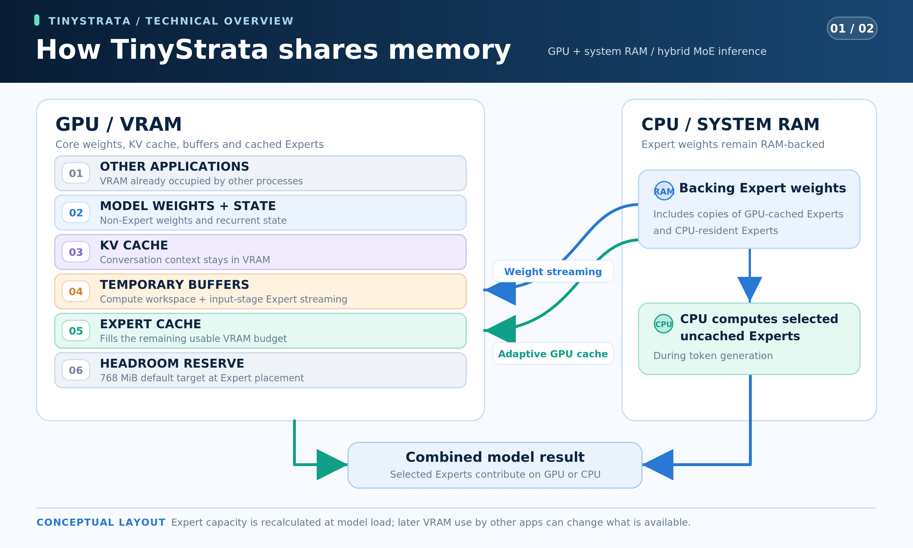

# TinyStrata

[English](README.md) · [简体中文](README.zh-CN.md) · [日本語](README.ja.md) · [Deutsch](README.de.md) · [Français](README.fr.md) · **Español** · [Português](README.pt-BR.md)

**TinyStrata es un motor de inferencia de alta velocidad en desarrollo para modelos MoE de la clase 30B, exclusivo de Windows.** Está orientado principalmente a PC equipados con tarjetas gráficas de uso común de **8–24 GB** de VRAM y con **32 GB de RAM del sistema o menos**. Ofrece una API y una interfaz de chat opcional.

**Se admiten GPU NVIDIA de la generación Ampere o posterior (CUDA) y GPU AMD RDNA 4 (HIP/ROCm).**

## ¿Por qué desarrollamos TinyStrata?

Con el aumento de los precios de los componentes, montar un PC de gama alta está cada vez más fuera del alcance de muchas personas.

Por eso, TinyStrata nació para ejecutar IA localmente a gran velocidad en PC equipados con tarjetas gráficas de uso común de la clase RTX 3060 o superior. Nos centramos en ejecutar modelos MoE relativamente pequeños, de la clase 30B, con la mayor rapidez posible.

Nuestro objetivo principal son los equipos con **8–24 GB de VRAM y 32 GB de RAM del sistema o menos**. Creemos que este intervalo representa las configuraciones más habituales de PC equipados con tarjetas gráficas de uso común.

Basado en Strata, TinyStrata busca aprovechar de forma eficiente la memoria de la GPU para ejecutar modelos MoE de la clase 30B con rapidez, incluso con VRAM limitada. Nuestro objetivo es que puedas trabajar con conversaciones y documentos largos en tu propio PC.

El desarrollo se centra en la inferencia local en Windows y su acceso mediante una API.

TinyStrata elige automáticamente los ajustes de inferencia y memoria para tu hardware, de modo que puedas empezar a usar la API sin una configuración complicada ni ajustes manuales.

## Modelo en el que nos centramos

[Qwen3.6-35B-A3B](https://huggingface.co/Qwen/Qwen3.6-35B-A3B) sigue siendo el modelo predeterminado por su equilibrio entre velocidad, consumo de memoria y calidad de respuesta en PC con tarjetas gráficas de uso común. TinyStrata se centra en modelos MoE pequeños y también ofrece **soporte para Gemma 4 26B-A4B-it, LFM2.5-24B-A2B y Clover-35B-A3B-Preview**.

**Qwen3.6-35B-A3B UD-IQ3_XXS** utiliza el [GGUF MTP fijado de Unsloth](https://huggingface.co/unsloth/Qwen3.6-35B-A3B-MTP-GGUF/blob/5bc3e238d916f48a861bac2f8a1990a0e9b7e98d/Qwen3.6-35B-A3B-UD-IQ3_XXS.gguf). Los dos archivos suman aproximadamente **15.0 GB**: modelo de lenguaje, incluidos los pesos MTP, de **14.1 GB** y proyector de visión (`mmproj-F16.gguf`) de **0.9 GB**.

**Gemma 4 26B-A4B-it QAT Q4_0** utiliza [el modelo y el proyector de visión oficiales de Google](https://huggingface.co/google/gemma-4-26B-A4B-it-qat-q4_0-gguf) con [el asistente MTP QAT correspondiente de Unsloth](https://huggingface.co/unsloth/gemma-4-26B-A4B-it-qat-GGUF/blob/7b92b5b28818151e8669af2e45e88d6086f490dd/mtp-gemma-4-26B-A4B-it.gguf). Los tres archivos suman **15.886 GB**: modelo **14.439 GB**, proyector **1.195 GB** y asistente **0.252 GB**.

**LFM2.5-24B-A2B Q4_K_M** utiliza el [GGUF oficial de LiquidAI](https://huggingface.co/LiquidAI/LFM2.5-24B-A2B-GGUF). Su único archivo de modelo de lenguaje ocupa **14.53 GB**.

**Clover-35B-A3B-Preview IQ3_XXS** utiliza por defecto el [GGUF de AtomicChat](https://huggingface.co/AtomicChat/Clover-35B-A3B-Preview-GGUF/blob/4f7e2918e5315634d9d9720ea4f6e8a9a627a875/Clover-35B-A3B-Preview-AD-IQ3_S-IQ3_XXS.gguf), con **IQ3_XXS en gate/up e IQ3_S en down** de los expertos. El modelo de lenguaje de **15.515 GB** conserva el tokenizador propio de Clover y sus parámetros GDN bidireccionales aprendidos. TinyStrata amplía la capacidad de contexto a **256K**. [Clover oficial especifica 128K](https://huggingface.co/Diffuspace/Clover-35B-A3B-Preview/blob/main/config.json); la calidad general de las respuestas por encima de 128K aún no se ha evaluado. Clover oficial solo admite texto; TinyStrata añade imágenes reutilizando el proyector Qwen3.6 (**0.899 GB**, **16.414 GB** en total). Si ya se descargó para Qwen, se reutiliza. Se selecciona con `run-api.bat --model-family clover`; un nuevo perfil independiente usa el puerto **18083** y guarda los ajustes en `config-clover.json`.

Los perfiles administrados de Clover usan ahora autoespeculación exacta D3 con KV INT8 (`--clover-mode self-spec --clover-draft 3 --clover-accept exact --kv-type int8`) y MT1 (`STRATA_IQ_MT_MIN=1`) de forma predeterminada. El codificador de imágenes permanece en la GPU por defecto; `--vision cpu` selecciona CPU y `--vision no` lo desactiva. Vision admite generación causal o autoespeculación exacta; difusión y aceptación por umbral requieren `--vision no`. LowConfidence por bloques y la aceptación aproximada por umbral siguen siendo opciones experimentales de activación explícita; consulta las [opciones de decodificación](benchmark/README.md#english).

Los motores Qwen, Gemma y LFM utilizan caché automática de expertos en VRAM, cálculo de expertos en CPU desde la RAM, streaming de pesos durante la entrada y CUDA Graphs. Comparten la misma API y permiten cambiar de modelo sin reiniciar, con los ajustes guardados por separado para cada modelo. No se omiten expertos seleccionados. También admiten el crecimiento automático de la memoria KV física, sin cambiar la capacidad máxima de contexto.

| Función | [Qwen3.6](https://huggingface.co/Qwen/Qwen3.6-35B-A3B) | [Gemma 4](https://huggingface.co/google/gemma-4-26B-A4B-it) | [LFM2.5](https://huggingface.co/LiquidAI/LFM2.5-24B-A2B) | [Clover](https://huggingface.co/Diffuspace/Clover-35B-A3B-Preview) |
| --- | --- | --- | --- | --- |
| Contexto máximo | 256K | 256K | 128K | 256K (extensión) |
| Entrada de imágenes | Sí; codificador en GPU de forma predeterminada | Sí; codificador en GPU de forma predeterminada | No | Sí (extensión de TinyStrata; residente en GPU por defecto) |
| MTP | 3 | 3 | No | No (autoespeculación exacta D3) |
| Formatos KV | FP32 / INT8 / FP8 nativo | FP16 / INT8 / FP8 nativo (experimental) | FP16 / INT8 / FP8 nativo | FP32 / INT8 / FP8 nativo |
| KV automático (predeterminado) | FP8 → INT8 | INT8 | FP8 → INT8 | INT8 |

La entrada de imágenes de Clover es una extensión de TinyStrata, no una función oficial de Clover.

Los encabezados enlazan a las fichas oficiales de los modelos. **FP8 → INT8** indica KV FP8 y Attention FP8 nativa (Tensor Cores en NVIDIA, WMMA en AMD RDNA 4) cuando la GPU y los kernels compilados lo permiten, o INT8 en caso contrario. La precisión KV es independiente de la cuantización de pesos GGUF; un KV de menor precisión puede cambiar la salida respecto a FP32 (Qwen) o FP16 (Gemma/LFM).

Gemma usa INT8 de forma predeterminada. FP8 nativo es experimental y puede seleccionarse explícitamente con `run-api.bat --model-family gemma4 --kv-type fp8-mma`.

La **capacidad de contexto automática** se basa en la VRAM total de la GPU, como se muestra abajo; la VRAM libre determina el tamaño de la caché de expertos. Un valor explícito de `--max-context N` tiene prioridad.

| VRAM total (ejemplos) | Qwen3.6 / Gemma 4 / Clover | LFM2.5 |
| --- | ---: | ---: |
| 8 GB | 64K | 64K |
| 12 GB | 128K | 128K |
| 16 GB o más | 256K | 128K |

Las clases de capacidad contemplan diferencias en lo que informa el controlador, por lo que una tarjeta de 16 GB que indique 15.x GiB sigue seleccionando 256K para Qwen, Gemma y Clover.

Si falta el ejecutable de un modelo adicional, consulta las [instrucciones de compilación manual](README.md#model-focus).

## Cómo instalar

Ejecuta uno de los dos instaladores en PowerShell de 64 bits:

**Con interfaz** ([instalador](install-ui.ps1)): chat en `http://127.0.0.1:3000`, API en `http://127.0.0.1:18080/v1`.

```powershell
irm 'https://raw.githubusercontent.com/kbc20f11/TinyStrata/refs/heads/main/install-ui.ps1' | iex
```

**Solo API** ([instalador](install.ps1)): la misma API sin interfaz.

```powershell
irm 'https://raw.githubusercontent.com/kbc20f11/TinyStrata/refs/heads/main/install.ps1' | iex
```

La interfaz opcional de tonos verdes admite los siete idiomas del README, imágenes y estadísticas de generación en directo. El modo claro u oscuro sigue la configuración del sistema.

Para volver a iniciarlo, ejecuta este comando o haz doble clic en `run-ui.bat`:

```powershell
& "$env:LOCALAPPDATA\TinyStrata\run-ui.bat"
```

Para la instalación de solo API, usa `run-api.bat`:

```powershell
& "$env:LOCALAPPDATA\TinyStrata\run-api.bat" --port 18080
```

### Búsqueda y Python en la UI

La casilla **Búsqueda web**, junto a **Ajustes del chat**, activa la búsqueda para los cuatro modelos. El proveedor, la clave API y la concurrencia se configuran en esos ajustes. La ejecución de Python en el entorno aislado está siempre disponible cuando el modelo la necesita. Los bloques Python terminados también se pueden ejecutar manualmente con **Ejecutar Python**.

### Compactación automática del contexto

La opción **Compactar el contexto automáticamente** está activada por defecto en los ajustes del chat de la UI. Antes de responder y entre rondas de herramientas locales, la UI cuenta el prompt con el tokenizador del modelo actual. Cuando el prompt más el espacio reservado para la salida alcanza el **85 %** del contexto, ese modelo resume los intercambios antiguos. Se conservan íntegros al menos los dos últimos mensajes del usuario con sus intercambios, sin separar las llamadas a herramientas de sus resultados. Se mantienen las instrucciones del sistema y las herramientas disponibles.

El resumen acumulativo se guarda con el chat en SQLite y el historial original completo permanece visible. Editar o retroceder a una parte resumida invalida ese resumen. Un fallo o una interrupción no elimina mensajes. Los resúmenes pueden omitir detalles; esta función es independiente de la cuantización KV. El nuevo prefijo se procesa una vez tras compactar y los turnos siguientes pueden reutilizar su caché KV.

Pulsa **KV** al pie del chat para abrir un gráfico de anillo del uso del contexto y **Compactar ahora**. La compactación manual funciona aunque la automática esté desactivada. Se conservan íntegros los dos últimos intercambios del usuario, y los mensajes y adjuntos originales permanecen en SQLite. El contexto compactado se carga al instante, sin añadir un mensaje a la conversación.

En **Distribución de expertos**, al lado, puedes elegir **Auto** o el **número de expertos enrutados que se mantendrán en la GPU**. Los incrementos se adaptan al modelo y el porcentaje se muestra como referencia. Al aplicar el cambio, se recarga el modelo y se guarda la elección para ese modelo. La distribución real depende de la VRAM disponible y del tamaño de los expertos. Con cero expertos, los expertos enrutados no residen en la caché GPU; los pesos compartidos, KV y el codificador de imágenes siguen usando la GPU.

Sin límite de salida explícito, se reservan hasta **8K tokens**, como máximo un cuarto del contexto. El resumen genera hasta **2K tokens**, limitado a un octavo del contexto. Las imágenes cuyo tamaño codificado se desconoce usan una estimación conservadora. Un mensaje demasiado grande aún debe acortarse. `POST /v1/chat/token-count` no genera texto ni modifica la caché KV; los clientes API no se compactan automáticamente.

Referencias: [Open WebUI](https://docs.openwebui.com/troubleshooting/context-window/) y [Anthropic](https://www.anthropic.com/research/effective-context-engineering-for-ai-agents).


### Cambiar de modelo sin reiniciar

El instalador inicia Qwen de forma predeterminada. Para preparar Gemma en el mismo servidor API, inicia la descarga y consulta el progreso:

```powershell
$api = 'http://127.0.0.1:18080'
Invoke-RestMethod "$api/v1/model/download" -Method Post -ContentType 'application/json' -Body '{"model":"gemma-4-26b-a4b-it"}'
Invoke-RestMethod "$api/v1/model/download?model=gemma-4-26b-a4b-it"
```

Repite la consulta hasta que `state` sea `ready` y después solicita el cambio explícitamente. Descargar un modelo inactivo lo prepara sin activarlo:

```powershell
Invoke-RestMethod "$api/v1/model/switch" -Method Post -ContentType 'application/json' -Body '{"model":"gemma-4-26b-a4b-it"}'
Invoke-RestMethod "$api/v1/model/switch"
```

Para iniciar directamente con Gemma, ejecuta `run-api.bat --model-family gemma4`; la API usa `http://127.0.0.1:18082/v1`. Para LFM, sustituye `gemma-4-26b-a4b-it` por `lfm2.5-24b-a2b` en las solicitudes anteriores de descarga, progreso y cambio, o ejecuta `run-api.bat --model-family lfm2` para iniciarlo directamente en `http://127.0.0.1:18081/v1`.

Para Clover, usa `clover-35b-a3b-preview` en las mismas solicitudes de descarga, progreso y cambio. El puerto de la API en ejecución no cambia.

Consulta `GET /v1/model/switch` hasta que `state` sea `ready`. Para volver a Qwen, envía la misma solicitud con `{"model":"qwen3.6-35b-a3b"}`. Iniciar una descarga o un cambio devuelve `202`; solicitar el cambio durante una generación devuelve `409`, así que vuelve a intentarlo cuando termine. Las solicitudes de inferencia durante el cambio reciben `503`. El puerto y la autenticación no cambian. La selección dura la sesión actual del servidor; al reiniciar se usa el modelo elegido en el lanzador.

## Velocidad medida — Qwen3.6

Medido el **2026-11-03** en Windows con una RTX PRO 4000 Blackwell SFF Edition (24 GB), un Ryzen 9 7945HX3D, 64 GB de RAM y el modelo fijo Unsloth MTP UD-IQ3_XXS. El codificador de imágenes permaneció en la GPU durante las solicitudes por API. Se activaron el razonamiento, los valores de muestreo predeterminados del modelo (temperatura 0.7) y MTP 3. Los bloques de entrada y la distribución de expertos fueron automáticos; el contexto se fijó según la clase de VRAM. La ruta híbrida de CUDA Graph permaneció desactivada por defecto y los grafos habituales de ejecución íntegra en GPU siguieron activos.

| Condición de memoria disponible | Capacidad de contexto | Generación con INT8 | Generación con FP8 nativo | Notas |
| --- | ---: | ---: | ---: | --- |
| 24 GB | 256K | 141.52 tok/s | 134.41 tok/s | Todos los pesos residentes en VRAM |
| Aprox. 16 GB | 256K | 103.69 tok/s | 105.15 tok/s | 8 GiB reservados; cálculo de expertos en CPU y GPU |
| Aprox. 12 GB | 128K | 92.89 tok/s | 94.74 tok/s | 12 GiB reservados; cálculo de expertos en CPU y GPU |
| Aprox. 8 GB | 64K | 67.17 tok/s | 69.95 tok/s | Cálculo de expertos en GPU y CPU |

Los mismos tres textos se ejecutaron dos veces por configuración FP8/INT8 con los valores de muestreo predeterminados del modelo, generando 128 tokens con razonamiento en cada solicitud. La velocidad es el total de tokens dividido por el tiempo total de decodificación, sin carga ni procesamiento de entrada; el contexto indica capacidad de caché. Las filas con menos memoria reservan 8, 12 o 16 GiB en la misma GPU de 24 GB y usan el contexto de esa clase de VRAM; no son pruebas de GPU físicas de 16/12/8 GB.

INT8 y FP8 se midieron en orden alterno con cuatro inicios independientes por formato, ejecutando las tres entradas dos veces por inicio y generando 128 tokens por solicitud; los detalles están en la [comparación directa](benchmark/results/qwen-kv-direct-20261103.md).

## Velocidad medida — Gemma 4

Medido en el mismo PC Windows con 64 GB de RAM, Gemma 4 26B-A4B-it QAT Q4_0 y el asistente MTP QAT correspondiente. El codificador de imágenes permaneció en la GPU durante las solicitudes por API. Se activaron MTP 3, CUDA Graphs y los valores predeterminados de razonamiento y muestreo del modelo; el contexto se fijó según la clase de VRAM, mientras que los bloques de entrada y la distribución de expertos se eligieron automáticamente.

FP8 nativo e INT8 se midieron el **2026-10-27**.

| VRAM disponible | Capacidad de contexto | INT8 (predeterminado) | FP8 nativo (experimental) | Notas |
| --- | ---: | ---: | ---: | --- |
| 24 GB | 256K | 115.89 tok/s | 115.46 tok/s | INT8 / FP8: Cálculo de expertos en GPU |
| Aprox. 16 GB | 256K | 102.83 tok/s | 100.86 tok/s | INT8 / FP8: Cálculo de expertos en GPU y CPU |
| Aprox. 12 GB | 128K | 85.53 tok/s | 91.71 tok/s | INT8 / FP8: Cálculo de expertos en GPU y CPU |
| Aprox. 8 GB | 64K | 52.98 tok/s | 55.09 tok/s | INT8 / FP8: Cálculo de expertos en GPU y CPU |

Los mismos tres textos se ejecutaron dos veces por configuración FP8/INT8 con los valores de muestreo predeterminados del modelo, generando 128 tokens con razonamiento en cada solicitud. La velocidad es el total de tokens dividido por el tiempo total de decodificación, sin carga ni procesamiento de entrada; el contexto indica capacidad de caché. Las filas con menos memoria reservan 8, 12 o 16 GiB en la misma GPU de 24 GB y usan el contexto de esa clase de VRAM; no son pruebas de GPU físicas de 16/12/8 GB.

## Velocidad medida — LFM2.5

Medido en el mismo PC Windows con 64 GB de RAM y el LFM2.5-24B-A2B Q4_K_M oficial, sin MTP ni Vision. Se activaron CUDA Graphs y los valores predeterminados de razonamiento y muestreo del modelo; el contexto se fijó según la clase de VRAM, mientras que los bloques de entrada y la distribución de expertos se eligieron automáticamente.

FP8 nativo e INT8 se midieron el **2026-10-27**.

| VRAM disponible | Capacidad de contexto | INT8 | FP8 nativo (predeterminado) | Notas |
| --- | ---: | ---: | ---: | --- |
| 24 GB | 128K | 143.85 tok/s | 148.61 tok/s | INT8 / FP8: Cálculo de expertos en GPU |
| Aprox. 16 GB | 128K | 138.14 tok/s | 139.22 tok/s | INT8 / FP8: Cálculo de expertos en GPU y CPU |
| Aprox. 12 GB | 128K | 115.61 tok/s | 117.90 tok/s | INT8 / FP8: Cálculo de expertos en GPU y CPU |
| Aprox. 8 GB | 64K | 79.74 tok/s | 81.39 tok/s | INT8 / FP8: Cálculo de expertos en GPU y CPU |

Los mismos tres textos se ejecutaron dos veces por configuración FP8/INT8 con los valores de muestreo predeterminados del modelo, generando 128 tokens con razonamiento en cada solicitud. La velocidad es el total de tokens dividido por el tiempo total de decodificación, sin carga ni procesamiento de entrada; el contexto indica capacidad de caché. Las filas con menos memoria reservan 8, 12 o 16 GiB en la misma GPU de 24 GB y usan el contexto de esa clase de VRAM; no son pruebas de GPU físicas de 16/12/8 GB.

## Velocidad medida — Clover

Medido el **2026-11-02** en Windows con una RTX PRO 4000 Blackwell SFF Edition (24 GB), Ryzen 9 7945HX3D y 64 GB de RAM, con Clover Preview IQ3_XXS. Se activaron el modo causal D0, el razonamiento y el codificador de imágenes residente en GPU. Los trabajadores CPU, bloques de entrada y la asignación de expertos fueron automáticos; el entorno usó `STRATA_IQ_MT_MIN=1` y `STRATA_EXP_MODE=8`.

| VRAM disponible | Capacidad de contexto | Generación INT8 | Generación FP8 nativo | Notas |
| --- | ---: | ---: | ---: | --- |
| 24 GB | 256K | 91.61 tok/s | 94.67 tok/s | Expertos GiB — INT8: 12.34 → 12.34; FP8: 12.34 → 12.34 |
| Aprox. 16 GB | 256K | 58.16 tok/s | 58.17 tok/s | Expertos GiB — INT8: 6.55–6.60 → 6.07–6.22; FP8: 6.55–6.60 → 6.11–6.19 |
| Aprox. 12 GB | 128K | 51.31 tok/s | 50.89 tok/s | Expertos GiB — INT8: 3.08–3.18 → 2.80–3.04; FP8: 2.94–3.18 → 2.80–3.04 |
| Aprox. 8 GB | 64K | Inestable (3/4 inicios) | 39.75 tok/s | Expertos GiB — INT8: 0.00 → 0.00 (3/4); FP8: 0.00 → 0.00; INT8/FP8: expertos de decodificación en CPU; cálculo denso/entrada en streaming en GPU |

Se intentaron cuatro inicios independientes por condición KV/VRAM, usando las entradas, el muestreo y el cronometraje de v1. Las cifras requieren cuatro inicios correctos; los fallos y resultados mixtos se indican expresamente. Es una variante controlada, separada del v1 estándar y del D3/INT8 predeterminado de los perfiles gestionados. La caché muestra las asignaciones reales de los inicios correctos: inicio → después de la entrada 16K. [Resultados completos y condiciones](benchmark/results/rtx-pro-4000-blackwell-sff.md).

Las filas de memoria reducida reservan y escriben 8, 12 o 16 GiB en la misma GPU de 24 GB, con capacidades de contexto de 256K / 256K / 128K / 64K. No son pruebas de GPU físicas de 16/12/8 GB. La selección automática del bloque distingue estos resultados del ajuste local anterior con un bloque fijo de 2.048 tokens.

## Velocidad medida — AMD Radeon (HIP)

Velocidad en tarjetas Radeon, medida con [tinystrata-bench-v1](benchmark/README.md#english). Cada tarjeta tiene su propia página con el hardware, el controlador, el commit del motor, los ajustes y todas las columnas: [`benchmark/results/`](benchmark/results/). Valores: generación / entrada 4K / entrada 16K, en tok/s. Los valores de Clover usan la variante exact D3.

| GPU | Qwen3.6 UD-IQ3_XXS | Gemma 4 QAT Q4_0 | LFM2.5 Q4_K_M | Clover IQ3_XXS (exact D3, Vision GPU) |
| --- | ---: | ---: | ---: | ---: |
| [RX 9060 XT](benchmark/results/rx-9060-xt.md) | 82.95 / 895.98 / 808.59 | 78.07 / 2482.20 / 2338.68 | 93.14 / 2062.80 / 1694.56 | 41.67 / 942.27 / 892.94 |
| [RX 9070 XT](benchmark/results/rx-9070-xt.md) | 97.89 / 1353.97 / 1561.60 | 70.40 / 2697.67 / 3589.72 | 88.99 / 1749.32 / 1880.91 | — |

Clover usa exact D3/INT8/MT1 con el codificador de imágenes residente en GPU. Primera salida / final con imagen: **2.43 / 4.54 s**; caché de expertos: **7.32–8.10 → 7.18–7.95 GiB** (inicio → tras la entrada 16K). [Condiciones y pruebas de imágenes](benchmark/results/rx-9060-xt.md#clover-vision-with-exact-d3-2026-11-01).

**Clover IQ3_XXS — RX 9060 XT (2026-11-01; historial anterior a la atención compartida)**

Se midieron las mismas entradas fijas con contexto de 128K, crecimiento físico de KV, razonamiento activado, trabajadores CPU/bloques automáticos y cuatro inicios independientes de la API por perfil. Las filas exact históricas eran variantes; causal INT8 es el control v1 fijo, no el actual modo D3 predeterminado. Caché de expertos: inicio → después de 16K, en GiB.

| Perfil | KV | Generación con entrada corta tok/s | Entrada 4K tok/s | Generación tras 4K tok/s | Entrada 16K tok/s | Generación tras 16K tok/s | Caché de expertos GiB |
| --- | --- | ---: | ---: | ---: | ---: | ---: | --- |
| Causal, estándar (control) | INT8 | 41.27 | 962.29 | 38.05 | 877.43 | 35.68 | 9.98 → 9.83 |
| Causal, MT1 (control) | INT8 | 40.64 | 962.21 | 36.99 | 877.58 | 35.77 | 9.98 → 9.83 |
| Autoespeculación exacta D3 (perfil rápido opcional) | INT8 | 49.39 | 963.95 | 33.06 | 878.30 | 33.83 | 9.98 → 9.83 |
| Autoespeculación exacta D3 | FP8 (opcional) | 46.11 | 959.49 | 28.94 | 872.02 | 18.00 | 9.98 → 9.83 |

Estas son mediciones históricas de control anteriores a la atención compartida. Clover usa ahora exact D3, KV INT8 y MT1 de forma predeterminada. La difusión por bloques y la aceptación por umbral siguen siendo experimentales. [Ajustes y comprobaciones de calidad](benchmark/results/rx-9060-xt.md#clover-hip-int8-query-sharing-2026-11-01) / [Comparación IQ3 anterior](benchmark/results/rx-9060-xt.md#clover-iq3-2026-10-31) / [Mediciones Q4_0 anteriores](benchmark/results/rx-9060-xt.md#clover-causal-and-native-block-diffusion-2026-10-31).

**Clover HIP INT8: consultas de atención compartidas — RX 9060 XT (2026-11-01; antes de Vision, histórico)**

KV INT8; cuatro inicios independientes de la API por perfil, en orden intercalado. La generación corta tiene un límite de 128 tokens de salida y las pruebas 4K/16K/64K de 32. El control del antiguo modo causal predeterminado usa la aritmética CPU habitual (MT2); ambas filas D3 usan MT1. Estas mediciones son anteriores a Vision; el codificador de imágenes no estaba residente. Conservan los ajustes de decodificación D3/INT8/MT1 actuales. [Condiciones, calidad y resultados](benchmark/results/rx-9060-xt.md#clover-hip-int8-query-sharing-2026-11-01).

| Perfil | Generación corta tok/s | Generación tras 4K tok/s | Generación tras 16K tok/s | Generación tras 64K tok/s | Entrada 64K tok/s | Caché de expertos GiB: inicio → 64K |
| --- | ---: | ---: | ---: | ---: | ---: | ---: |
| Causal MT2 (anterior predeterminado/control) | 41.16 | 38.04 | 36.40 | 24.11 | 662.52 | 9.98 → 9.35 |
| Exact D3 MT1 (sin atención compartida/control) | 49.78 | 33.35 | 34.11 | 17.51 | 663.12 | 9.98 → 9.35 |
| Exact D3 MT1 (antes de Vision) | 49.49 | 34.87 | 39.30 | 26.62 | 664.65 | 9.98 → 9.35 |

## ¿Qué proyecto debería usar?

| Tu objetivo y tu hardware | Proyecto |
| --- | --- |
| Quieres inferencia de Qwen3.6 / Gemma 4 / LFM2.5 / Clover en **Windows**, con **8–24 GB de VRAM y 32 GB de RAM del sistema o menos**, por ejemplo, en un PC equipado con una tarjeta gráfica de uso común. | TinyStrata (**solo Windows**, en desarrollo) |
| Tienes tanto **una GPU de la clase RTX 3060 o superior** como **64 GB de RAM del sistema o más**. | Recomendamos [Strata (proyecto original)](https://github.com/Niko1221/Strata). |
| Quieres una **interfaz de chat con estadísticas en directo**. | TinyStrata con el [instalador de interfaz opcional](install-ui.ps1). |

## Cómo se reparte la memoria — Qwen3.6

Un modelo MoE contiene muchos **expertos**: redes neuronales más pequeñas que se seleccionan para cada token. TinyStrata mantiene tantos expertos como puede en la memoria de la GPU (VRAM). Durante la generación, puede calcular en la CPU los expertos seleccionados que no están en caché, usando la RAM del sistema. Al procesar lotes de entrada más grandes, puede, en su lugar, transferir progresivamente los pesos de los expertos desde la RAM a través de búferes temporales de la GPU. Todos los expertos seleccionados por el modelo participan en el cálculo.

Los archivos del modelo descargados suman unos **15.0 GB**: **14.1 GB** para el modelo de lenguaje (incluidos los pesos de MTP) y **0.9 GB** para el proyector de visión (`mmproj-F16.gguf`). No es necesario que todo el modelo de lenguaje quepa en la VRAM. La memoria de la GPU también necesita espacio para el codificador de visión y los búferes de procesamiento de imágenes, la **caché KV** de la conversación, los demás pesos del modelo y los búferes de cálculo temporales:



Este es un diagrama de distribución en el modo de imágenes GPU predeterminado, no una partición de tamaño fijo. Cada vez que carga el modelo, TinyStrata inicia y prepara el codificador de visión de la GPU antes de cargar el modelo de lenguaje; sus pesos y búferes de trabajo preparados permanecen residentes. Después asigna las páginas iniciales de KV, los demás pesos y los búferes de trabajo, y dimensiona la caché de expertos según la VRAM libre restante. En Windows usa el menor valor entre la memoria libre que informa CUDA y la VRAM dedicada libre que informa el controlador NVIDIA, cuando ambos están disponibles.

El contenido de la caché cambia según los expertos usados. Con el crecimiento KV predeterminado, las conversaciones cortas dejan más VRAM para expertos; al crecer la secuencia, la caché de expertos devuelve memoria a KV. Las nuevas solicitudes más cortas pueden devolver páginas KV sin usar a la caché de expertos. `run-api.bat --kv-whole` asigna toda la capacidad KV desde el principio; `run-api.bat --kv-grow` restablece el crecimiento. Otras aplicaciones pueden seguir consumiendo VRAM.

La ubicación de expertos busca normalmente un margen de 768 MiB. En el modo `--kv-whole` de Qwen, como en Strata, cuando falta poco para que todos los expertos del modelo principal quepan en VRAM, puede liberar las copias empaquetadas de los pesos Q8, reducir un búfer de puntuaciones de Attention si existe y bajar el margen a 256 MiB; los expertos MTP pueden ejecutarse en la CPU. `--vram-reserve-mib N` fija la reserva explícitamente. Es un objetivo al ubicar los expertos, no una garantía permanente de memoria libre.

Tener más expertos residentes en la GPU suele implicar menos trabajo para la CPU. En modo híbrido, la RAM del sistema también conserva copias de respaldo de los expertos almacenados en la caché de VRAM, por lo que añadir VRAM no reduce el uso de RAM byte por byte. Deja RAM también para el sistema operativo y las demás aplicaciones. Una mayor **capacidad de RAM** permite alojar los datos del modelo, pero la velocidad también depende de la CPU, el ancho de banda de la RAM y la GPU. La «memoria compartida de GPU» de Windows es distinta del cálculo deliberado de expertos en la CPU que realiza TinyStrata.

La caché KV permanece en la VRAM; la RAM del sistema almacena los datos de los expertos para este mecanismo de descarga de trabajo. Por tanto, una conversación larga sigue necesitando suficiente memoria de GPU para su caché KV.

## Ajustes automáticos — Qwen3.6

Las configuraciones nuevas eligen automáticamente KV/Attention y la capacidad de contexto. No necesitas seleccionar una receta para 8 GB, 12 GB o 16 GB.

En Qwen3.6 y LFM2.5, una RTX 3060 selecciona INT8. Los entornos compatibles con RTX de las series 40/50 y AMD RDNA 4 seleccionan FP8 nativo automáticamente; el motor comprueba los kernels compilados y las capacidades de la GPU, además de la generación del hardware. Si FP8 nativo no está disponible, el modo automático usa INT8. Gemma usa INT8 por defecto tanto en NVIDIA como en AMD. Esto elige una ruta compatible sin ejecutar una prueba de velocidad o calidad al iniciar.

El motor nativo estima al iniciar un tamaño de bloque de entrada de 512, 1024, 2048 o 4096 tokens, según la VRAM libre, la capacidad de contexto y si los expertos caben en la GPU. Los bloques mayores pueden reducir las transferencias repetidas de pesos de RAM a GPU durante el procesamiento de la entrada. `run-api.bat --chunk N` fija el tamaño; `run-api.bat --chunk auto` restablece la selección automática nativa.

La capacidad de contexto es el límite lógico para la entrada y la salida generada en conjunto. Por defecto, la memoria KV física se asigna a medida que crece la conversación, en lugar de reservar toda la capacidad para una conversación corta. Los documentos largos siguen requiriendo más cálculo y, finalmente, más memoria KV.

A plena capacidad, KV en INT8 de Qwen ocupa unos **0.71 GiB a 64K, 1.42 GiB a 128K y 2.84 GiB a 256K**, incluida la capa MTP; los demás pesos y búferes de trabajo requieren espacio adicional. En esta implementación, FP8 nativo usa aproximadamente el mismo almacenamiento KV que INT8; su ventaja es una ruta de cálculo diferente, en lugar de una caché considerablemente más pequeña.

La capacidad de contexto se elige según la VRAM total de la GPU; la caché de expertos se ajusta después a la VRAM libre que queda al cargar el modelo. Otras aplicaciones que usan VRAM dejan espacio para menos expertos en GPU. La API rechaza las entradas que superan la capacidad de contexto, en lugar de truncarlas silenciosamente.

La cuantización de los pesos GGUF y la precisión de KV son independientes. El modelo UD-IQ3_XXS seleccionado tiene pesos comprimidos; INT8 o FP8 describe la caché de la conversación y su ruta de Attention. KV de menor precisión puede cambiar las respuestas, por lo que estos modos no prometen una salida idéntica a la de KV en FP32. La implementación conserva todas las posiciones visibles del contexto y todos los expertos seleccionados por el modelo.

Las configuraciones nuevas del lanzador usan MTP 3, que propone varios tokens por adelantado y los verifica con el modelo principal. Puede mejorar la velocidad de generación, pero la ganancia depende de cuántas propuestas se acepten. La verificación busca preservar el comportamiento de decodificación del modelo principal; las diferencias entre las rutas de ejecución numérica pueden aun así cambiar los tokens, de modo que activar MTP no promete una salida idéntica a la obtenida al desactivarlo.

MTP admite tanto la generación voraz como el muestreo basado en temperatura, incluidas las penalizaciones por repetición, frecuencia y presencia. En las solicitudes con muestreo, el modelo principal muestrea cada fila de verificación y solo se acepta el prefijo del borrador que coincide.

Los ajustes explícitos prevalecen sobre las elecciones automáticas, y los ajustes seleccionados manualmente con anterioridad siguen en vigor. Por ejemplo, `run-api.bat --kv-type int8` fija INT8; `run-api.bat --kv-type auto --max-context auto --expert-vram auto` restablece la selección automática de KV, contexto y ubicación de expertos.

## Servidor API

TinyStrata ofrece las API Chat Completions (`/v1/chat/completions`) y Responses (`/v1/responses`) compatibles con OpenAI, y una API Messages (`/v1/messages`) compatible con Anthropic, incluida la generación en streaming. Usa la interfaz opcional de TinyStrata, un cliente de API o una interfaz externa.

Las configuraciones nuevas utilizan valores de muestreo propios de cada modelo. Los valores de cada solicitud tienen prioridad; se conservan los ajustes personalizados guardados.

| Ajuste | Qwen3.6 | Gemma 4 | LFM2.5 | Clover |
| --- | ---: | ---: | ---: | ---: |
| `temperature` | 0.7 | 1.0 | 0.1 | 0.0 |
| `top_p` | 0.95 | 0.95 | 1.0 | 1.0 |
| `top_k` | 20 | 64 | 50 | 64 |
| `min_p` | 0.0 | 0.0 | 0.0 | 0.0 |
| `presence_penalty` | 1.5 | 0.0 | 0.0 | 0.9 |
| `frequency_penalty` | 0.0 | 0.0 | 0.0 | 0.0 |
| `repetition_penalty` | 1.0 | 1.0 | 1.05 | 1.05 |
| `enable_thinking` | true | true | true (siempre activado) | true (se puede desactivar) |
| `max_tokens` (incluido el razonamiento) | 32768 | 32768 | 32768 | 24576 |

La API escucha en `http://127.0.0.1:18080` de forma predeterminada. Para usar otro puerto, ejecuta `run-api.bat --port 18081` desde la carpeta de TinyStrata instalada.

Para Qwen y Clover, `run-api.bat --vision gpu` procesa las imágenes en la GPU (valor predeterminado para nuevas configuraciones); `--vision cpu` usa la CPU y `--vision no` desactiva las imágenes. `--vision-tokens N` fija el límite de tokens de imagen (4096 por defecto). Estas opciones se guardan y se mantienen en los siguientes inicios si se omiten.

La API puede iniciarse antes de que se instalen los archivos del modelo. Con Qwen seleccionado, `POST /v1/model/download` con un cuerpo JSON vacío (`{}`) descarga el [modelo de lenguaje fijo Unsloth Qwen3.6-35B-A3B MTP UD-IQ3_XXS](https://huggingface.co/unsloth/Qwen3.6-35B-A3B-MTP-GGUF/blob/5bc3e238d916f48a861bac2f8a1990a0e9b7e98d/Qwen3.6-35B-A3B-UD-IQ3_XXS.gguf) (14.1 GB, incluidos los pesos de MTP) y su [proyector de visión](https://huggingface.co/unsloth/Qwen3.6-35B-A3B-MTP-GGUF/blob/5bc3e238d916f48a861bac2f8a1990a0e9b7e98d/mmproj-F16.gguf) (0.9 GB), unos **15.0 GB en total**. Verifica las sumas de comprobación SHA-256 de ambos archivos, extrae el tokenizador y los carga. `GET /v1/model/download` informa del progreso; las descargas interrumpidas se pueden reanudar. Repetir la solicitud de descarga reutiliza el trabajo activo, y `POST /v1/model/download/cancel` puede cancelar la transferencia o la verificación. Que la descarga haya finalizado no significa que la inferencia esté lista: espera a que el estado de la descarga sea `ready` y a que `/health` indique `loaded: true` y, si las imágenes están activadas, también `images: true`.

El instalador prepara los ejecutables de los motores y las bibliotecas de ejecución de la GPU, y descarga Qwen y su proyector de visión de forma predeterminada. Las configuraciones existentes conservan el modelo local seleccionado hasta que lo cambies explícitamente.

## Agradecimientos

TinyStrata es un fork independiente de [Strata](https://github.com/Niko1221/Strata) y se apoya ampliamente en su implementación. Gracias a [Niko](https://github.com/Niko1221) y a la comunidad de Strata por el motor y el trabajo que hizo posible TinyStrata.

Gracias también a [Aaron Flin](https://github.com/aflin) y al [proyecto MoMoE](https://github.com/aflin/momoe) por el código de caché KV, atención y expertos cuantizados adaptado en TinyStrata.

## Licencia

MIT. Consulta [LICENSE](LICENSE).

Copyright (c) 2026 Niko1221 and the Strata contributors.

Atribución al proyecto original: [NOTICE](NOTICE). GGML: [licencia MIT](third_party/ggml/LICENSE).
