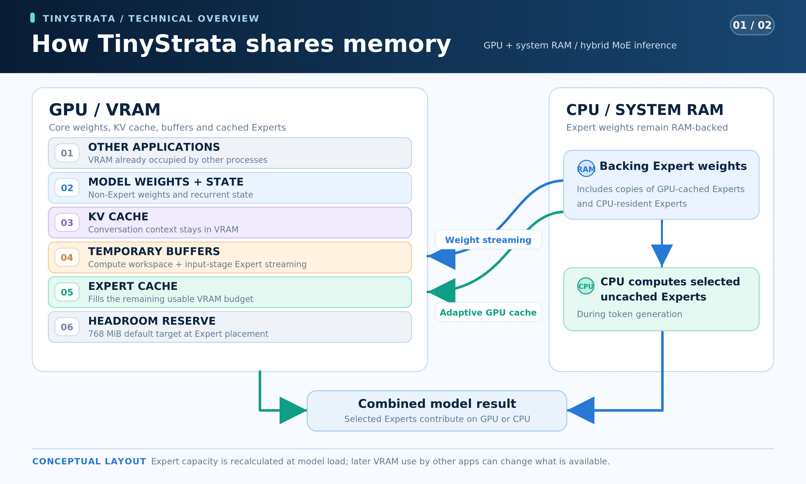

# TinyStrata

[English](README.md) · [简体中文](README.zh-CN.md) · **日本語** · [Deutsch](README.de.md) · [Français](README.fr.md) · [Español](README.es.md) · [Português](README.pt-BR.md)

**TinyStrata は、30B 級の MoE モデル向けに開発している Windows 専用の高速推論エンジンです。** VRAM が **8–24 GB** の一般的なグラフィックボードを搭載し、システム RAM が **32 GB 以下**の PC を主な対象としています。 API と、必要に応じて導入できるチャット UI を提供します。

**NVIDIA Ampere 世代以降（CUDA）と AMD RDNA 4（HIP/ROCm）に対応しています。**

## TinyStrata を開発する理由

PC パーツの価格が上昇するなか、ハイエンド PC を組むことは、多くの人にとってますます難しくなっています。

そこで TinyStrata は、RTX 3060 クラス以上のグラフィックボードを搭載した PC で、AI をローカルで高速に動かすために作られました。30B 級の比較的小さな MoE モデルを、できるだけ速く動かすことに注力しています。

主な対象は、**VRAM が 8–24 GB、システム RAM が 32 GB 以下**の PC です。この範囲は、グラフィックボードを搭載した PC で最も一般的な構成に当たると考えています。

TinyStrata は Strata を基盤に、限られた VRAM でも 30B 級の MoE モデルを高速に動かせるよう、GPU メモリの効率的な活用に取り組んでいます。これにより、長い会話や文書も手元の PC で扱える環境を目指しています。

開発は Windows 上でのローカル推論と API 提供に集中しています。

ハードウェアに応じて推論・メモリ設定を自動選択するため、複雑な設定や手動調整をせずに API を使い始められます。

## 対象モデル

一般的なグラフィックボードを搭載した PC での速度・省メモリ性・回答品質のバランスを重視し、[Qwen3.6-35B-A3B](https://huggingface.co/Qwen/Qwen3.6-35B-A3B) を既定のモデルとしています。比較的小さな MoE モデルに注力し、**Gemma 4 26B-A4B-it、LFM2.5-24B-A2B、Clover-35B-A3B-Preview にも対応しています**。

**Qwen3.6-35B-A3B UD-IQ3_XXS** は、固定版の [Unsloth MTP GGUF](https://huggingface.co/unsloth/Qwen3.6-35B-A3B-MTP-GGUF/blob/5bc3e238d916f48a861bac2f8a1990a0e9b7e98d/Qwen3.6-35B-A3B-UD-IQ3_XXS.gguf) を使います。ダウンロードは 2 ファイル、合計約 **15.0 GB** です。MTP の重みを含む言語モデルが **14.1 GB**、ビジョンプロジェクタ（`mmproj-F16.gguf`）が **0.9 GB** です。

**Gemma 4 26B-A4B-it QAT Q4_0** は、[Google 公式の本体・ビジョンプロジェクタ](https://huggingface.co/google/gemma-4-26B-A4B-it-qat-q4_0-gguf) と、[対応する Unsloth の QAT MTP アシスタント](https://huggingface.co/unsloth/gemma-4-26B-A4B-it-qat-GGUF/blob/7b92b5b28818151e8669af2e45e88d6086f490dd/mtp-gemma-4-26B-A4B-it.gguf) を使います。ダウンロードは 3 ファイル、合計 **15.886 GB** です。本体が **14.439 GB**、プロジェクタが **1.195 GB**、アシスタントが **0.252 GB** です。

**LFM2.5-24B-A2B Q4_K_M** は、公式の [LiquidAI GGUF](https://huggingface.co/LiquidAI/LFM2.5-24B-A2B-GGUF) を使います。ダウンロードは言語モデルの 1 ファイルで、**14.53 GB** です。

**Clover-35B-A3B-Preview IQ3_XXS** は、[AtomicChat 配布の GGUF](https://huggingface.co/AtomicChat/Clover-35B-A3B-Preview-GGUF/blob/4f7e2918e5315634d9d9720ea4f6e8a9a627a875/Clover-35B-A3B-Preview-AD-IQ3_S-IQ3_XXS.gguf) を既定で使います。エキスパートの **gate/up は IQ3_XXS、down は IQ3_S** です。本体は **15.515 GB** で、Clover 専用のトークナイザーと学習済みの双方向 GDN の追加重みを保持しています。TinyStrata ではコンテキスト容量を最大 **256K** に拡張します。[公式 Clover の公称上限は 128K](https://huggingface.co/Diffuspace/Clover-35B-A3B-Preview/blob/main/config.json) で、128K を超える長文全般の回答品質は未評価です。公式 Clover はテキスト専用ですが、TinyStrata は Qwen3.6 の projector を流用して画像入力に対応します。projector は **0.899 GB**、合計 **16.414 GB** で、Qwen 用にダウンロード済みなら再利用します。`run-api.bat --model-family clover` で選択でき、新規の単独プロファイルではポート **18083** を使い、設定は `config-clover.json` に保存します。

管理対象の Clover プロファイルは、ドラフトを使わない因果生成 D0・INT8 KV（`--clover-mode causal --clover-draft 0 --kv-type int8`）と MT1（`STRATA_IQ_MT_MIN=1`）を既定とします。exact 自己投機 D3 は任意で選べます（`--clover-mode self-spec --clover-draft 3 --clover-accept exact`）。有効にする前に、使う環境で因果生成との速度を比較してください。画像エンコーダは既定で GPU に常駐し、`--vision cpu` で CPU、`--vision no` で無効にできます。画像入力は因果生成と exact 自己投機に対応し、ブロック拡散・閾値採用には `--vision no` が必要です。LowConfidence 方式のブロック拡散と閾値による近似採用は、明示的に選ぶ実験的な機能です。[生成方式の設定](benchmark/README.md#日本語)を参照してください。

Qwen・Gemma・Clover・LFM はいずれも、空き VRAM に合わせたエキスパートキャッシュ、システム RAM を使った CPU でのエキスパート計算、入力時の重みのストリーミング、CUDA Graph に対応しています。共通の API と起動中のモデル切り替えを利用でき、設定はモデルごとに保存します。モデルが選んだエキスパートは省略しません。また、最大コンテキスト容量を変えずに、会話の長さに応じて KV の物理メモリを自動で増やせます。

| 機能 | [Qwen3.6](https://huggingface.co/Qwen/Qwen3.6-35B-A3B) | [Gemma 4](https://huggingface.co/google/gemma-4-26B-A4B-it) | [LFM2.5](https://huggingface.co/LiquidAI/LFM2.5-24B-A2B) | [Clover](https://huggingface.co/Diffuspace/Clover-35B-A3B-Preview) |
| --- | --- | --- | --- | --- |
| 最大コンテキスト | 256K | 256K | 128K | 256K（拡張） |
| 画像入力 | 対応（画像エンコーダは既定で GPU 常駐） | 対応（画像エンコーダは既定で GPU 常駐） | なし | 対応（TinyStrata 拡張・既定で GPU 常駐） |
| MTP | 3 | 3 | なし | なし（exact 自己投機 D3 は任意選択） |
| KV 形式 | FP32 / INT8 / ネイティブ FP8 | FP16 / INT8 / ネイティブ FP8（実験的） | FP16 / INT8 / ネイティブ FP8 | FP32 / INT8 / ネイティブ FP8 |
| KV の自動選択（既定） | FP8 → INT8 | INT8 | FP8 → INT8 | INT8 |

Clover の画像入力は TinyStrata の拡張で、公式 Clover の機能ではありません。

表のモデル名は公式モデルカードへのリンクです。**FP8 → INT8** は、GPU とコンパイル済みカーネルが対応していれば FP8 KV とネイティブ FP8 Attention（NVIDIA では Tensor Core、AMD RDNA 4 では WMMA）を使い、非対応なら INT8 を使うことを示します。KV の精度と GGUF の重みの量子化は別のものです。低精度の KV では、FP32（Qwen）や FP16（Gemma・LFM）と回答が変わる場合があります。

Gemma の既定は INT8 です。ネイティブ FP8 は実験的な機能で、`run-api.bat --model-family gemma4 --kv-type fp8-mma` で明示的に選択できます。

**コンテキスト容量の自動選択**は、下表のように GPU の総 VRAM を基準とし、空き VRAM はエキスパートキャッシュの容量に反映されます。`--max-context N` を指定した場合は、その値を優先します。

| GPU の総 VRAM（目安） | Qwen3.6 / Gemma 4 / Clover | LFM2.5 |
| --- | ---: | ---: |
| 8 GB | 64K | 64K |
| 12 GB | 128K | 128K |
| 16 GB 以上 | 256K | 128K |

ドライバーによる容量表示の差を見込んでいるため、16 GB の GPU が 15.x GiB と表示されても、Qwen・Gemma では 256K が選択されます。

<details>
<summary>追加モデルの実行ファイルがない場合の手動ビルド</summary>

CUDA を導入した x64 Visual Studio 開発者ターミナルで、このリポジトリから実行してください。

```powershell
cmake -S . -B ..\TinyStrata-work\build -DTINYSTRATA_BACKEND=CUDA
cmake --build ..\TinyStrata-work\build --config Release --target tinystrata-gemma4 tinystrata-lfm2 --parallel 4
```

Gemma は `run-api.bat --model-family gemma4`（既定ポート 18082）、LFM は `run-api.bat --model-family lfm2`（既定ポート 18081）で起動できます。

</details>

## インストール方法

64 ビット PowerShell で、どちらかのインストーラーを実行してください。

**UI あり**（[インストーラー](install-ui.ps1)）：チャットは `http://127.0.0.1:3000`、API は `http://127.0.0.1:18080/v1` で利用できます。

```powershell
irm 'https://raw.githubusercontent.com/kbc20f11/TinyStrata/refs/heads/main/install-ui.ps1' | iex
```

**API のみ**（[インストーラー](install.ps1)）：UI を導入せず、同じ API を利用できます。

```powershell
irm 'https://raw.githubusercontent.com/kbc20f11/TinyStrata/refs/heads/main/install.ps1' | iex
```

緑を基調とした UI は、README と同じ 7 言語、画像入力、生成状況のリアルタイム表示に対応します。ライト／ダークモードは OS の設定に従います。

Windows の UI ありインストーラーは、デスクトップに **TinyStrata** のショートカットを作成します。開くとローカルの API と UI を起動し、起動済みなら再利用して、ブラウザにチャットを表示します。API のみのインストーラーは、このショートカットを作成しません。次のコマンドや `run-ui.bat` のダブルクリックでも起動できます。

```powershell
& "$env:LOCALAPPDATA\TinyStrata\run-ui.bat"
```

API のみの構成では `run-api.bat` を使います。

```powershell
& "$env:LOCALAPPDATA\TinyStrata\run-api.bat" --port 18080
```

### UI の検索・Python 実行・チャット保存

入力欄の **チャット設定** の隣にある **ウェブ検索** のチェックボックスで、4 モデル共通のウェブ検索を切り替えます。検索サービス・API キー・同時実行数はチャット設定で指定します。Python 実行はモデルが必要としたときにいつでも利用できます。生成が完了した Python コードブロックは、**Pythonを実行**ボタンから手動でも実行できます。

- **検索：** DDGS はキー不要で、既定では同時実行数 1、開始間隔は最低 2 秒です。Brave は API キーが必要で、既定では同時実行数 1、開始間隔は最低 1.1 秒とし、レート制限ヘッダーにも従います。同じ検索の結果は 5 分間キャッシュし、1 回の回答につき検索は最大 3 回です。検索プロバイダー・キー・同時実行数は UI サーバーが全モデルで共通管理します。キーは Windows DPAPI で保護し、ブラウザへ返しません。
- **Python：** Pyodide を使い、隔離したブラウザの iframe・Worker 内で標準ライブラリのコードを実行します。実行は 10 秒までで、ネットワーク・ホストのファイル・シェル・`pip` は利用できません。初回のみ、バージョンを固定して SHA-256 で検証する約 **13.5 MB** のランタイムを Git 管理外の作業ディレクトリへダウンロードし、以後は再利用します。
- **履歴：** 会話・ツールの結果・手動で実行した Python の結果は、既定で `TinyStrata-work/runtime/ui/chat-history.sqlite3` に保存し、別のブラウザからも開けます。従来のブラウザ内履歴は取り込み、取り込み時の元データもバックアップとして保持します。

これらは UI 専用の機能で、API のみで使う場合の推論処理は変わりません。ランタイムのライセンスは [Pyodide のライセンス](ui/python-runtime-LICENSE.txt)と[依存ライブラリの表記](ui/python-runtime-NOTICES.txt)に同梱しています。

### コンテキストの自動圧縮

UI のチャット設定では、**コンテキストを自動圧縮**が既定で有効です。回答の前とローカルツール実行後に、現在のモデルの tokenizer で入力を数えます。入力と回答用の予約領域の合計がコンテキスト上限の **85%** に達すると、現在のモデルで古いやり取りを要約します。直近の会話は最低 2 回分のユーザーメッセージを含めて原文のまま残し、ツール呼び出しと実行結果を分断しません。システム指示と利用可能なツールは維持します。

要約はチャットと一緒に SQLite に保存し、元の会話全文も UI に残します。要約済みの範囲を編集・巻き戻しした場合、その要約を無効にします。要約の失敗や中断では、メッセージを削除したり有効な要約を置き換えたりしません。要約では細部が失われることがあり、KV 量子化とは別の機能です。圧縮直後は入力の先頭部分が変わるため一度読み直しますが、それ以降の会話では再び KV キャッシュを再利用できます。

チャット下部の **KV** をクリックすると、使用量のドーナツ表示と **今すぐ圧縮** ボタンが開きます。自動圧縮をオフにしていても手動で実行でき、直近2回のユーザー発言とその応答は原文のまま保持します。元のメッセージと添付は SQLite に残ります。圧縮後のコンテキストはその場で読み込まれ、会話に余分なメッセージを追加しません。

隣の **エキスパート配置** では、**自動** または **GPU に常駐させるエキスパート数**を選べます。モデルに適した刻みで指定でき、割合は目安として併記されます。適用時はモデルを読み込み直し、選択をモデルごとに保存します。実際の配置は空き VRAM やエキスパートの大きさによって変わります。0個ではルーティング対象のエキスパートを GPU に常駐させませんが、共有重み・KV・画像エンコーダーは引き続き GPU を使います。

回答用には指定した出力上限を予約し、未指定なら最大 **8K トークン**、かつコンテキストの 4 分の 1 以下を確保します。要約の出力は最大 **2K トークン**、かつコンテキストの 8 分の 1 以下です。画像のエンコード後の正確なサイズが不明な場合は、余裕を持ったトークン数を見込みます。単一のメッセージや添付ファイルだけで容量を超える場合は、内容を短くする必要があります。計数用の `POST /v1/chat/token-count` は生成や KV キャッシュの変更を行わず、API クライアントの会話を自動圧縮することもありません。

[Open WebUI のローリング要約](https://docs.openwebui.com/troubleshooting/context-window/)と[Anthropic のコンテキスト設計指針](https://www.anthropic.com/research/effective-context-engineering-for-ai-agents)を参考にしています。


### 起動したままモデルを切り替える

インストーラーは既定で Qwen を起動します。同じ API サーバーで Gemma を使うには、まずダウンロードを開始し、進捗を確認します。

```powershell
$api = 'http://127.0.0.1:18080'
Invoke-RestMethod "$api/v1/model/download" -Method Post -ContentType 'application/json' -Body '{"model":"gemma-4-26b-a4b-it"}'
Invoke-RestMethod "$api/v1/model/download?model=gemma-4-26b-a4b-it"
```

進捗確認を繰り返して `state` が `ready` になったら、明示的に切り替えます。使用中でないモデルのダウンロードは準備だけを行い、自動では切り替わりません。

```powershell
Invoke-RestMethod "$api/v1/model/switch" -Method Post -ContentType 'application/json' -Body '{"model":"gemma-4-26b-a4b-it"}'
Invoke-RestMethod "$api/v1/model/switch"
```

初めから Gemma で起動する場合は `run-api.bat --model-family gemma4` を実行します。既定の API アドレスは `http://127.0.0.1:18082/v1` です。LFM を使う場合は、上のダウンロード・進捗確認・切り替えリクエストの `gemma-4-26b-a4b-it` を `lfm2.5-24b-a2b` に置き換えるか、`run-api.bat --model-family lfm2`（既定の API アドレス `http://127.0.0.1:18081/v1`）で起動してください。

Clover を使う場合は、同じダウンロード・進捗確認・切り替えリクエストで `clover-35b-a3b-preview` を指定します。起動中の API のポートは変わりません。

`GET /v1/model/switch` で `state` が `ready` になるまで確認してください。Qwen に戻す場合は、同じ切り替えリクエストに `{"model":"qwen3.6-35b-a3b"}` を指定します。ダウンロード・切り替えの開始時は `202`、生成中の切り替え要求は `409` を返すので、生成終了後に再試行してください。切り替え中の推論リクエストは `503` になります。ポートと認証設定はそのままです。モデルの選択は今回の起動中だけ有効で、再起動時はランチャーで選んだモデルを使用します。

## 実測速度 — Qwen3.6

**2026-11-03** に Windows、RTX PRO 4000 Blackwell SFF Edition（24 GB）、Ryzen 9 7945HX3D、システム RAM 64 GB、固定の Unsloth MTP UD-IQ3_XXS モデルで計測しました。画像エンコーダを GPU に常駐させた状態で API を使用し、思考・モデル既定のサンプリング（温度 0.7）・MTP 3 を有効にしています。入力チャンクとエキスパート配置は自動選択、コンテキスト容量は各 VRAM クラスに合わせた設定です。ハイブリッド CUDA Graph は既定の無効設定、通常の全 GPU 実行時の CUDA Graph は有効です。

| VRAM 条件 | コンテキスト容量 | INT8 生成 | ネイティブ FP8 生成 | 備考 |
| --- | ---: | ---: | ---: | --- |
| 24 GB | 256K | 141.52 tok/s | 134.41 tok/s | VRAM にすべての重みを常駐 |
| VRAM を約 16 GB に制限 | 256K | 103.69 tok/s | 105.15 tok/s | GPU と CPU でエキスパートを計算 |
| VRAM を約 12 GB に制限 | 128K | 92.89 tok/s | 94.74 tok/s | GPU と CPU でエキスパートを計算 |
| VRAM を約 8 GB に制限 | 64K | 67.17 tok/s | 69.95 tok/s | GPU と CPU でエキスパートを計算 |

同じ 3 種類の入力文を FP8・INT8 の各設定で 2 回ずつ使い、モデル既定のサンプリングで毎回、思考を含む 128 トークンを生成しました。速度は総生成トークン数を総デコード時間で割った値で、読み込み・入力処理は含みません。コンテキストはキャッシュ容量です。VRAM を制限した行は、同じ 24 GB GPU 上で別途 8・12・16 GiB を確保し、各 VRAM クラスに合わせたコンテキスト容量を設定した条件で、物理的な 16/12/8 GB GPU の測定ではありません。

INT8 と FP8 を交互に各 4 回独立起動し、各起動で 3 入力を 2 回ずつ・毎回 128 トークン生成する条件で計測しました（詳細は[直接比較](benchmark/results/qwen-kv-direct-20261103.md)）。

[Basalt を参考にした CPU 処理・Clover GPU・チェックポイントの比較](benchmark/results/basalt-adoption-20261105.md#日本語)も掲載しています。Expert 予算などを制御した対照実験で、上の通常ベンチ表とは別条件です。

[CloverのGDN融合の計測](benchmark/results/gdn-chain-20261105.md#日本語)では、全GPU常駐とExpert予算固定のハイブリッド経路を比較しています。Qwenの既定経路は維持します。

[ハイブリッド実行のCPU結果統合と、実測に基づくワーカー数の調整](benchmark/results/basalt-remaining-20261105.md#日本語)
も掲載しています。過去のベンチマーク表はそのまま残しています。

[VRAM制限時の一時バッファ選択](benchmark/results/portable-hybrid-20261105.md#日本語)
についても、別条件の対照実験を掲載しています。

## 実測速度 — Gemma 4

同じ Windows PC（システム RAM 64 GB）で、Gemma 4 26B-A4B-it QAT Q4_0 と対応する QAT MTP アシスタントを使って計測しました。画像エンコーダを GPU に常駐させた状態で API を使用し、MTP 3・CUDA Graph・モデルごとの既定の思考とサンプリングを有効にし、コンテキスト容量は各 VRAM クラスに合わせ、入力チャンクとエキスパート配置は自動選択しています。

ネイティブ FP8・INT8 は **2026-10-27** の測定値です。

| VRAM 条件 | コンテキスト容量 | INT8（既定） | ネイティブ FP8（実験的） | 備考 |
| --- | ---: | ---: | ---: | --- |
| 24 GB | 256K | 115.89 tok/s | 115.46 tok/s | INT8 / FP8: エキスパートを GPU で計算 |
| VRAM を約 16 GB に制限 | 256K | 102.83 tok/s | 100.86 tok/s | INT8 / FP8: GPU と CPU でエキスパートを計算 |
| VRAM を約 12 GB に制限 | 128K | 85.53 tok/s | 91.71 tok/s | INT8 / FP8: GPU と CPU でエキスパートを計算 |
| VRAM を約 8 GB に制限 | 64K | 52.98 tok/s | 55.09 tok/s | INT8 / FP8: GPU と CPU でエキスパートを計算 |

同じ 3 種類の入力文を FP8・INT8 の各設定で 2 回ずつ使い、モデル既定のサンプリングで毎回、思考を含む 128 トークンを生成しました。速度は総生成トークン数を総デコード時間で割った値で、読み込み・入力処理は含みません。コンテキストはキャッシュ容量です。VRAM を制限した行は、同じ 24 GB GPU 上で別途 8・12・16 GiB を確保し、各 VRAM クラスに合わせたコンテキスト容量を設定した条件で、物理的な 16/12/8 GB GPU の測定ではありません。

## 実測速度 — LFM2.5

同じ Windows PC（システム RAM 64 GB）で、公式 LFM2.5-24B-A2B Q4_K_M を使い、MTP・Vision なしで計測しました。CUDA Graph とモデルごとの既定の思考・サンプリングを有効にし、コンテキスト容量は各 VRAM クラスに合わせ、入力チャンクとエキスパート配置は自動選択しています。

ネイティブ FP8・INT8 は **2026-10-27** の測定値です。

| VRAM 条件 | コンテキスト容量 | INT8 | ネイティブ FP8（既定） | 備考 |
| --- | ---: | ---: | ---: | --- |
| 24 GB | 128K | 143.85 tok/s | 148.61 tok/s | INT8 / FP8: エキスパートを GPU で計算 |
| VRAM を約 16 GB に制限 | 128K | 138.14 tok/s | 139.22 tok/s | INT8 / FP8: GPU と CPU でエキスパートを計算 |
| VRAM を約 12 GB に制限 | 128K | 115.61 tok/s | 117.90 tok/s | INT8 / FP8: GPU と CPU でエキスパートを計算 |
| VRAM を約 8 GB に制限 | 64K | 79.74 tok/s | 81.39 tok/s | INT8 / FP8: GPU と CPU でエキスパートを計算 |

同じ 3 種類の入力文を FP8・INT8 の各設定で 2 回ずつ使い、モデル既定のサンプリングで毎回、思考を含む 128 トークンを生成しました。速度は総生成トークン数を総デコード時間で割った値で、読み込み・入力処理は含みません。コンテキストはキャッシュ容量です。VRAM を制限した行は、同じ 24 GB GPU 上で別途 8・12・16 GiB を確保し、各 VRAM クラスに合わせたコンテキスト容量を設定した条件で、物理的な 16/12/8 GB GPU の測定ではありません。

## 実測速度 — Clover

**2026-11-02** に Windows、RTX PRO 4000 Blackwell SFF Edition（24 GB）、Ryzen 9 7945HX3D、システム RAM 64 GB、Clover Preview IQ3_XXS で計測しました。因果実行 D0・思考・画像エンコーダの GPU 常駐を有効にしています。CPU ワーカー数・入力チャンク・Expert 配置は自動で、環境変数は `STRATA_IQ_MT_MIN=1` と `STRATA_EXP_MODE=8` です。

| VRAM 条件 | コンテキスト容量 | INT8 生成 | ネイティブ FP8 生成 | 備考 |
| --- | ---: | ---: | ---: | --- |
| 24 GB | 256K | 91.61 tok/s | 94.67 tok/s | Expert GiB — INT8: 12.34 → 12.34; FP8: 12.34 → 12.34 |
| VRAM を約 16 GB に制限 | 256K | 58.16 tok/s | 58.17 tok/s | Expert GiB — INT8: 6.55–6.60 → 6.07–6.22; FP8: 6.55–6.60 → 6.11–6.19 |
| VRAM を約 12 GB に制限 | 128K | 51.31 tok/s | 50.89 tok/s | Expert GiB — INT8: 3.08–3.18 → 2.80–3.04; FP8: 2.94–3.18 → 2.80–3.04 |
| VRAM を約 8 GB に制限 | 64K | 不安定（成功 3/4） | 39.75 tok/s | Expert GiB — INT8: 0.00 → 0.00 (3/4); FP8: 0.00 → 0.00; INT8/FP8: decode Expert は CPU、dense／入力ストリーミングは GPU |

KV／VRAM の各条件で独立起動を 4 回試み、v1 の入力・サンプリング・計時方法を使いました。表の数値は 4 回とも成功した条件で、起動失敗や成功・失敗の混在は明示しています。標準 v1 と配布版の既定である因果 D0／INT8 とは別の比較条件です。Expert キャッシュは成功した起動の実割当範囲を起動時 → 16K 入力後の順に示します。[全測定値と条件](benchmark/results/rtx-pro-4000-blackwell-sff.md)。

制限した行は、同じ 24 GB GPU 上で別途 8・12・16 GiB を確保して書き込み、コンテキスト容量を 256K／256K／128K／64K に設定したものです。物理的な 16／12／8 GB GPU の測定ではありません。今回のチャンク自動設定は、先に示したチャンク 2048 固定のローカル調整とは別条件です。

## 実測速度 — AMD Radeon（HIP）

Radeon カードでの速度を [tinystrata-bench-v1](benchmark/README.md#日本語) で計測した結果です。ハードウェア、ドライバー、エンジンのコミット、設定、全項目はカードごとのページにあります: [`benchmark/results/`](benchmark/results/)。値は 生成／4K 入力／16K 入力（tok/s）です。 Clover は exact D3 の派生条件です。

| GPU | Qwen3.6 UD-IQ3_XXS | Gemma 4 QAT Q4_0 | LFM2.5 Q4_K_M | Clover IQ3_XXS (exact D3, Vision GPU) |
| --- | ---: | ---: | ---: | ---: |
| [RX 9060 XT](benchmark/results/rx-9060-xt.md) | 82.95 / 895.98 / 808.59 | 78.07 / 2482.20 / 2338.68 | 93.14 / 2062.80 / 1694.56 | 41.67 / 942.27 / 892.94 |
| [RX 9070 XT](benchmark/results/rx-9070-xt.md) | 89.11 / 1056.20 / 1383.33 | 87.81 / 2977.93 / 3667.40 | 102.67 / 2601.75 / 2531.47 | 39.86 / 888.74 / 1215.40 |

この Clover の計測は画像エンコーダ GPU 常駐の exact D3・INT8・MT1 で、D3 は現在のアプリの既定ではありません。画像の最初の出力／完了は **2.43／4.54 秒** (RX 9060 XT), **2.61／5.47 秒** (RX 9070 XT)、Expert キャッシュは **7.32–8.10 → 7.18–7.95 GiB** (RX 9060 XT), **6.84 → 6.70 GiB** (RX 9070 XT)（起動直後 → 16K 入力後）です。[条件・画像検証](benchmark/results/rx-9060-xt.md#clover-vision-with-exact-d3-2026-11-01)。

**Clover IQ3_XXS — RX 9060 XT（2026-11-01・Attention 共有前の記録）**

同じ規定入力を、128K コンテキスト・KV 段階確保・思考有効・CPU ワーカー数とチャンク自動で、各条件 4 回独立に API を起動して測りました。この過去計測の exact 行は別枠の variant、因果生成 INT8 の行は当時の画像なし設定で測った固定 v1 の対照です。Expert キャッシュは起動時 → 16K 入力後、単位は GiB です。

| 条件 | KV | 短文生成 tok/s | 4K 入力 tok/s | 4K 入力後の生成 tok/s | 16K 入力 tok/s | 16K 入力後の生成 tok/s | Expert キャッシュ GiB |
| --- | --- | ---: | ---: | ---: | ---: | ---: | --- |
| 因果・標準（対照） | INT8 | 41.27 | 962.29 | 38.05 | 877.43 | 35.68 | 9.98 → 9.83 |
| 因果・MT1（対照） | INT8 | 40.64 | 962.21 | 36.99 | 877.58 | 35.77 | 9.98 → 9.83 |
| exact 自己投機 D3（任意選択） | INT8 | 49.39 | 963.95 | 33.06 | 878.30 | 33.83 | 9.98 → 9.83 |
| exact 自己投機 D3 | FP8（任意選択） | 46.11 | 959.49 | 28.94 | 872.02 | 18.00 | 9.98 → 9.83 |

ここまでは Attention 共有前の対照計測です。現在の Clover の既定は因果 D0・INT8 KV・MT1 で、exact D3 は任意選択です。過去の D3 の数値は現在の既定設定での測定値ではありません。ブロック拡散と閾値による近似採用は実験的な機能です。[詳細設定・品質確認](benchmark/results/rx-9060-xt.md#clover-hip-int8-query-sharing-2026-11-01)／[過去の IQ3 比較](benchmark/results/rx-9060-xt.md#clover-iq3-2026-10-31)／[過去の Q4_0 計測](benchmark/results/rx-9060-xt.md#clover-causal-and-native-block-diffusion-2026-10-31)。

**Clover HIP INT8 Attention 共有 — RX 9060 XT（2026-11-01・Vision 追加前の記録）**

INT8 KV、各条件で API を 4 回独立に起動し、交互に計測しました。短文の出力上限は 128、4K・16K・64K 入力後は 32 トークンです。以前の既定である因果生成の対照は通常の CPU Expert 演算（MT2）、D3 の両行は MT1 を使います。これは Vision 追加前で、画像エンコーダを常駐させていない計測です。D3 の行は、現在も任意選択できる D3・INT8・MT1 の設定です。[詳細条件・品質確認・結果](benchmark/results/rx-9060-xt.md#clover-hip-int8-query-sharing-2026-11-01)。

| 条件 | 短文生成 tok/s | 4K 入力後の生成 tok/s | 16K 入力後の生成 tok/s | 64K 入力後の生成 tok/s | 64K 入力 tok/s | Expert キャッシュ GiB：起動時 → 64K |
| --- | ---: | ---: | ---: | ---: | ---: | ---: |
| 因果 MT2（以前の既定・対照） | 41.16 | 38.04 | 36.40 | 24.11 | 662.52 | 9.98 → 9.35 |
| exact D3 MT1（Attention 共有なし・対照） | 49.78 | 33.35 | 34.11 | 17.51 | 663.12 | 9.98 → 9.35 |
| exact D3 MT1（Vision 追加前） | 49.49 | 34.87 | 39.30 | 26.62 | 664.65 | 9.98 → 9.35 |

## どのプロジェクトを使うべきか

| 目的とハードウェア | プロジェクト |
| --- | --- |
| 一般的なグラフィックボードを搭載した、**VRAM が 8–24 GB、システム RAM が 32 GB 以下**の **Windows** PC で、Qwen3.6 / Gemma 4 / LFM2.5 / Clover を使いたい。 | TinyStrata（**Windows 専用**、開発中） |
| **RTX 3060 クラス以上の GPU** と **64 GB 以上のシステム RAM** の両方を備えている。 | [Strata（上流プロジェクト）](https://github.com/Niko1221/Strata) をお勧めします。 |
| **生成状況をリアルタイム表示するチャット UI** を使いたい。 | TinyStrata の [UI ありインストーラー](install-ui.ps1)。 |

## メモリの分担 — Qwen3.6

MoE モデルには、トークンごとに選ばれる小さなニューラルネットワークである**エキスパート**（Experts）が多数含まれています。TinyStrata は、できるだけ多くのエキスパートを GPU メモリ（VRAM）に保持します。生成中は、選択されたエキスパートがキャッシュされていない場合、システム RAM を使って CPU で計算できます。大きな入力バッチを処理するときは、代わりに RAM から一時的な GPU バッファへエキスパートの重みをストリーミングできます。モデルが選択したエキスパートは計算から除外されません。

ダウンロードするモデルファイルは合計約 **15.0 GB** です。言語モデル（MTP の重みを含む）が **14.1 GB**、ビジョンプロジェクタ（`mmproj-F16.gguf`）が **0.9 GB** です。言語モデル全体を VRAM に収める必要はありません。GPU メモリには、ビジョンエンコーダと画像処理バッファ、会話の **KV キャッシュ**、モデルのその他の重み、一時計算バッファの領域も必要です。



これは既定の GPU 画像処理モードでの配置の概念図であり、各領域のサイズが固定されているわけではありません。モデルを読み込むたびに、TinyStrata は言語モデルを読み込む前に GPU のビジョンエンコーダを起動してウォームアップし、その重みと作業バッファを常駐させます。その後、KV キャッシュの初期領域、その他の重み、作業バッファを確保し、残りの空き VRAM からエキスパートキャッシュの容量を決めます。Windows では CUDA の空きメモリと NVIDIA ドライバの専用 VRAM の空き容量を確認し、両方取得できた場合は小さい方を使います。

使用されるエキスパートが変わると、キャッシュの内容も変わります。既定の KV 自動拡張では、短い会話の間はエキスパートに多くの VRAM を使い、会話が伸びると KV に領域を返します。新しい短い入力に切り替わると、不要になった KV 領域をエキスパートキャッシュへ戻せます。`run-api.bat --kv-whole` で最大容量分を最初から確保する方式に切り替え、`run-api.bat --kv-grow` で自動拡張に戻せます。ほかのアプリケーションが VRAM を使うこともあります。

エキスパート配置時の余裕領域は、通常 768 MiB を目標とします。Qwen の `--kv-whole` モードでは、本家 Strata と同様に、本体の全エキスパートがあと少しで GPU に収まる場合は、高速化用の Q8 重みの複製を解放し、Attention のスコア用バッファがあれば縮小し、余裕領域を 256 MiB まで減らすことがあります。MTP のエキスパートは CPU でも処理できます。`--vram-reserve-mib N` で余裕領域を明示的に固定できます。これは配置時の目標であり、その後の空き容量を保証するものではありません。

通常、GPU に常駐するエキスパートが多いほど、CPU の処理は少なくなります。ハイブリッドモードでは、VRAM にキャッシュされたエキスパートの元になるコピーもシステム RAM に保持するため、VRAM を増やしても RAM 使用量が同じバイト数だけ減るわけではありません。OS やほかのアプリケーションが使う RAM も残してください。**RAM 容量**が多ければモデルデータを保持できますが、速度は CPU、RAM の帯域幅、GPU にも左右されます。Windows の「共有 GPU メモリ」は、TinyStrata が意図的に CPU でエキスパートを計算する仕組みとは異なります。

KV キャッシュは VRAM に保持され、このオフロードの仕組みではシステム RAM がエキスパートのデータを保持します。そのため、長い会話には、KV キャッシュに必要な十分な GPU メモリが引き続き必要です。

## 自動設定 — Qwen3.6

新しい構成では、KV/Attention とコンテキスト容量が自動で選択されます。8 GB、12 GB、16 GB 向けの設定を自分で選ぶ必要はありません。

Qwen3.6 と LFM2.5 では、RTX 3060 で INT8 が選択されます。対応する RTX 40/50 シリーズと AMD RDNA 4 環境では、ネイティブ FP8 を自動選択します。エンジンは、GPU の世代だけでなく、コンパイル済みカーネルと GPU の機能も確認します。ネイティブ FP8 が利用できない場合、自動モードは INT8 を使用します。Gemma の既定は NVIDIA・AMD ともに INT8 です。起動時に速度や品質のベンチマークを実行することなく、対応する処理経路を選択します。

入力チャンクは、空き VRAM、コンテキスト容量、エキスパートが GPU に収まるかに基づき、ネイティブエンジンが起動時に 512・1024・2048・4096 トークンから選びます。大きなチャンクでは、入力処理中に RAM から GPU へ重みを転送する回数を減らせます。`run-api.bat --chunk N` でサイズを固定し、`run-api.bat --chunk auto` でネイティブの自動選択に戻せます。

コンテキスト容量は、入力と生成される出力を合わせた論理上限です。既定では、短い会話でも最大容量分を先に確保するのではなく、会話の長さに応じて KV の物理メモリを確保します。長い文書を処理するほど計算量が増え、最終的には KV に必要なメモリも増えます。

最大容量まで使った場合、Qwen の MTP レイヤーを含む INT8 KV だけで、**64K では約 0.71 GiB、128K では約 1.42 GiB、256K では約 2.84 GiB** が目安です。その他の重みや作業バッファは別途必要です。この実装では、ネイティブ FP8 の KV 保存容量は INT8 とほぼ同じです。利点はキャッシュ容量の大幅な削減ではなく、計算経路の違いにあります。

コンテキスト容量は GPU の総 VRAM から選択し、読み込み時に残る空き VRAM にエキスパートキャッシュを収めます。他のアプリが VRAM を使うほど、GPU に置けるエキスパートは少なくなります。入力がコンテキスト容量を超える場合、API は黙って切り詰めずに拒否します。

GGUF の重みの量子化と KV の精度は別のものです。選択されている UD-IQ3_XXS モデルは重みが圧縮されています。INT8 や FP8 は、会話のキャッシュと、その Attention 処理経路を表しています。KV の精度を下げると回答が変わる場合があるため、これらのモードは FP32 KV と同じ出力を保証しません。この実装では、見えているすべてのコンテキスト位置と、モデルが選択したすべてのエキスパートを保持します。

新しいランチャー構成では MTP 3 を使用します。MTP は数トークン先を提案し、メインモデルで検証します。生成を高速化できる場合がありますが、その効果は提案がどれだけ受理されるかによって変わります。検証はメインモデルのデコード動作を保つことを意図しています。ただし、数値計算の実行経路の違いによってトークンが変わる場合があるため、MTP を有効にした場合と無効にした場合で同じ出力になるとは限りません。

MTP は greedy 生成と温度付きサンプリングの両方に対応しており、反復・頻度・出現の各ペナルティも利用できます。サンプリング時は、メインモデルが検証の各行からトークンを選び、予測トークン列のうち先頭から一致した部分だけを採用します。

CUDA 版 Qwen では、主モデルのエキスパートが GPU に常駐し、CUDA Graph が有効な MTP 1〜3 の実行で、データを並べ替える行列ベクトル演算の高速経路を自動使用します。`TINYSTRATA_Q36_MMVQ_IL=0` で従来の演算経路に戻せます。MTP は引き続き有効です。また、MTP の重み形式が MMQ 未対応でも、主モデルの入力処理は 128 行以上から MMQ を独立して選択できます。自動選択はエキスパート配置後に行い、作業領域と余裕容量が足りる場合に有効にします。主モデルを RAM と併用する構成では native の CPU/GPU 演算経路を使います。`TINYSTRATA_Q36_MAIN_MMQ=0` で従来の MMQ 選択に戻せます。[CUDA での条件を揃えた比較と検証結果](benchmark/results/qwen-cuda-20261103.md)。

CUDA 版 Qwen は、対応する SM80 以降の GPU で補償付き INT8 FDEC 生成を自動使用します。FP8・Clover は従来経路を維持します。今回の Blackwell 実機では、4K 入力後の生成が **114.24 → 149.14 tok/s** に改善しました。入力処理の取消後も完了したチャンクを保持します。[11月3日の採用結果・計測条件・品質確認](benchmark/results/fork-adoption-20261103.md#日本語)。

CUDA の Gemma/LFM は、同じモデル内のチャット復帰用キャッシュを **1024/512 MiB** の上限・退避2枠・ディスク保存なしで保持します。HIP の追加キャッシュは既定オフです。Gemma の CUDA アップロードバッファは1本256 MiBとなり、2本で **512 MiB** 削減します。LFM は1本512 MiBを維持します。

明示的な設定は自動選択より優先され、既存の手動設定も引き続き有効です。たとえば、`run-api.bat --kv-type int8` は INT8 に固定し、`run-api.bat --kv-type auto --max-context auto --expert-vram auto` は KV、コンテキスト、エキスパート配置を自動設定に戻します。

## API サーバー

TinyStrata は OpenAI 互換の Chat Completions（`/v1/chat/completions`）と Responses（`/v1/responses`）API、および Anthropic 互換の Messages API（`/v1/messages`）を提供し、ストリーミング生成にも対応しています。オプションの TinyStrata UI、API クライアント、外部のフロントエンドから利用できます。

新しい構成では、モデルごとのサンプリング設定を使います。リクエストで指定した値が優先され、保存済みの手動設定も維持されます。

| 設定 | Qwen3.6 | Gemma 4 | LFM2.5 | Clover |
| --- | ---: | ---: | ---: | ---: |
| `temperature` | 0.7 | 1.0 | 0.1 | 0.0 |
| `top_p` | 0.95 | 0.95 | 1.0 | 1.0 |
| `top_k` | 20 | 64 | 50 | 64 |
| `min_p` | 0.0 | 0.0 | 0.0 | 0.0 |
| `presence_penalty` | 1.5 | 0.0 | 0.0 | 0.9 |
| `frequency_penalty` | 0.0 | 0.0 | 0.0 | 0.0 |
| `repetition_penalty` | 1.0 | 1.0 | 1.05 | 1.05 |
| `enable_thinking` | true | true | true（常に有効） | true（無効化可） |
| `max_tokens`（思考を含む） | 32768 | 32768 | 32768 | 24576 |

API は、デフォルトで `http://127.0.0.1:18080` で待ち受けます。別のポートを使うには、インストール先の TinyStrata フォルダで `run-api.bat --port 18081` を実行してください。

Qwen と Clover では `run-api.bat --vision gpu` で GPU（新規構成の既定）、`--vision cpu` で CPU による画像処理を選べます。`--vision no` は画像を無効にし、`--vision-tokens N` は画像トークン数の上限（既定 4096）を指定します。選択は保存され、次回以降は省略しても維持されます。

API はモデルファイルをインストールする前でも起動できます。Qwen を選択している場合、`POST /v1/model/download` に空の JSON ボディ（`{}`）を指定すると、固定の [Unsloth Qwen3.6-35B-A3B MTP UD-IQ3_XXS 言語モデル](https://huggingface.co/unsloth/Qwen3.6-35B-A3B-MTP-GGUF/blob/5bc3e238d916f48a861bac2f8a1990a0e9b7e98d/Qwen3.6-35B-A3B-UD-IQ3_XXS.gguf)（MTP の重みを含む 14.1 GB）と、その[ビジョンプロジェクタ](https://huggingface.co/unsloth/Qwen3.6-35B-A3B-MTP-GGUF/blob/5bc3e238d916f48a861bac2f8a1990a0e9b7e98d/mmproj-F16.gguf)（0.9 GB）、合計約 **15.0 GB** をダウンロードします。両方のファイルの SHA-256 チェックサムを検証し、トークナイザーを抽出して読み込みます。`GET /v1/model/download` で進捗を確認でき、中断したダウンロードは再開できます。ダウンロードを繰り返し要求した場合は、実行中のジョブを再利用します。`POST /v1/model/download/cancel` で転送や検証をキャンセルできます。ダウンロード完了は推論の準備完了を意味しません。ダウンロード状態が `ready` になり、`/health` が `loaded: true`（画像が有効なら `images: true` も）を返すまで待ってください。

インストーラーはエンジンの実行ファイルと GPU ランタイムライブラリを準備し、既定で Qwen とそのビジョンプロジェクタをダウンロードします。既存の構成では、明示的に変更するまで、選択済みのローカルモデルを使用し続けます。

## 謝辞

TinyStrata は [Strata](https://github.com/Niko1221/Strata) から独立したフォークであり、その実装を広く利用しています。Strata を開発してきた [Niko](https://github.com/Niko1221) と Strata コミュニティに感謝します。

TinyStrata に取り入れた KV キャッシュ、attention、量子化エキスパートのコードを開発・公開している [Aaron Flin](https://github.com/aflin) と [MoMoE プロジェクト](https://github.com/aflin/momoe) にも感謝します。

## ライセンス

TinyStrata は MIT ライセンスで公開されています。詳細は [LICENSE](LICENSE) を参照してください。

Copyright (c) 2026 Niko1221 and the Strata contributors.

利用している外部コードの出典とライセンス情報は [NOTICE](NOTICE) にまとめています。GGML は [MIT ライセンス](third_party/ggml/LICENSE) で公開されています。
