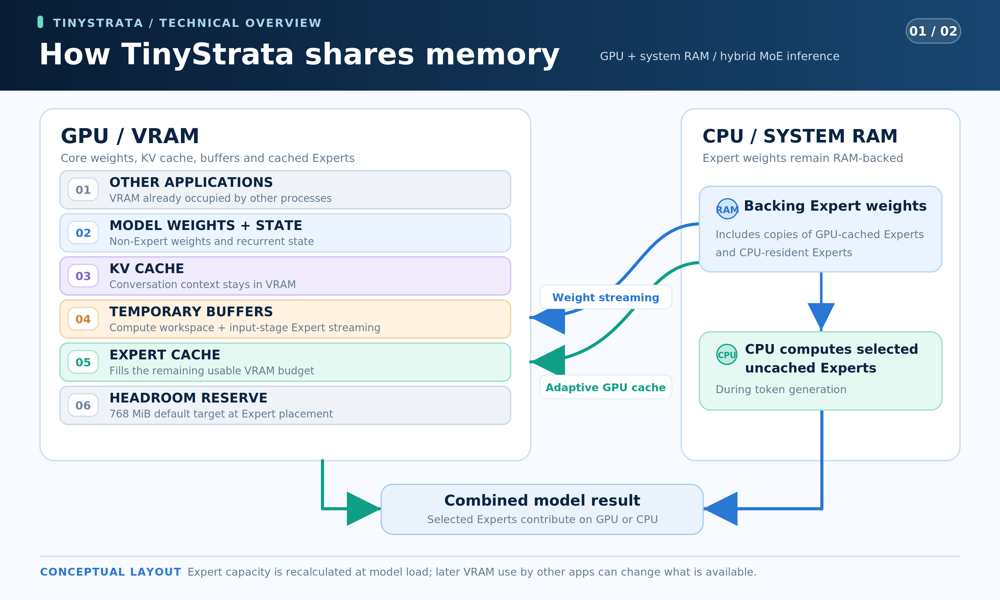

# TinyStrata

**English** · [简体中文](README.zh-CN.md) · [日本語](README.ja.md) · [Deutsch](README.de.md) · [Français](README.fr.md) · [Español](README.es.md) · [Português](README.pt-BR.md)

**TinyStrata is a fast, Windows-only inference engine for 30B-class MoE models.** It primarily targets PCs with mainstream graphics cards (**8–24 GB of VRAM**) and **32 GB of system RAM or less**. It offers an API and an optional chat UI.

**NVIDIA Ampere and newer GPUs (CUDA) and AMD RDNA 4 GPUs (HIP/ROCm) are supported.**

**AMD display limitation:** With AMD integrated graphics and a separate Radeon inference GPU, connect the monitor to the Radeon card **before starting Windows**. Motherboard/integrated-GPU display output is temporarily unsupported: another user reported whole-PC restarts and we reproduced them on our validation machine. Moving the cable after boot did not prevent recurrence. The cause remains unknown; see [issue #10](https://github.com/kbc20f11/TinyStrata/issues/10).

## Why we are building TinyStrata

With PC component prices rising, putting together a high-end PC is increasingly out of reach for many people.

To address this, TinyStrata was created to run AI locally at high speed on PCs with an RTX 3060-class graphics card or better. Our focus is on making relatively small, 30B-class MoE models run as fast as possible.

Our main target is PCs with **8–24 GB of VRAM and 32 GB of system RAM or less**. We believe this range represents the most common configurations for PCs equipped with graphics cards.

TinyStrata builds on Strata to use GPU memory efficiently and run 30B-class MoE models quickly with limited VRAM. Our goal is to make long conversations and documents practical on your own PC.

We focus on local inference on Windows and serving it through an API.

TinyStrata automatically selects inference and memory settings for your hardware, so you can start using the API without complex configuration or manual tuning.

## Model focus

[Qwen3.6-35B-A3B](https://huggingface.co/Qwen/Qwen3.6-35B-A3B) remains the default model, with a balance of speed, memory efficiency and answer quality for PCs with mainstream graphics cards. TinyStrata focuses on compact MoE models and also supports **Gemma 4 26B-A4B-it, LFM2.5-24B-A2B, Clover-35B-A3B-Preview and Tiel Coder 35B-A3B**.

**Qwen3.6-35B-A3B UD-IQ3_XXS** uses the fixed [Unsloth MTP GGUF](https://huggingface.co/unsloth/Qwen3.6-35B-A3B-MTP-GGUF/blob/5bc3e238d916f48a861bac2f8a1990a0e9b7e98d/Qwen3.6-35B-A3B-UD-IQ3_XXS.gguf). The two downloads total about **15.0 GB**: language model including MTP weights **14.1 GB**, and vision projector (`mmproj-F16.gguf`) **0.9 GB**.

**Gemma 4 26B-A4B-it QAT Q4_0** uses the [Google-official model and vision projector](https://huggingface.co/google/gemma-4-26B-A4B-it-qat-q4_0-gguf) with the [matching Unsloth QAT MTP assistant](https://huggingface.co/unsloth/gemma-4-26B-A4B-it-qat-GGUF/blob/7b92b5b28818151e8669af2e45e88d6086f490dd/mtp-gemma-4-26B-A4B-it.gguf). The three downloads total **15.886 GB**: model **14.439 GB**, projector **1.195 GB** and assistant **0.252 GB**.

**LFM2.5-24B-A2B Q4_K_M** uses the official [LiquidAI GGUF](https://huggingface.co/LiquidAI/LFM2.5-24B-A2B-GGUF). Its single language-model download is **14.53 GB**.

**Clover-35B-A3B-Preview IQ3_XXS** defaults to [AtomicChat’s GGUF](https://huggingface.co/AtomicChat/Clover-35B-A3B-Preview-GGUF/blob/4f7e2918e5315634d9d9720ea4f6e8a9a627a875/Clover-35B-A3B-Preview-AD-IQ3_S-IQ3_XXS.gguf) with **IQ3_XXS gate/up and IQ3_S down** Expert projections. The **15.515 GB** language model retains Clover’s own tokenizer and learned bidirectional GDN parameters. TinyStrata extends its context capacity to **256K**. [Official Clover specifies 128K](https://huggingface.co/Diffuspace/Clover-35B-A3B-Preview/blob/main/config.json); general answer quality beyond 128K has not been established. Official Clover is text-only; TinyStrata adds image input by reusing the Qwen3.6 projector (**0.899 GB**, **16.414 GB** in total, reused if already downloaded for Qwen). Select it with `run-api.bat --model-family clover`; a new standalone profile uses port **18083**, with settings in `config-clover.json`.

Managed Clover profiles default to causal decoding without drafts, D0, with INT8 KV (`--clover-mode causal --clover-draft 0 --kv-type int8`) and MT1 (`STRATA_IQ_MT_MIN=1`). Exact self-speculation D3 remains optional (`--clover-mode self-spec --clover-draft 3 --clover-accept exact`); compare it with causal decoding on your hardware before enabling it. The image encoder stays on the GPU by default; `--vision cpu` and `--vision no` select CPU encoding or disable it. Vision supports causal or exact self-speculative decoding; diffusion and threshold acceptance require `--vision no`. LowConfidence block diffusion and approximate threshold acceptance remain experimental opt-ins; see the [decoding options](benchmark/README.md#english).

Clover also offers optional repetition lookup: `--clover-lookup N` proposes at most **0–7 tokens**, with **0/off** as the default. It copies known prompt/history continuations and verifies them with the full causal model and the same penalties. It requires causal D0 and temperature 0, and supports images. Try **3** or **7** on your workload; see [measurements and exactness limits](benchmark/results/clover-lookup-20261107.md). Matches shorter than eight tokens propose at most three tokens; proposals 4–7 require a match of at least eight tokens.

**Tiel Coder 35B-A3B UD-IQ3_XXS** uses the [Tiel MTP GGUF](https://huggingface.co/peculiar-ragdoll/Tiel-Coder-35B-A3B-GGUF-MTP), based on Ornith-1.5. The model is **13.601 GB**, with its own **0.903 GB** Ornith vision projector (**14.503 GB** total), tokenizer and Sharp chat template. It shares the Qwen35MoE engine while keeping separate model settings. Select **Tiel Coder** in the chat's model dropdown or use `run-api.bat --model-family tiel`; its standalone profile uses port **18084** and `config-tiel-coder.json`. Sampling follows the author's `temperature 1.0`, `top_p 0.95`, `top_k 20`; temperature **0.6** is the author's coding setting. MTP defaults to **3**; `--mtp 0` disables it and `--mtp 1` selects a shorter draft.

Gemma automatically groups long text around fresh images when its current Expert/staging layout supports weight reuse. Low-residency layouts retain the original image path. [Upstream changes, 8/12/16 GiB measurements and recovery tests](benchmark/results/upstream-refresh-20261111.md).

The Qwen, Gemma and LFM engines use an automatic VRAM Expert cache, CPU Expert computation from system RAM, prompt weight streaming and CUDA Graphs. They share the same API and support live model switching, with settings saved separately for each model. Selected Experts are not omitted. They also support automatic physical KV growth without changing the maximum context capacity.

**GPT-OSS support is retired.** It is no longer an active download, launch or benchmark target. [Historical measurements](benchmark/results/gptoss-adoption-20261110.md) are retained; see the [status and reintroduction requirements](docs/gpt-oss-reintroduction.md).

| Feature | [Qwen3.6](https://huggingface.co/Qwen/Qwen3.6-35B-A3B) | [Gemma 4](https://huggingface.co/google/gemma-4-26B-A4B-it) | [LFM2.5](https://huggingface.co/LiquidAI/LFM2.5-24B-A2B) | [Clover](https://huggingface.co/Diffuspace/Clover-35B-A3B-Preview) | [Tiel Coder](https://huggingface.co/peculiar-ragdoll/Tiel-Coder-35B-A3B-GGUF-MTP) |
| --- | --- | --- | --- | --- | --- |
| Maximum context | 256K | 256K | 128K | 256K (extension) | 256K |
| Image input | Yes; GPU-resident encoder by default | Yes; GPU-resident encoder by default | No | Yes (TinyStrata extension; GPU-resident encoder by default) | Yes; GPU-resident encoder by default |
| MTP | 3 | 3 | No | No (exact self-spec D3 optional) | 3 |
| KV formats | FP32 / INT8 / native FP8 | FP16 / INT8 / native FP8 (experimental) | FP16 / INT8 / native FP8 | FP32 / INT8 / native FP8 | FP32 / INT8 / native FP8 |
| Automatic KV (default) | FP8 → INT8 | INT8 | FP8 → INT8 | INT8 | FP8 → INT8 |

Image input for Clover is a TinyStrata extension, not an official Clover capability.

The column headings link to the official model cards. **FP8 → INT8** means FP8 KV and native FP8 Attention (Tensor Cores on NVIDIA, WMMA on AMD RDNA 4) when the GPU and compiled kernels support it, otherwise INT8. KV precision is separate from GGUF weight quantization; lower-precision KV can change outputs relative to FP32 (Qwen) or FP16 (Gemma/LFM).

Gemma uses INT8 by default. Native FP8 is experimental and can be selected explicitly with `run-api.bat --model-family gemma4 --kv-type fp8-mma`.

**Automatic context capacity** uses the GPU’s total VRAM as shown below; available free VRAM determines the Expert cache size. An explicit `--max-context N` takes priority.

| Total VRAM (examples) | Qwen3.6 / Gemma 4 / Clover / Tiel Coder | LFM2.5 |
| --- | ---: | ---: |
| 8 GB | 64K | 64K |
| 12 GB | 128K | 128K |
| 16 GB or more | 256K | 128K |

Capacity classes allow for driver reporting differences, so a 16 GB card reported as 15.x GiB still selects 256K for Qwen, Gemma, Clover and Tiel Coder.

<details>
<summary>Build additional model engines manually if an executable is missing</summary>

From this checkout, use an x64 Visual Studio developer terminal with CUDA installed:

```powershell
cmake -S . -B ..\TinyStrata-work\build -DTINYSTRATA_BACKEND=CUDA
cmake --build ..\TinyStrata-work\build --config Release --target tinystrata-gemma4 tinystrata-lfm2 --parallel 4
```

Start Gemma with `run-api.bat --model-family gemma4` (default port 18082), or LFM with `run-api.bat --model-family lfm2` (default port 18081).

</details>

## Installation

Run either installer in 64-bit PowerShell:

**With UI** ([installer](install-ui.ps1)): chat at `http://127.0.0.1:3000`, with the API at `http://127.0.0.1:18080/v1`.

```powershell
irm 'https://raw.githubusercontent.com/kbc20f11/TinyStrata/refs/heads/main/install-ui.ps1' | iex
```

**API only** ([installer](install.ps1)): the same API without the UI.

```powershell
irm 'https://raw.githubusercontent.com/kbc20f11/TinyStrata/refs/heads/main/install.ps1' | iex
```

**AMD runtime default:** automatic installs and updates use the private **ROCm `10.2.0a20260930` SDK (HIP 7.17)** in the work directory, rather than an older global `HIP_PATH` or system SDK. An explicit `-HipDirectory` still selects a custom SDK. Matching HIP/COMGR/Kpack libraries and verified SDK math paths are shared by the model engines and Vision; updates prepare a separate native generation before publishing settings. Drivers, System32 and the persistent system PATH are not changed.

Windows HIP uses the driver's minimum VMM granularity only when the three app-local core hashes, actual loaded runtime and compiled HIP version (7.17 or newer) pass verification. Legacy, mismatched or unverified runtimes retain a **4 MiB allocation floor**. For coarse recovery, set `$env:TINYSTRATA_HIP_VMM_COARSE='1'` before launch; **any nonempty value forces coarse backing**, so remove the variable to restore automatic selection. Graceful native unload allows **60 seconds only for verified sub-4-MiB HIP**, with the existing budget on other paths. The AMD display limitation above remains in effect. See [validation and remaining limits](benchmark/results/hip-runtime-vmm-20261107.md).

The optional green-themed UI supports the seven README languages, image input and live generation statistics. Under **About → Settings → Appearance**, choose **Follow OS** (default), **Light** or **Dark**. This browser remembers your choice across restarts.

The Windows UI installer creates a **TinyStrata** desktop shortcut. Open it to start or reuse the local API and UI and open the chat in your browser. The API-only installer does not create this shortcut. You can also run this command or double-click `run-ui.bat`:

```powershell
& "$env:LOCALAPPDATA\TinyStrata\run-ui.bat"
```

For the API-only installation, use `run-api.bat`:

```powershell
& "$env:LOCALAPPDATA\TinyStrata\run-api.bat" --port 18080
```

### UI search, Python and saved chats

Use the **Models** tab to download models or remove their downloaded files. The chat model picker lists installed models only. Deletion requires confirmation. Switch to another model before deleting the active one. Shared files needed by another model are retained.

Thinking controls follow the selected model: Qwen3.6, Clover and Gemma 4 offer **On / Off**, initially **On**; LFM2.5 is always **On**. Tiel Coder offers **Off / Low / Medium / High**, initially **Medium** (`xhigh` for High). The UI remembers each model's choice separately. Tiel's [Sharp template](https://huggingface.co/peculiar-ragdoll/Qwen-Sharp-Chat-Templates#setting-reasoning-effort) implements effort levels through prompt instructions; they are not numeric token budgets, and High does not guarantee a better answer.

Web search is **on by default** in a fresh UI, using **DDGS without an API key** when no provider has been saved. Turn off the **Web search** checkbox beside **Chat settings** to disable it; this browser remembers that choice across restarts for all supported models. Previously saved on/off, provider and API-key choices are preserved. Configure the provider, API key and concurrency in Chat settings. Python execution is always available when the model needs it; completed Python code blocks also have a **Run Python** button for manual execution.

- **Search:** DDGS needs no key and defaults to one concurrent search with at least 2 seconds between starts. Brave needs an API key and defaults to one concurrent search with at least 1.1 seconds between starts; rate-limit headers are respected. Queries are cached for 5 minutes, with at most 3 searches per reply. Provider, key and concurrency settings are shared across models by the UI server; keys are protected with Windows DPAPI and are not returned to the browser.
- **Python:** standard-library code runs in an isolated browser iframe/worker using Pyodide, with a 10-second execution limit and no network, host filesystem, shell or `pip` access. First use downloads a pinned, SHA-256-verified runtime of about **13.5 MB** into the work directory, outside Git; later runs reuse it.
- **History:** chats, tool results and manual Python results are saved in SQLite at `TinyStrata-work/runtime/ui/chat-history.sqlite3` by default and can be reopened in another browser. Existing browser history is imported, with the original import retained as a backup.

These features belong to the optional UI; API-only inference is unchanged. Runtime licenses are included in [the Pyodide license](ui/python-runtime-LICENSE.txt) and [third-party notices](ui/python-runtime-NOTICES.txt).

### Automatic context compaction

The optional UI enables **Automatically compact context** in Chat settings by default. Before a reply and between local tool rounds, it counts the active prompt with the current model’s tokenizer. When the prompt plus reserved output space reaches **85%** of the context limit, the current model summarizes older exchanges. The most recent exchanges, including at least two user turns, remain verbatim; tool calls and their results stay together. System instructions and available tools are preserved.

Rolling summaries are saved with the chat in SQLite, while the full original conversation remains available in the UI. Editing or rewinding into a summarized part invalidates that checkpoint. A failed or interrupted summary does not delete messages or replace a valid checkpoint. Summaries can lose details; this is conversation summarization, separate from KV quantization. After compaction, the changed prefix must be processed again once before subsequent turns can reuse its KV cache.

Click **KV** in the chat footer to open a context-usage doughnut and **Compact now**. Manual compaction works even when automatic compaction is off, keeps the latest two user exchanges intact, and retains the original messages and attachments in SQLite. The compacted context is loaded immediately without adding a message to the conversation.

Click **Expert placement** beside it to choose **Auto** or the **number of routed Experts to keep on the GPU**. The control uses steps appropriate to the model and shows the percentage as a guide. Applying a change reloads the model and saves the choice for that model. Actual placement depends on available VRAM and Expert sizes. At zero Experts, routed Experts have no resident GPU cache; shared weights, KV and the image encoder still use the GPU.

The trigger reserves the requested output limit, or up to **8K tokens** (at most a quarter of the context) when no limit is set. A summary uses up to **2K output tokens**, capped at an eighth of the context. Images use a conservative token allowance when their exact encoded size is unavailable. An individual message or attachment that cannot fit still needs to be shortened. The counting endpoint, `POST /v1/chat/token-count`, does not generate text or change the model’s KV cache; API clients are not automatically compacted.

The design follows [Open WebUI’s rolling context compaction](https://docs.openwebui.com/troubleshooting/context-window/) and [Anthropic’s context-engineering guidance](https://www.anthropic.com/research/effective-context-engineering-for-ai-agents).


### Switch models without restarting

The installer starts with Qwen by default. To prepare Gemma on the same running API server, download it and check its progress:

```powershell
$api = 'http://127.0.0.1:18080'
Invoke-RestMethod "$api/v1/model/download" -Method Post -ContentType 'application/json' -Body '{"model":"gemma-4-26b-a4b-it"}'
Invoke-RestMethod "$api/v1/model/download?model=gemma-4-26b-a4b-it"
```

Repeat the progress request until `state` is `ready`, then switch explicitly. Downloading an inactive model does not activate it:

```powershell
Invoke-RestMethod "$api/v1/model/switch" -Method Post -ContentType 'application/json' -Body '{"model":"gemma-4-26b-a4b-it"}'
Invoke-RestMethod "$api/v1/model/switch"
```

To start directly with Gemma, run `run-api.bat --model-family gemma4`; its default API address is `http://127.0.0.1:18082/v1`. For LFM, replace `gemma-4-26b-a4b-it` in the download, progress and switch requests above with `lfm2.5-24b-a2b`, or start it with `run-api.bat --model-family lfm2` (default API address `http://127.0.0.1:18081/v1`).

For Clover, use `clover-35b-a3b-preview` in the same download, progress and switch requests. The running API's port stays unchanged.

For Tiel Coder, use `tiel-coder-35b-a3b` in those requests. Its model, projector, tokenizer and settings remain separate from Qwen even though both use the same engine architecture.

Poll `GET /v1/model/switch` until `state` is `ready`. To return to Qwen, send the same switch request with `{"model":"qwen3.6-35b-a3b"}`. Starting a download or switch returns `202`; a switch during generation returns `409`, so retry after generation finishes. Inference during switching returns `503`. The port and authentication stay unchanged. Selection lasts for the current server session; restarting uses the model selected by the launcher.

## Measured speed — Qwen3.6

Measured on **2026-11-03** using Windows, an RTX PRO 4000 Blackwell SFF Edition (24 GB), a Ryzen 9 7945HX3D, 64 GB of system RAM and the fixed Unsloth MTP UD-IQ3_XXS model. The image encoder stayed on the GPU during API requests. Thinking, the model’s sampling defaults (temperature 0.7) and MTP 3 were enabled. Prompt chunks and Expert placement were automatic; context capacity was set for each VRAM class. Hybrid CUDA Graphs stayed at their default off; normal all-GPU CUDA Graphs remained enabled.

| Available VRAM | Context capacity | INT8 generation | Native FP8 generation | Notes |
| --- | ---: | ---: | ---: | --- |
| 24 GB | 256K | 141.52 tok/s | 134.41 tok/s | All weights resident in VRAM |
| Approximately 16 GB | 256K | 103.69 tok/s | 105.15 tok/s | GPU and CPU Expert computation |
| Approximately 12 GB | 128K | 92.89 tok/s | 94.74 tok/s | GPU and CPU Expert computation |
| Approximately 8 GB | 64K | 67.17 tok/s | 69.95 tok/s | GPU and CPU Expert computation |

Each of the same three input texts was run twice per FP8/INT8 configuration, generating 128 tokens including thinking; sampling settings were left at their model defaults. Speed is total generated tokens divided by total decode time, excluding loading and prompt processing; context values are cache capacities. The reduced-memory rows reserve 8, 12 or 16 GiB on the same 24 GB GPU and use the context capacity for that VRAM class; they are not physical 16/12/8 GB GPU benchmarks.

INT8 and FP8 were measured in alternating groups with four independent starts per format, each start running the three inputs twice and generating 128 tokens per request; see the [direct comparison](benchmark/results/qwen-kv-direct-20261103.md) for details.

[Basalt-based CPU, Clover GPU and checkpoint comparisons](benchmark/results/basalt-adoption-20261105.md#english) use separate controlled settings; they do not replace the historical benchmark tables.

[Further Basalt history review](benchmark/results/basalt-history-20261107.md#english) records packed-byte and CPU-watchdog fixes, the rejected scheduling candidate, and Radeon development comparisons without a headline speedup claim.

Windows HIP hybrid decoding for Qwen, Clover and Tiel uses verified coherent host memory for CPU results. INT8 Clover also shares KV reads from 8K onward for single-row causal decoding on gfx1200. [Controlled 8/12/16 GiB comparisons and adoption decisions](benchmark/results/other-models-20261110.md).

[Clover GDN chain measurements](benchmark/results/gdn-chain-20261105.md#english) cover repeated full-GPU and fixed-budget hybrid comparisons; Qwen retains its existing default path.

[Hybrid CPU result merging and measured worker tuning](benchmark/results/basalt-remaining-20261105.md#english)
are documented separately; the historical benchmark tables remain unchanged.

[Capacity-aware staging under VRAM pressure](benchmark/results/portable-hybrid-20261105.md#english)
is documented with separate controlled measurements.

## Measured speed — Gemma 4

Measured on the same Windows PC with 64 GB of system RAM, using Gemma 4 26B-A4B-it QAT Q4_0 and its matching QAT MTP assistant. The image encoder stayed on the GPU during API requests. MTP 3, CUDA Graphs and the model-specific thinking/sampling defaults were enabled; context capacity was set for each VRAM class; prompt chunks and Expert placement were automatic.

Native FP8 and INT8 were measured on **2026-10-27**.

| Available VRAM | Context capacity | INT8 (default) | Native FP8 (experimental) | Notes |
| --- | ---: | ---: | ---: | --- |
| 24 GB | 256K | 115.89 tok/s | 115.46 tok/s | INT8 / FP8: Experts computed on the GPU |
| Approximately 16 GB | 256K | 102.83 tok/s | 100.86 tok/s | INT8 / FP8: GPU and CPU Expert computation |
| Approximately 12 GB | 128K | 85.53 tok/s | 91.71 tok/s | INT8 / FP8: GPU and CPU Expert computation |
| Approximately 8 GB | 64K | 52.98 tok/s | 55.09 tok/s | INT8 / FP8: GPU and CPU Expert computation |

Each of the same three input texts was run twice per FP8/INT8 configuration, generating 128 tokens including thinking; sampling settings were left at their model defaults. Speed is total generated tokens divided by total decode time, excluding loading and prompt processing; context values are cache capacities. The reduced-memory rows reserve 8, 12 or 16 GiB on the same 24 GB GPU and use the context capacity for that VRAM class; they are not physical 16/12/8 GB GPU benchmarks.

## Measured speed — LFM2.5

Measured on the same Windows PC with 64 GB of system RAM, using the official LFM2.5-24B-A2B Q4_K_M model, without MTP or Vision. CUDA Graphs and the model-specific thinking/sampling defaults were enabled; context capacity was set for each VRAM class; prompt chunks and Expert placement were automatic.

Native FP8 and INT8 were measured on **2026-10-27**.

| Available VRAM | Context capacity | INT8 | Native FP8 (default) | Notes |
| --- | ---: | ---: | ---: | --- |
| 24 GB | 128K | 143.85 tok/s | 148.61 tok/s | INT8 / FP8: Experts computed on the GPU |
| Approximately 16 GB | 128K | 138.14 tok/s | 139.22 tok/s | INT8 / FP8: GPU and CPU Expert computation |
| Approximately 12 GB | 128K | 115.61 tok/s | 117.90 tok/s | INT8 / FP8: GPU and CPU Expert computation |
| Approximately 8 GB | 64K | 79.74 tok/s | 81.39 tok/s | INT8 / FP8: GPU and CPU Expert computation |

Each of the same three input texts was run twice per FP8/INT8 configuration, generating 128 tokens including thinking; sampling settings were left at their model defaults. Speed is total generated tokens divided by total decode time, excluding loading and prompt processing; context values are cache capacities. The reduced-memory rows reserve 8, 12 or 16 GiB on the same 24 GB GPU and use the context capacity for that VRAM class; they are not physical 16/12/8 GB GPU benchmarks.

## Measured speed — Clover

Measured on **2026-11-02** on Windows with an RTX PRO 4000 Blackwell SFF Edition (24 GB), Ryzen 9 7945HX3D and 64 GB of system RAM, using Clover Preview IQ3_XXS. Causal D0, thinking and the GPU-resident image encoder were enabled. CPU workers, input chunks and Expert placement were automatic; the tuning environment was `STRATA_IQ_MT_MIN=1` and `STRATA_EXP_MODE=8`.

| Available VRAM | Context capacity | INT8 generation | Native FP8 generation | Notes |
| --- | ---: | ---: | ---: | --- |
| 24 GB | 256K | 91.61 tok/s | 94.67 tok/s | Expert GiB — INT8: 12.34 → 12.34; FP8: 12.34 → 12.34 |
| Approximately 16 GB | 256K | 58.16 tok/s | 58.17 tok/s | Expert GiB — INT8: 6.55–6.60 → 6.07–6.22; FP8: 6.55–6.60 → 6.11–6.19 |
| Approximately 12 GB | 128K | 51.31 tok/s | 50.89 tok/s | Expert GiB — INT8: 3.08–3.18 → 2.80–3.04; FP8: 2.94–3.18 → 2.80–3.04 |
| Approximately 8 GB | 64K | Unstable (3/4 starts) | 39.75 tok/s | Expert GiB — INT8: 0.00 → 0.00 (3/4); FP8: 0.00 → 0.00; INT8/FP8: CPU decode Experts; GPU dense/prompt streaming |

Four fresh starts were attempted for each KV/VRAM condition with the v1 inputs, sampler and timers. Numerical cells require four successful starts; startup failures or mixed outcomes are shown explicitly. This controlled variant is separate from standard v1 and the managed causal D0/INT8 default. Expert cache shows actual startup → after-16K allocation ranges for successful starts. [Full results and conditions](benchmark/results/rtx-pro-4000-blackwell-sff.md).

The reduced-memory rows reserve and touch 8, 12 or 16 GiB on the same 24 GB GPU, with 256K / 256K / 128K / 64K context capacities. They are not benchmarks of physical 16/12/8 GB GPUs. These automatic-chunk results are separate from the earlier local tuning with a fixed 2,048-token chunk.

## Measured speed — AMD Radeon (HIP)

Speed on Radeon cards, measured with [tinystrata-bench-v1](benchmark/README.md#english). Each card has its own page with the hardware, driver, engine commit, settings and every column: [`benchmark/results/`](benchmark/results/). Values are generation / 4K input / 16K input, in tok/s. Clover uses the exact D3 variant.

**Archived saved-settings run:** [RX 9060 XT, 2026-11-11 (six models, one pass; includes retired GPT-OSS)](benchmark/results/rx-9060-xt.md). The table below retains the historical fixed-v1 comparison.

| GPU | Qwen3.6 UD-IQ3_XXS | Gemma 4 QAT Q4_0 | LFM2.5 Q4_K_M | Clover IQ3_XXS (exact D3, Vision GPU) |
| --- | ---: | ---: | ---: | ---: |
| [RX 9060 XT](benchmark/results/rx-9060-xt.md) | 82.95 / 895.98 / 808.59 | 78.07 / 2482.20 / 2338.68 | 93.14 / 2062.80 / 1694.56 | 41.67 / 942.27 / 892.94 |
| [RX 9070 XT](benchmark/results/rx-9070-xt.md) | 89.11 / 1056.20 / 1383.33 | 87.81 / 2977.93 / 3667.40 | 102.67 / 2601.75 / 2531.47 | 39.86 / 888.74 / 1215.40 |

This Clover measurement uses exact D3/INT8/MT1 with a GPU-resident image encoder; D3 is no longer the app default. Image first output / completion: **2.43 / 4.54 s** (RX 9060 XT), **2.61 / 5.47 s** (RX 9070 XT); Expert cache: **7.32–8.10 → 7.18–7.95 GiB** (RX 9060 XT), **6.84 → 6.70 GiB** (RX 9070 XT) (startup → after 16K input). [Conditions and image checks](benchmark/results/rx-9060-xt.md#clover-vision-with-exact-d3-2026-11-01).

**Clover IQ3_XXS — RX 9060 XT (2026-11-01; before query sharing, historical)**

The same canonical workloads were measured with 128K context, physical KV growth, thinking enabled, automatic CPU workers/chunks and four independent API starts per profile. These historical exact rows were separately labelled variants; the causal INT8 row is the fixed-v1 control, with its original no-Vision settings. Expert cache is startup → after 16K, in GiB.

| Profile | KV | Short-input generation tok/s | 4K input tok/s | Generation after 4K tok/s | 16K input tok/s | Generation after 16K tok/s | Expert cache GiB |
| --- | --- | ---: | ---: | ---: | ---: | ---: | --- |
| Causal, standard (control) | INT8 | 41.27 | 962.29 | 38.05 | 877.43 | 35.68 | 9.98 → 9.83 |
| Causal, MT1 (control) | INT8 | 40.64 | 962.21 | 36.99 | 877.58 | 35.77 | 9.98 → 9.83 |
| Exact self-spec D3 (optional) | INT8 | 49.39 | 963.95 | 33.06 | 878.30 | 33.83 | 9.98 → 9.83 |
| Exact self-spec D3 | FP8 (optional) | 46.11 | 959.49 | 28.94 | 872.02 | 18.00 | 9.98 → 9.83 |

These are historical control measurements before query sharing. Clover now defaults to causal D0, INT8 KV and MT1; exact D3 is optional. These historical D3 results are not measurements of the current default. Block diffusion and threshold acceptance remain experimental. [Settings and quality checks](benchmark/results/rx-9060-xt.md#clover-hip-int8-query-sharing-2026-11-01) / [Historical IQ3 comparison](benchmark/results/rx-9060-xt.md#clover-iq3-2026-10-31) / [Historical Q4_0 measurements](benchmark/results/rx-9060-xt.md#clover-causal-and-native-block-diffusion-2026-10-31).

**Clover HIP INT8 query sharing — RX 9060 XT (2026-11-01; before Vision, historical)**

INT8 KV; four independent API starts per profile in interleaved order. Short generation is capped at 128 output tokens; generation after 4K/16K/64K input is capped at 32. The former causal-default control uses normal CPU Expert arithmetic (MT2); both D3 rows use MT1. These measurements predate Vision: the image encoder was not resident. The D3 rows use D3/INT8/MT1, which remains an optional profile. [Conditions, quality checks and results](benchmark/results/rx-9060-xt.md#clover-hip-int8-query-sharing-2026-11-01).

| Profile | Short generation tok/s | Generation after 4K tok/s | Generation after 16K tok/s | Generation after 64K tok/s | 64K input tok/s | Expert cache GiB: startup → 64K |
| --- | ---: | ---: | ---: | ---: | ---: | ---: |
| Causal MT2 (former default/control) | 41.16 | 38.04 | 36.40 | 24.11 | 662.52 | 9.98 → 9.35 |
| Exact D3 MT1 (query sharing off/control) | 49.78 | 33.35 | 34.11 | 17.51 | 663.12 | 9.98 → 9.35 |
| Exact D3 MT1 (before Vision) | 49.49 | 34.87 | 39.30 | 26.62 | 664.65 | 9.98 → 9.35 |

## Which project should I use?

| Your goal and hardware                                                                                                                       | Project                                                               |
| -------------------------------------------------------------------------------------------------------------------------------------------- | --------------------------------------------------------------------- |
| You want Qwen3.6 / Gemma 4 / LFM2.5 / Clover / Tiel Coder inference on a **Windows** PC with a mainstream graphics card, **8–24 GB of VRAM and 32 GB of system RAM or less**. | TinyStrata (**Windows only**, under development)                      |
| You have both **an RTX 3060-class GPU or better** and **64 GB of system RAM or more**.                                                        | We recommend [Strata (upstream)](https://github.com/Niko1221/Strata). |
| You want a **chat UI with live generation statistics**. | TinyStrata with the [optional UI installer](install-ui.ps1). |

## How memory is shared — Qwen3.6

A MoE model contains many **Experts**: smaller neural networks selected for each token. TinyStrata keeps as many Experts as it can in GPU memory (VRAM). During generation, it can compute selected uncached Experts on the CPU using system RAM. When processing larger input batches, it can instead stream Expert weights from RAM through temporary GPU buffers. Model-selected Experts are kept in the computation.

The downloaded model files total about **15.0 GB**: **14.1 GB** for the language model (including MTP weights) and **0.9 GB** for the vision projector (`mmproj-F16.gguf`). The language model does not all have to fit in VRAM. GPU memory also needs room for the vision encoder and image-processing buffers, the conversation's **KV cache**, the model's other weights and temporary computation buffers:



This is a layout diagram for the default GPU image mode, not a fixed-size partition. At each model load, TinyStrata starts and warms up the GPU vision encoder before loading the language model; its weights and warmed work buffers stay resident. It then allocates the initial KV pages, other weights and work buffers, and sizes the Expert cache from the remaining free VRAM. On Windows, it uses the smaller of CUDA's free-memory reading and the NVIDIA driver's free dedicated VRAM when both are available.

Cache contents change as different Experts are used. With default KV growth, short conversations leave more VRAM for Experts; as the sequence grows, the Expert cache gives memory back to KV. New shorter requests can return unused KV pages to the Expert cache. `run-api.bat --kv-whole` allocates the whole KV capacity up front; `run-api.bat --kv-grow` restores growth. Other applications can still consume VRAM.

Expert placement normally targets 768 MiB of headroom. In Qwen’s `--kv-whole` mode, near-fit placement follows Strata and can release packed Q8 weight copies, shrink an Attention score buffer where present and reduce the target to 256 MiB so all main-model Experts fit in VRAM, while MTP Experts can run on the CPU. `--vram-reserve-mib N` fixes the reserve explicitly. This is a placement target, not a permanent guarantee of free memory.

More GPU-resident Experts usually means less CPU work. In hybrid mode, system RAM also retains backing copies of Experts that are cached in VRAM, so adding VRAM does not reduce RAM usage byte for byte. Leave RAM for the operating system and other applications too. More **RAM capacity** lets you hold model data, but speed also depends on the CPU, RAM bandwidth and GPU. Windows' "shared GPU memory" is different from TinyStrata deliberately computing Experts on the CPU.

The KV cache stays in VRAM; system RAM holds Expert data for this offload mechanism. A long conversation therefore still needs enough GPU memory for its KV cache.

## Automatic settings — Qwen3.6

New configurations choose KV/Attention and context capacity automatically. You do not need to select an 8 GB, 12 GB or 16 GB recipe.

For Qwen3.6 and LFM2.5, an RTX 3060 selects INT8. Supported RTX 40/50-series and AMD RDNA 4 environments select native FP8 automatically; the engine checks the compiled kernels and GPU capabilities as well as the hardware generation. If native FP8 is unavailable, automatic mode uses INT8. Gemma uses INT8 by default on both NVIDIA and AMD. This chooses a supported path without running a speed or quality benchmark at startup.

The native engine estimates the prompt chunk size at startup, choosing 512, 1024, 2048 or 4096 tokens from available VRAM, context capacity and whether the Experts fit on the GPU. Larger chunks can reduce repeated RAM-to-GPU weight transfers during input processing. `run-api.bat --chunk N` fixes the size; `run-api.bat --chunk auto` restores native automatic selection.

Context capacity is the logical maximum for the input and generated output together. By default, physical KV memory is allocated as the conversation grows, rather than reserving the whole capacity for a short conversation. Long documents still require more computation and eventually more KV memory.

For scale, Qwen INT8 KV at full capacity takes about **0.71 GiB at 64K, 1.42 GiB at 128K and 2.84 GiB at 256K**, including the MTP layer; other weights and work buffers are additional. Native FP8 uses approximately the same KV storage as INT8 in this implementation; its benefit is a different computation path, rather than a substantially smaller cache.

Context capacity is chosen from total GPU VRAM; the Expert cache then fits into the free VRAM left at load time. Other applications using VRAM leave room for fewer GPU-cached Experts. The API rejects input that exceeds the context capacity instead of silently truncating it.

GGUF weight quantization and KV precision are separate. The selected UD-IQ3_XXS model has compressed weights; INT8 or FP8 describes the conversation cache and its Attention path. Lower-precision KV can change answers, so these modes do not promise identical output to FP32 KV. The implementation keeps all visible context positions and every model-selected Expert.

New launcher configurations use MTP 3, which proposes several tokens ahead and verifies them with the main model. It can improve generation speed, but the gain depends on how many proposals are accepted. Verification is intended to preserve the main model's decoding behavior; differences in numerical execution paths can still change tokens, so enabling MTP does not promise identical output to disabling it.

MTP supports both greedy generation and temperature-based sampling, including repetition, frequency and presence penalties. For sampled requests, the main model samples each verification row, and only the matching draft prefix is accepted.

Qwen and Gemma also offer optional `--lookup-draft N` (**0–7**, the maximum proposed tokens) and experimental `--mtp-auto 0|1`; **both default to 0/off**. Lookup copies known prompt/history continuations and verifies each token with the existing target sampler and penalties, including at normal temperatures. All selected Experts still run; there is no approximate acceptance or tail skipping. Default **MTP 3** and temperatures (**Qwen 0.7 / Gemma 1.0**) stay unchanged. Automatic MTP is not a uniform speedup and remains off. See the [controlled development measurements and limits](benchmark/results/qwen-gemma-speculation-20261107.md), separate from the fixed v1 benchmark.

CUDA Qwen automatically uses the interleaved dense matvec fast path with MTP 1–3 when the main Experts stay on the GPU and CUDA Graphs are enabled. `TINYSTRATA_Q36_MMVQ_IL=0` restores the previous matvec dispatch while MTP remains enabled. Main-model prompt MMQ can also be selected independently of unsupported MTP weight formats, from 128 input rows. This automatic choice is made after Expert placement and requires enough extra workspace and headroom; hybrid main-model execution uses native CPU/GPU kernels. `TINYSTRATA_Q36_MAIN_MMQ=0` restores the previous MMQ selection. [Controlled CUDA comparisons and validation](benchmark/results/qwen-cuda-20261103.md).

CUDA Qwen now automatically selects compensated INT8 FDEC decode on supported SM80+ GPUs; FP8 and Clover retain their existing paths. On the tested Blackwell card, generation after 4K input improves from **114.24 to 149.14 tok/s**. Qwen also retains completed input chunks after cancellation. [November 3 adoption results, conditions and quality checks](benchmark/results/fork-adoption-20261103.md#english).

Gemma/LFM can retain bounded same-model chat snapshots on CUDA: **1024/512 MiB** cache limits, two parked slots, disk storage off. HIP's additional parking defaults to off. Gemma's CUDA upload buffers are now 256 MiB each, saving **512 MiB** across two buffers; LFM keeps 512 MiB per buffer.

Explicit settings override automatic choices, and existing manually selected settings remain in effect. For example, `run-api.bat --kv-type int8` fixes INT8; `run-api.bat --kv-type auto --max-context auto --expert-vram auto` restores automatic KV, context and Expert placement.

### Learned Expert placement — Qwen3.6 / Clover / Tiel Coder

The normal Qwen, Clover and Tiel Coder API configurations automatically save learned Expert rankings in `expert-profiles` beside the engine log and use the new prompt's routing frequencies to adapt to topic changes. Each load sizes the cache from the current Expert budget and available VRAM; saved rankings do not impose the previous GPU's slot count. Profiles must match the model-file metadata/sampled-content fingerprint and quantized layout. Invalid or unreadable profiles use ordinary initial placement; a failed save, including a read-only destination, leaves inference usable and the previous profile intact.

These profile files contain only Expert rankings, with no serialized prompts, activations or KV; no model-selected Expert is skipped. Changing residency can change CPU/GPU rounding and generated tokens, so identical output is not guaranteed.

Direct native execution is opt-in with `--expert-profile PATH --expert-topic-cache 1`; `--expert-profile off --expert-topic-cache 0` disables both features. For the launcher/API, set these process environment overrides, or the same values in the configuration's `env` object:

```powershell
$env:TINYSTRATA_Q36_EXPERT_PROFILE = 'off'
$env:TINYSTRATA_Q36_EXPERT_TOPIC = '0'
.\run-api.bat
```

## API server

TinyStrata provides OpenAI-compatible Chat Completions (`/v1/chat/completions`) and Responses (`/v1/responses`) APIs and an Anthropic-compatible Messages API (`/v1/messages`), including streamed generation. Use the optional TinyStrata UI, an API client or an external frontend.

New configurations use model-specific sampling defaults. Per-request settings take precedence; saved custom settings remain in effect.

| Setting | Qwen3.6 | Gemma 4 | LFM2.5 | Clover |
| --- | ---: | ---: | ---: | ---: |
| `temperature` | 0.7 | 1.0 | 0.1 | 0.0 |
| `top_p` | 0.95 | 0.95 | 1.0 | 1.0 |
| `top_k` | 20 | 64 | 50 | 64 |
| `min_p` | 0.0 | 0.0 | 0.0 | 0.0 |
| `presence_penalty` | 1.5 | 0.0 | 0.0 | 0.9 |
| `frequency_penalty` | 0.0 | 0.0 | 0.0 | 0.0 |
| `repetition_penalty` | 1.0 | 1.0 | 1.05 | 1.05 |
| `enable_thinking` | true | true | true (always enabled) | true (can be disabled) |
| `max_tokens` (including thinking) | 32768 | 32768 | 32768 | 24576 |

The API listens on `http://127.0.0.1:18080` by default. To use another port, run `run-api.bat --port 18081` from the installed TinyStrata folder.

For Qwen and Clover, `run-api.bat --vision gpu` uses GPU image processing (the default for new setups); `--vision cpu` uses the CPU and `--vision no` disables images. `--vision-tokens N` sets the image-token limit (default: 4096). These choices are saved and reused when omitted on later starts.

The API can start before the model files are installed. With Qwen selected, `POST /v1/model/download` with an empty JSON body (`{}`) downloads the fixed [Unsloth Qwen3.6-35B-A3B MTP UD-IQ3_XXS language model](https://huggingface.co/unsloth/Qwen3.6-35B-A3B-MTP-GGUF/blob/5bc3e238d916f48a861bac2f8a1990a0e9b7e98d/Qwen3.6-35B-A3B-UD-IQ3_XXS.gguf) (14.1 GB, including MTP weights) and its [vision projector](https://huggingface.co/unsloth/Qwen3.6-35B-A3B-MTP-GGUF/blob/5bc3e238d916f48a861bac2f8a1990a0e9b7e98d/mmproj-F16.gguf) (0.9 GB), about **15.0 GB in total**. It verifies both files' SHA-256 checksums, extracts the tokenizer and loads them. `GET /v1/model/download` reports progress; interrupted downloads can resume. A repeated download request reuses the active job, and `POST /v1/model/download/cancel` can cancel transfer or verification. Download completion is not inference readiness: wait for the download state to become `ready` and `/health` to report `loaded: true`, plus `images: true` when images are enabled.

The installer prepares the engine binaries and GPU runtime libraries, and downloads Qwen and its vision projector by default. Existing configurations keep their selected local model until you explicitly change it.

## Acknowledgments

TinyStrata is an independent fork of [Strata](https://github.com/Niko1221/Strata) and draws heavily on its implementation. Thanks to [Niko](https://github.com/Niko1221) and the Strata community for the engine and the work that made TinyStrata possible.

Thanks also to [Aaron Flin](https://github.com/aflin) and the [MoMoE project](https://github.com/aflin/momoe) for the KV cache, attention and quantized Expert code adapted in TinyStrata.

## License

MIT. See [LICENSE](LICENSE).

Copyright (c) 2026 Niko1221 and the Strata contributors.

Upstream attribution: [NOTICE](NOTICE). GGML: [MIT license](third_party/ggml/LICENSE).
