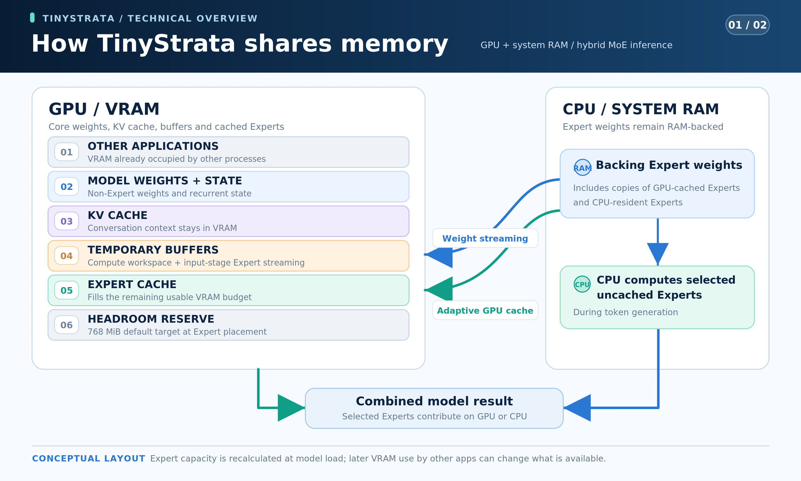
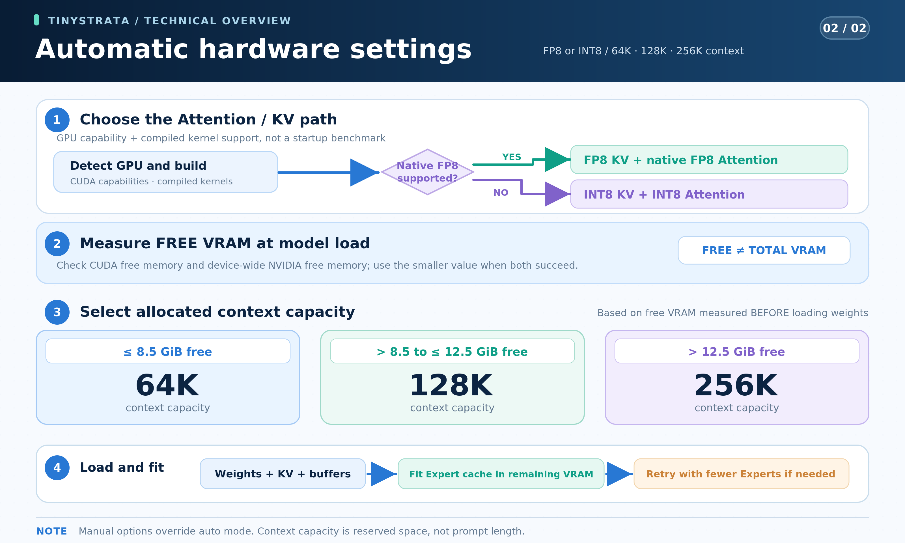

# TinyStrata

[English](README.md) · [简体中文](README.zh-CN.md) · [日本語](README.ja.md) · [Deutsch](README.de.md) · [Français](README.fr.md) · [Español](README.es.md) · **Português**

**O TinyStrata é um mecanismo de inferência de alta velocidade em desenvolvimento para modelos MoE da classe 30B, exclusivo para Windows e acessível apenas por API.** Ele é voltado principalmente a PCs equipados com placas de vídeo comuns de **8–24 GB** de VRAM e com **32 GB de RAM do sistema ou menos**.

## Por que desenvolvemos o TinyStrata?

Com o aumento dos preços dos componentes, montar um PC de ponta está cada vez mais fora do alcance de muitas pessoas.

Por isso, o TinyStrata foi criado para executar IA localmente em alta velocidade em PCs equipados com placas de vídeo comuns da classe RTX 3060 ou superior. Nosso foco é fazer modelos MoE relativamente pequenos, da classe 30B, rodarem o mais rápido possível.

Nosso principal público são PCs com **8–24 GB de VRAM e 32 GB de RAM do sistema ou menos**. Acreditamos que essa faixa representa as configurações mais frequentes de PCs equipados com placas de vídeo comuns.

Baseado no Strata, o TinyStrata busca melhorar a velocidade de inferência do Qwen3.6-35B-A3B em ambientes com VRAM limitada. Queremos usar a memória da GPU de forma eficiente para que você possa trabalhar com conversas e documentos longos no seu próprio PC.

O TinyStrata concentra seu desenvolvimento na execução de inferência local rápida no Windows e no acesso a ela por meio de uma API. Essa orientação guia nossa implementação e nossos testes.

Também buscamos tornar os primeiros passos o mais simples possível. O TinyStrata escolhe automaticamente as configurações de inferência e memória para o seu hardware, para que você possa usar a API sem configurações complicadas nem ajustes manuais.

## Por que não há uma interface incluída?

Já existem muitas interfaces e ambientes de agentes compatíveis com APIs para LLMs. Como o TinyStrata também oferece suporte a formatos comuns de API, você pode conectar e usar os que preferir. Se configurar a conexão parecer trabalhoso, você pode pedir a um agente de IA que faça isso. Ao deixar a interface a cargo do software existente, nos concentramos no desenvolvimento do mecanismo de inferência e da API.

## Foco de modelos

Atualmente, o TinyStrata se concentra exclusivamente no [Qwen3.6-35B-A3B](https://huggingface.co/Qwen/Qwen3.6-35B-A3B). Consideraremos oferecer suporte a outro modelo quando um modelo MoE for mais adequado que o Qwen3.6-35B-A3B para inferência local rápida em PCs equipados com placas de vídeo comuns.

Consideramos um problema o fato de que, enquanto o desenvolvimento e o lançamento de grandes modelos avançam, as opções de modelos MoE da classe 30B fáceis de usar em PCs equipados com placas de vídeo comuns não aumentam o suficiente. O [Qwen3.6-35B-A3B, lançado em 16 de abril de 2026](https://github.com/QwenLM/Qwen3.8#news), continua adequado ao nosso caso de uso, que prioriza o equilíbrio entre velocidade, baixo consumo de memória e qualidade das respostas, mesmo com o tempo decorrido desde seu lançamento. Ainda não encontramos um modelo MoE pequeno que, em nossa avaliação, supere claramente esse equilíbrio nos ambientes visados pelo projeto.

## Como instalar

Execute no PowerShell de 64 bits para instalar o TinyStrata e iniciar a API em `http://127.0.0.1:18080/v1`:

```powershell
irm 'https://raw.githubusercontent.com/kbc20f11/TinyStrata/refs/heads/main/install.ps1' | iex
```

Para iniciar novamente após reiniciar o Windows, execute este comando ou dê um clique duplo no mesmo arquivo `run-api.bat`:

```powershell
& "$env:LOCALAPPDATA\TinyStrata\run-api.bat" --port 18080
```

Você também pode passar o link do [repositório do TinyStrata no GitHub](https://github.com/kbc20f11/TinyStrata) a um agente de IA e deixar a instalação por conta dele.

## Velocidade medida

As medições a seguir foram feitas em 2026-10-19 no Windows, com uma RTX PRO 4000 Blackwell SFF Edition (24 GB), um Ryzen 9 7945HX3D e o modelo fixo Unsloth MTP UD-IQ3_XXS. O projetor de visão permaneceu carregado e aquecido na GPU; as solicitações continham apenas texto, sem tempo de codificação de imagens. Foram usados os padrões da API: raciocínio ativado, temperatura 0.7, MTP 3, blocos de entrada de 512 tokens e seleção automática de contexto e alocação de especialistas. O caminho híbrido de CUDA Graph estava desativado por padrão; os grafos normais para execução inteiramente na GPU mantiveram a configuração padrão.

As solicitações omitiram os parâmetros de amostragem e a semente. A única alteração aos seus padrões foi `max_tokens=128` como limite do teste, em vez de 32768. A coluna FP8 usa a seleção automática de KV nesta GPU; para a comparação com INT8, apenas o modo KV foi forçado para INT8.

**Planejamos realizar medições em máquinas reais com GPUs de 8 GB, 12 GB e 16 GB no futuro.** As linhas com memória reduzida da tabela abaixo foram medidas limitando a memória disponível na mesma GPU de 24 GB; elas não são testes de desempenho de GPUs físicas de 8/12/16 GB.

| Condição de memória disponível | Capacidade de contexto | Geração com INT8 | Geração com FP8 nativo | Notas |
| --- | ---: | ---: | ---: | --- |
| 24 GB | 256K | 118.40 tok/s | 131.82 tok/s | Todos os pesos residentes na VRAM |
| Aprox. 16 GB | 128K | 95.09 tok/s | 99.39 tok/s | 8 GiB reservados; cálculo de especialistas na CPU e na GPU |
| Aprox. 12 GB | 64K | 85.03 tok/s | 85.59 tok/s | 12 GiB reservados; cálculo de especialistas na CPU e na GPU |
| Aprox. 8 GB | 64K | 64.35 tok/s | 65.62 tok/s | 16 GiB reservados; cálculo de especialistas na CPU e na GPU |

Somente a linha de 8 GB foi medida novamente após a liberação dos buffers de trabalho de visão e a introdução do ajuste automático dos blocos; ambos os modos selecionaram automaticamente blocos de 512 tokens. As linhas de 24/16/12 GB mantêm os resultados anteriores do mesmo dia.

Essas são velocidades agregadas de decodificação: o total de tokens gerados dividido pelo tempo de decodificação registrado pelo mecanismo, excluindo o carregamento e o processamento da entrada. Foram usados os mesmos três textos, com 32, 44 e 1,597 tokens após aplicar o template de raciocínio, cada um gerando 128 tokens duas vezes, incluindo os tokens de raciocínio. **As capacidades da tabela são capacidades de cache alocadas, não comprimentos de entrada.** As linhas com memória reduzida reservaram separadamente 8, 12 ou 16 GiB na mesma GPU de 24 GB e realizaram trabalho real de especialistas na CPU.

O contexto e a alocação de especialistas indicados são os selecionados durante cada execução. A capacidade de contexto também afeta a velocidade, portanto essas linhas mostram diferentes configurações práticas. Os resultados de FP8 se limitam a essas condições e não garantem maior velocidade em geral nem comparam a qualidade.

## Qual projeto devo usar?

| Seu objetivo e seu hardware | Projeto |
| --- | --- |
| Você quer inferência do Qwen3.6-35B-A3B apenas por API no **Windows**, com **8–24 GB de VRAM e 32 GB de RAM do sistema ou menos**, como em um PC equipado com uma placa de vídeo comum. | TinyStrata (**somente Windows**, em desenvolvimento) |
| Você tem tanto **uma GPU da classe RTX 3060 ou superior** quanto **64 GB de RAM do sistema ou mais**. | Recomendamos o [Strata (projeto original)](https://github.com/Niko1221/Strata). |
| Você quer uma **interface de chat incluída**. | Recomendamos o [Strata (projeto original)](https://github.com/Niko1221/Strata). |

## Como a memória é compartilhada

Um modelo MoE contém muitos **especialistas**: redes neurais menores selecionadas para cada token. O TinyStrata mantém o maior número possível de especialistas na memória da GPU (VRAM). Durante a geração, ele pode calcular na CPU os especialistas selecionados que não estão em cache, usando a RAM do sistema. Ao processar lotes de entrada maiores, ele pode, em vez disso, transferir os pesos dos especialistas da RAM por meio de buffers temporários da GPU. Todos os especialistas selecionados pelo modelo participam do cálculo.

Os arquivos de modelo baixados somam cerca de **15.0 GB**: **14.1 GB** para o modelo de linguagem (incluindo os pesos de MTP) e **0.9 GB** para o projetor de visão (`mmproj-F16.gguf`). O modelo de linguagem não precisa caber inteiro na VRAM. A memória da GPU também precisa de espaço para o codificador de visão e os buffers de processamento de imagens, o **cache KV** da conversa, os demais pesos do modelo e os buffers temporários de cálculo:



Este é um diagrama de distribuição, não uma partição de tamanho fixo. A cada carregamento do modelo, o TinyStrata inicia e aquece o codificador de visão da GPU antes de carregar o modelo de linguagem. Em seguida, aloca o cache KV, os demais pesos e os buffers de trabalho, e ajusta o cache de especialistas à VRAM livre restante, deixando uma margem. No Windows, ele consulta tanto a leitura de memória livre do CUDA quanto a leitura de todo o dispositivo fornecida pelo driver da NVIDIA e usa o menor valor disponível quando ambas as consultas são bem-sucedidas. Se a alocação falhar ou deixar pouca margem, ele tenta novamente com menos especialistas.

O conteúdo do cache muda conforme diferentes especialistas são usados; a capacidade do cache é recalculada quando o modelo é recarregado. Outros aplicativos abertos posteriormente ainda podem consumir VRAM. A reserva é uma margem no momento da alocação dos especialistas, não uma garantia permanente de que 768 MiB continuarão livres.

Mais especialistas residentes na GPU geralmente significam menos trabalho para a CPU. No modo híbrido, a RAM do sistema também mantém cópias de apoio dos especialistas armazenados em cache na VRAM, portanto adicionar VRAM não reduz o uso de RAM byte por byte. Deixe RAM também para o sistema operacional e outros aplicativos. Uma maior **capacidade de RAM** permite manter os dados do modelo, mas a velocidade também depende da CPU, da largura de banda da RAM e da GPU. A "memória de GPU compartilhada" do Windows é diferente do cálculo deliberado de especialistas na CPU feito pelo TinyStrata.

O cache KV permanece na VRAM; a RAM do sistema armazena os dados dos especialistas para esse mecanismo de transferência de trabalho. Portanto, uma conversa longa ainda precisa de memória de GPU suficiente para seu cache KV.

## Configurações automáticas

Novas configurações escolhem KV/Attention e a capacidade de contexto automaticamente. Você não precisa selecionar uma receita para 8 GB, 12 GB ou 16 GB.



Uma RTX 3060 seleciona INT8. Ambientes compatíveis com RTX das séries 40/50 podem selecionar FP8 nativo; o mecanismo verifica os kernels compilados e os recursos da GPU, além da geração do hardware. Se o FP8 nativo não estiver disponível, o modo automático usa INT8. Isso escolhe um caminho compatível sem executar um teste de velocidade ou qualidade na inicialização. **Attention com FP8 nativo continua experimental.**

A divisão automática da entrada começa com blocos de 512 tokens. Somente se a inicialização indicar VRAM insuficiente, o TinyStrata tenta novamente com 256, 128, 64, 32 e, por fim, 16 tokens, sem alterar o modelo, a capacidade de contexto selecionada nem a reserva de VRAM. Blocos menores podem tornar o processamento da entrada mais lento. `run-api.bat --chunk N` fixa o tamanho; `run-api.bat --chunk auto` restaura o ajuste automático.

A capacidade de contexto é o espaço máximo reservado para a entrada e a saída gerada em conjunto. Uma capacidade maior usa mais memória KV mesmo com uma conversa curta, deixando menos VRAM para os especialistas. A capacidade também não implica velocidade igual para todos os comprimentos de conversa: processar um documento longo de fato exige mais trabalho. Como referência, apenas o KV em INT8 ocupa cerca de **0.71 GiB em 64K, 1.42 GiB em 128K e 2.84 GiB em 256K**, incluindo a camada MTP; os demais pesos e buffers de trabalho são adicionais. Nesta implementação, o FP8 nativo usa aproximadamente o mesmo armazenamento KV que o INT8; seu benefício é um caminho de cálculo diferente, em vez de um cache substancialmente menor.

VRAM livre significa a memória disponível no momento do carregamento, não o número impresso na caixa da GPU. Outros aplicativos podem, portanto, fazer com que um contexto menor seja selecionado. Se um recarregamento reduzir a capacidade, a API rejeitará uma entrada que não caiba mais, em vez de truncá-la silenciosamente.

A quantização dos pesos GGUF e a precisão do KV são independentes. O modelo UD-IQ3_XXS selecionado tem pesos comprimidos; INT8 ou FP8 descreve o cache da conversa e seu caminho de Attention. O KV de menor precisão pode alterar as respostas, portanto esses modos não prometem uma saída idêntica à do KV em FP32. A implementação mantém todas as posições visíveis do contexto e todos os especialistas selecionados pelo modelo.

Novas configurações do inicializador usam MTP 3, que propõe vários tokens adiante e os verifica com o modelo principal. Isso pode melhorar a velocidade de geração, mas o ganho depende de quantas propostas são aceitas. A verificação busca preservar o comportamento de decodificação do modelo principal; diferenças nos caminhos de execução numérica ainda podem alterar os tokens, portanto ativar MTP não promete uma saída idêntica à obtida ao desativá-lo.

O MTP oferece suporte tanto à geração gulosa quanto à amostragem baseada em temperatura, incluindo penalidades de repetição, frequência e presença. Nas solicitações com amostragem, o modelo principal faz a amostragem de cada linha de verificação, e apenas o prefixo do rascunho que coincide é aceito.

Configurações explícitas substituem as escolhas automáticas, e as configurações existentes selecionadas manualmente continuam em vigor. Por exemplo, `run-api.bat --kv-type int8` fixa INT8; `run-api.bat --kv-type auto --max-context auto --expert-vram auto` restaura a seleção automática de KV, contexto e alocação de especialistas.

## Servidor de API

**O TinyStrata funciona apenas por API.** Ele fornece APIs Chat Completions (`/v1/chat/completions`) e Responses (`/v1/responses`) compatíveis com OpenAI e uma API Messages (`/v1/messages`) compatível com Anthropic, incluindo geração em streaming. Conecte um cliente de API ou uma interface externa; o TinyStrata não inclui uma interface de chat.

Por padrão, o raciocínio fica ativado, com `temperature=0.7`, `top_p=0.95`, `top_k=20`, `min_p=0.0`, `presence_penalty=1.5`, `repetition_penalty=1.0` e um máximo de **32,768 tokens de saída**, incluindo o raciocínio. As configurações de cada solicitação têm prioridade.

Por padrão, a API escuta em `http://127.0.0.1:18080`. Para usar outra porta, execute `run-api.bat --port 18081` na pasta em que o TinyStrata foi instalado.

A API pode iniciar antes que os arquivos de modelo sejam instalados. `POST /v1/model/download` com um corpo JSON vazio (`{}`) baixa o [modelo de linguagem fixo Unsloth Qwen3.6-35B-A3B MTP UD-IQ3_XXS](https://huggingface.co/unsloth/Qwen3.6-35B-A3B-MTP-GGUF/blob/5bc3e238d916f48a861bac2f8a1990a0e9b7e98d/Qwen3.6-35B-A3B-UD-IQ3_XXS.gguf) (14.1 GB, incluindo os pesos de MTP) e seu [projetor de visão](https://huggingface.co/unsloth/Qwen3.6-35B-A3B-MTP-GGUF/blob/5bc3e238d916f48a861bac2f8a1990a0e9b7e98d/mmproj-F16.gguf) (0.9 GB), cerca de **15.0 GB no total**. Ele verifica as somas de verificação SHA-256 de ambos os arquivos, extrai o tokenizador e os carrega. `GET /v1/model/download` informa o progresso; downloads interrompidos podem ser retomados. Uma solicitação de download repetida reutiliza a tarefa ativa, e `POST /v1/model/download/cancel` pode cancelar a transferência ou a verificação. A conclusão do download não significa que a inferência está pronta: espere o estado do download se tornar `ready` e `/health` informar `loaded: true` e `images: true`.

O instalador prepara o mecanismo e as bibliotecas de execução da GPU e baixa os dois arquivos de modelo automaticamente. Configurações existentes mantêm o modelo local selecionado até que você o altere explicitamente.

## Agradecimentos

O TinyStrata é um fork independente do [Strata](https://github.com/Niko1221/Strata) e se apoia amplamente em sua implementação. Agradecemos a [Niko](https://github.com/Niko1221) e à comunidade Strata pelo mecanismo e pelo trabalho que tornaram o TinyStrata possível.

Agradecemos também a [Aaron Flin](https://github.com/aflin) e ao [projeto MoMoE](https://github.com/aflin/momoe) pelo código de cache KV, atenção e especialistas quantizados adaptado no TinyStrata.

## Licença

MIT. Consulte [LICENSE](LICENSE).

Copyright (c) 2026 Niko1221 and the Strata contributors.

Atribuição ao projeto original: [NOTICE](NOTICE). GGML: [licença MIT](third_party/ggml/LICENSE).
