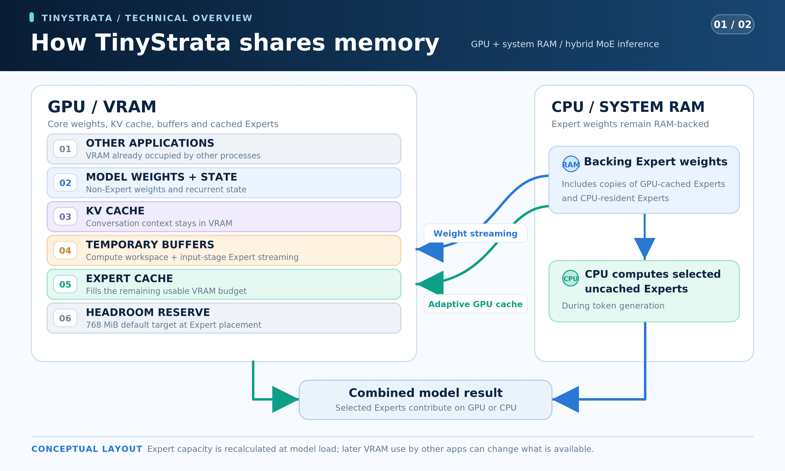

# TinyStrata

[English](README.md) · **简体中文** · [日本語](README.ja.md) · [Deutsch](README.de.md) · [Français](README.fr.md) · [Español](README.es.md) · [Português](README.pt-BR.md)

**TinyStrata 是一款正在开发中的高速推理引擎，面向 30B 级 MoE 模型，仅支持 Windows。** 主要面向配备主流显卡、显存为 **8–24 GB** 且系统内存**不超过 32 GB** 的 PC。 提供 API 和可选的聊天 UI。

**支持 NVIDIA Ampere 及更新架构的 GPU（CUDA）和 AMD RDNA 4 GPU（HIP/ROCm）。**

**AMD 显示输出限制：** 同时使用 AMD 核显和独立 Radeon 显卡进行推理时，请在 **启动 Windows 之前将显示器连接到 Radeon 显卡**。暂不支持使用主板或核显的显示输出：已有其他用户报告整机重启，我们也在验证机上复现了该现象。系统启动后再更换接口仍未能防止故障再次发生。原因尚未确定，详见 [Issue #10](https://github.com/kbc20f11/TinyStrata/issues/10)。

## 为什么开发 TinyStrata？

随着 PC 配件价格上涨，组装一台高端 PC 对许多人来说正变得越来越难。

因此，我们开发了 TinyStrata，让 AI 能在配备 RTX 3060 级别或更高性能主流显卡的 PC 上，以本地方式高速运行。我们专注于让 30B 级的较小型 MoE 模型尽可能快地运行。

我们的主要目标是配备 **8–24 GB 显存、系统内存不超过 32 GB** 的 PC。我们认为，这一范围涵盖了配备主流显卡的 PC 中最常见的配置。

TinyStrata 基于 Strata，致力于高效利用 GPU 内存，让 30B 级 MoE 模型即使在显存有限的情况下也能高速运行。我们的目标是让你能在自己的 PC 上处理长对话和文档。

开发工作专注于 Windows 上的本地推理及其 API 服务。

TinyStrata 会根据你的硬件自动选择推理和内存设置，因此无需复杂配置或手动调优即可开始使用 API。

## 重点支持的模型

[Qwen3.6-35B-A3B](https://huggingface.co/Qwen/Qwen3.6-35B-A3B) 仍是默认模型，适合在配备主流显卡的 PC 上兼顾速度、内存效率和回答质量。TinyStrata 专注于较小的 MoE 模型，并支持 **Gemma 4 26B-A4B-it、LFM2.5-24B-A2B 和 Clover-35B-A3B-Preview**。

**Qwen3.6-35B-A3B UD-IQ3_XXS** 使用固定版本的 [Unsloth MTP GGUF](https://huggingface.co/unsloth/Qwen3.6-35B-A3B-MTP-GGUF/blob/5bc3e238d916f48a861bac2f8a1990a0e9b7e98d/Qwen3.6-35B-A3B-UD-IQ3_XXS.gguf)。两个文件共约 **15.0 GB**：包含 MTP 权重的语言模型 **14.1 GB**，视觉投影器（`mmproj-F16.gguf`）**0.9 GB**。

**Gemma 4 26B-A4B-it QAT Q4_0** 使用 [Google 官方模型及视觉投影器](https://huggingface.co/google/gemma-4-26B-A4B-it-qat-q4_0-gguf)，以及[匹配的 Unsloth QAT MTP 助手](https://huggingface.co/unsloth/gemma-4-26B-A4B-it-qat-GGUF/blob/7b92b5b28818151e8669af2e45e88d6086f490dd/mtp-gemma-4-26B-A4B-it.gguf)。三个文件共 **15.886 GB**：模型 **14.439 GB**、投影器 **1.195 GB**、助手 **0.252 GB**。

**LFM2.5-24B-A2B Q4_K_M** 使用官方 [LiquidAI GGUF](https://huggingface.co/LiquidAI/LFM2.5-24B-A2B-GGUF)。仅需下载一个语言模型文件，大小为 **14.53 GB**。

**Clover-35B-A3B-Preview IQ3_XXS** 默认使用 [AtomicChat 提供的 GGUF](https://huggingface.co/AtomicChat/Clover-35B-A3B-Preview-GGUF/blob/4f7e2918e5315634d9d9720ea4f6e8a9a627a875/Clover-35B-A3B-Preview-AD-IQ3_S-IQ3_XXS.gguf)，专家的 **gate/up 使用 IQ3_XXS，down 使用 IQ3_S**。语言模型大小为 **15.515 GB**，保留 Clover 自己的分词器和已学习的双向 GDN 参数。TinyStrata 将上下文容量扩展至 **256K**。[官方 Clover 的标称上限为 128K](https://huggingface.co/Diffuspace/Clover-35B-A3B-Preview/blob/main/config.json)，超过 128K 时的整体回答质量尚未评估。官方 Clover 仅支持文本；TinyStrata 通过复用 Qwen3.6 projector 添加图像输入。projector 为 **0.899 GB**，总计 **16.414 GB**，已为 Qwen 下载时会直接复用。通过 `run-api.bat --model-family clover` 选择；新建的独立配置使用端口 **18083**，设置保存在 `config-clover.json`。

托管的 Clover 配置默认使用不带草稿的因果生成 D0、INT8 KV（`--clover-mode causal --clover-draft 0 --kv-type int8`）和 MT1（`STRATA_IQ_MT_MIN=1`）。exact 自投机 D3 仍可显式选择（`--clover-mode self-spec --clover-draft 3 --clover-accept exact`）；启用前请在自己的硬件上与因果生成比较速度。图像编码器默认常驻 GPU；`--vision cpu` 使用 CPU，`--vision no` 关闭图像功能。Vision 支持因果生成或 exact 自投机；块扩散和阈值接受需要 `--vision no`。LowConfidence 块扩散和近似阈值接受仍为需显式启用的实验性选项，参见[解码设置](benchmark/README.md#english)。

Clover 还提供可选的重复片段 lookup：`--clover-lookup N` 指定最多提议 **0–7 个 token**，**默认 0（关闭）**。它复制输入或历史中已有的后续片段，再由完整的因果模型应用相同惩罚进行验证。需要因果 D0 和温度 0，支持图像。请在自己的任务中比较 **3** 和 **7**；参见[测量结果与一致性验证范围](benchmark/results/clover-lookup-20261107.md)。 匹配片段不足 8 个 token 时最多提议 3 个；提议 4–7 个需要至少匹配 8 个 token。

Qwen、Gemma 和 LFM 引擎均支持根据空闲显存自动调整的专家缓存、利用系统 RAM 的 CPU 专家计算、输入阶段权重流式传输及 CUDA Graph。它们使用相同的 API，支持运行中切换模型，并分别保存各模型的设置。不省略模型选中的专家。还支持按实际序列长度自动扩展 KV 物理内存，最大上下文容量保持不变。

**gpt-oss 20B MXFP4** 使用固定的 [ggml-org GGUF](https://huggingface.co/ggml-org/gpt-oss-20b-GGUF/blob/15dcfc7e7c608c6161507211ed43c5b590801b4b/gpt-oss-20b-MXFP4.gguf)（**12.110 GB**）。仅支持文本，上下文上限为 **128K**，默认使用 **INT8 KV**，没有 MTP 头。思考强度为**低／中／高**，默认为**中**。使用 `run-api.bat --model-family gpt-oss` 启动（端口 **18085**，`config-gpt-oss.json`），与 Gemma 共用可执行文件。默认采样参数为温度 **1.0**、top-p **1.0**、top-k **0**（不限制）。

[HIP 本地实测与验证](benchmark/results/gptoss-adoption-20261110.md)：HIP 默认启用 MXFP4 MMQ（`-DSTRATA_HIP_MXFP4_MMQ=OFF` 编译 matvec 回退路径；`TINYSTRATA_GPTOSS_MMQ=0` 可在诊断时禁用 MMQ）。原生 `--serve --lookup-draft 7` 为可选项；采样生成并非总能加速，因此现有 lookup 默认值保持 **0**。

| 功能 | [Qwen3.6](https://huggingface.co/Qwen/Qwen3.6-35B-A3B) | [Gemma 4](https://huggingface.co/google/gemma-4-26B-A4B-it) | [LFM2.5](https://huggingface.co/LiquidAI/LFM2.5-24B-A2B) | [Clover](https://huggingface.co/Diffuspace/Clover-35B-A3B-Preview) | [gpt-oss](https://huggingface.co/openai/gpt-oss-20b) |
| --- | --- | --- | --- | --- | --- |
| 最大上下文 | 256K | 256K | 128K | 256K（扩展） | 128K |
| 图像输入 | 支持；默认编码器常驻 GPU | 支持；默认编码器常驻 GPU | 不支持 | 支持（TinyStrata 扩展，默认常驻 GPU） | 否 |
| MTP | 3 | 3 | 不支持 | 无（exact 自投机 D3 可选） | 否 |
| KV 格式 | FP32 / INT8 / 原生 FP8 | FP16 / INT8 / 原生 FP8（实验性） | FP16 / INT8 / 原生 FP8 | FP32 / INT8 / 原生 FP8 | FP16 / INT8 |
| KV 自动选择（默认） | FP8 → INT8 | INT8 | FP8 → INT8 | INT8 | INT8 |

Clover 的图像输入是 TinyStrata 扩展，并非官方 Clover 功能。

表头中的模型名称链接到官方模型卡。**FP8 → INT8** 表示 GPU 与已编译内核支持时使用 FP8 KV 和原生 FP8 Attention（NVIDIA 使用 Tensor Core，AMD RDNA 4 使用 WMMA），否则使用 INT8。KV 精度与 GGUF 权重量化相互独立；低精度 KV 可能产生与 FP32（Qwen）或 FP16（Gemma/LFM）不同的输出。

Gemma 默认使用 INT8。原生 FP8 为实验性功能，可通过 `run-api.bat --model-family gemma4 --kv-type fp8-mma` 显式选择。

**上下文容量自动选择**依据 GPU 总显存，如下表所示；可用显存决定专家缓存的大小。显式指定 `--max-context N` 时，以该值为准。

| GPU 总显存（示例） | Qwen3.6 / Gemma 4 / Clover | LFM2.5 / gpt-oss |
| --- | ---: | ---: |
| 8 GB | 64K | 64K |
| 12 GB | 128K | 128K |
| 16 GB 及以上 | 256K | 128K |

容量档位容许驱动报告值的差异，因此 16 GB 显卡即使报告为 15.x GiB，Qwen、Gemma 和 Clover 仍会选择 256K。

额外模型的可执行文件缺失时，请参见[手动构建说明](README.md#model-focus)。

## 安装方法

在 64 位 PowerShell 中运行以下任意一种安装方式：

**带 UI**（[安装脚本](install-ui.ps1)）：聊天地址为 `http://127.0.0.1:3000`，API 地址为 `http://127.0.0.1:18080/v1`。

```powershell
irm 'https://raw.githubusercontent.com/kbc20f11/TinyStrata/refs/heads/main/install-ui.ps1' | iex
```

**仅 API**（[安装脚本](install.ps1)）：提供相同的 API，不安装 UI。

```powershell
irm 'https://raw.githubusercontent.com/kbc20f11/TinyStrata/refs/heads/main/install.ps1' | iex
```

**AMD 运行时默认设置：** 自动安装和更新使用工作目录中的私有 **ROCm `10.2.0a20260930` SDK（HIP 7.17）**，不会默认选择旧的全局 `HIP_PATH` 或系统 SDK。显式指定 `-HipDirectory` 仍可选择自定义 SDK。模型与 Vision 共用匹配的 HIP／COMGR／Kpack 和经过验证的 SDK 数学库路径；更新先准备独立的 native 版本，再提交设置。不会修改驱动、System32 或持久的系统 PATH。

仅当本地三个核心文件的哈希、实际加载的运行时及编译时 HIP 版本（7.17 或更新）通过验证时，Windows HIP 才使用驱动报告的最小 VMM 粒度。旧版、不匹配或未验证的运行时保留 **4 MiB 分配下限**。恢复时可在启动前设置 `$env:TINYSTRATA_HIP_VMM_COARSE='1'`；**任何非空值都会强制粗粒度**，恢复自动选择时请删除该变量。仅对**验证通过且粒度小于 4 MiB 的 HIP**，正常卸载的 native 退出等待可达 **60 秒**；其他路径保持原有等待时间。上方 AMD 显示输出限制仍然适用。参见[验证结果与剩余限制](benchmark/results/hip-runtime-vmm-20261107.md)。

绿色主题的可选 UI 支持 README 的七种语言、图像输入和实时生成统计。在**关于 → 设置 → 外观**中，可选择**跟随系统**（默认）、**浅色**或**深色**。本浏览器会保存此选择，并在重启后保留。

Windows 的带 UI 安装脚本会在桌面创建 **TinyStrata** 快捷方式。打开它即可启动或复用本地 API 和 UI，并在浏览器中显示聊天页面。仅安装 API 的脚本不会创建此快捷方式。也可以运行以下命令或双击 `run-ui.bat`：

```powershell
& "$env:LOCALAPPDATA\TinyStrata\run-ui.bat"
```

仅安装 API 时使用 `run-api.bat`：

```powershell
& "$env:LOCALAPPDATA\TinyStrata\run-api.bat" --port 18080
```

### UI 搜索与 Python

在 **模型** 标签页下载模型或删除已下载的模型文件。聊天中的模型选择器只显示已安装的模型。删除前需要确认。 删除当前模型前，请先切换到其他模型。其他模型仍需使用的共享文件会保留。

思考选项随模型变化：Qwen3.6、Clover 和 Gemma 4 提供**开启／关闭**，初始为**开启**；LFM2.5 始终**开启**。Tiel Coder 提供**关闭／低／中／高**，初始为**中**（高对应 API 值 `xhigh`）。UI 分别保存各模型的选择。Tiel 的 [Sharp 模板](https://huggingface.co/peculiar-ragdoll/Qwen-Sharp-Chat-Templates#setting-reasoning-effort)通过添加提示指令调整思考程度；这些级别不是 token 数量预算，选择高也不保证回答更准确。

首次使用且尚未保存 UI 设置时，网页搜索**默认开启**；尚未配置搜索服务时，使用**无需 API 密钥的 DDGS**。取消勾选输入框**聊天设置**旁的**网页搜索**即可关闭，本浏览器会在重启后保留此选择，并对所有支持的模型生效。已保存的开关状态、搜索服务和 API 密钥均保持不变。搜索服务、API 密钥和并发数在聊天设置中配置。模型需要时始终可以调用隔离环境中的 Python，无需另行启用。生成完毕的 Python 代码块也可以通过**运行 Python**按钮手动执行。

### 自动压缩上下文

UI 的聊天设置默认启用**自动压缩上下文**。在回答前及本地工具调用轮次之间，UI 使用当前模型的 tokenizer 计算输入长度。当输入加上预留输出空间达到上下文上限的 **85%** 时，由当前模型总结较早的对话。最近至少两次用户消息及其完整交流保留原文，工具调用与结果不会分开。系统指令和可用工具保持不变。

滚动摘要与聊天一起保存在 SQLite 中，原始对话全文仍可在 UI 中查看。编辑或回退到已总结的范围会使该摘要失效。总结失败或中断不会删除消息。摘要可能遗漏细节；这与 KV 量化是不同的功能。压缩后，新前缀需要重新处理一次，之后的对话可以再次复用其 KV 缓存。

点击聊天底部的 **KV**，即可查看上下文用量环形图并选择**立即压缩**。即使关闭自动压缩，也可以手动执行；最近两次用户发言及其交流保留原文，原始消息和附件仍保存在 SQLite 中。压缩后的上下文会立即加载，不会在对话中增加消息。

点击旁边的**专家分布**，可以选择**自动**或指定 **GPU 中常驻的路由专家数量**。调整步长按模型设置，同时显示百分比供参考。应用时会重新加载模型，并为各模型分别保存设置。实际分布取决于可用显存和专家大小。设为0个时，路由专家不在 GPU 中常驻；共享权重、KV 和图像编码器仍使用 GPU。

未指定输出上限时，最多预留 **8K 词元**，且不超过上下文的四分之一。摘要最多输出 **2K 词元**，且不超过上下文的八分之一。无法获取图像编码后的精确大小时，按保守的词元上限计算。单条消息或附件本身超出容量时，仍需缩短内容。`POST /v1/chat/token-count` 不生成文本，也不修改 KV 缓存；API 客户端不会被自动压缩。

设计参考：[Open WebUI](https://docs.openwebui.com/troubleshooting/context-window/) 与 [Anthropic](https://www.anthropic.com/research/effective-context-engineering-for-ai-agents)。


### 无需重启即可切换模型

安装器默认启动 Qwen。要在同一个 API 服务中使用 Gemma，请先下载并查看进度：

```powershell
$api = 'http://127.0.0.1:18080'
Invoke-RestMethod "$api/v1/model/download" -Method Post -ContentType 'application/json' -Body '{"model":"gemma-4-26b-a4b-it"}'
Invoke-RestMethod "$api/v1/model/download?model=gemma-4-26b-a4b-it"
```

重复查询进度，直到 `state` 为 `ready`，再明确请求切换。下载未启用的模型只会完成准备，不会自动切换：

```powershell
Invoke-RestMethod "$api/v1/model/switch" -Method Post -ContentType 'application/json' -Body '{"model":"gemma-4-26b-a4b-it"}'
Invoke-RestMethod "$api/v1/model/switch"
```

通过 `run-api.bat --model-family gemma4` 可直接启动 Gemma，默认 API 地址为 `http://127.0.0.1:18082/v1`。使用 LFM 时，将上述下载、进度查询和切换请求中的 `gemma-4-26b-a4b-it` 替换为 `lfm2.5-24b-a2b`；也可通过 `run-api.bat --model-family lfm2` 直接启动，默认地址为 `http://127.0.0.1:18081/v1`。

使用 Clover 时，在相同的下载、进度查询和切换请求中指定 `clover-35b-a3b-preview`。运行中的 API 端口保持不变。

轮询 `GET /v1/model/switch`，直到 `state` 为 `ready`。切回 Qwen 时，向相同切换接口发送 `{"model":"qwen3.6-35b-a3b"}`。下载或切换开始时返回 `202`；生成期间的切换请求返回 `409`，请在生成结束后重试。切换期间的推理请求返回 `503`。端口和身份验证保持不变。模型选择只在当前服务会话中有效，重启后使用启动器选择的模型。

## 实测速度 — Qwen3.6

于 **2026-11-03** 在 Windows 上测量，使用 RTX PRO 4000 Blackwell SFF Edition（24 GB）、Ryzen 9 7945HX3D、64 GB 系统内存和固定的 Unsloth MTP UD-IQ3_XXS 模型。图像编码器常驻 GPU，通过 API 进行测量；启用思考、模型默认采样设置（温度 0.7）及 MTP 3。输入分块和专家分配自动选择，上下文容量按各显存档位设置。混合 CUDA Graph 保持默认关闭，全部专家常驻 GPU 时的常规 CUDA Graph 保持启用。

| 可用内存条件 | 上下文容量 | INT8 生成 | 原生 FP8 生成 | 备注 |
| --- | ---: | ---: | ---: | --- |
| 24 GB | 256K | 141.52 tok/s | 134.41 tok/s | 所有权重常驻显存 |
| 约 16 GB | 256K | 103.69 tok/s | 105.15 tok/s | GPU 与 CPU 共同计算专家 |
| 约 12 GB | 128K | 92.89 tok/s | 94.74 tok/s | GPU 与 CPU 共同计算专家 |
| 约 8 GB | 64K | 67.17 tok/s | 69.95 tok/s | GPU 和 CPU 计算专家 |

每个 FP8/INT8 配置均使用相同的三段文本各运行两次，采用模型默认采样设置，每次生成包含思考的 128 个 token。速度为总生成 token 数除以总解码时间，不含加载与输入处理；上下文值表示缓存容量。内存受限行是在同一块 24 GB GPU 上另行预留 8、12 或 16 GiB，并设置相应显存档位的上下文容量，并非使用实际的 16/12/8 GB GPU。

INT8 和 FP8 按交替顺序各独立启动 4 次，每次启动将 3 段输入各运行 2 次、每次生成 128 个 token，详见[直接对比](benchmark/results/qwen-kv-direct-20261103.md)。

另见[参考 Basalt 的 CPU、Clover GPU 与检查点对照测试](benchmark/results/basalt-adoption-20261105.md#english)。这些测试使用单独控制的设置，不替代上方的历史基准表。

[Clover GDN 融合测试](benchmark/results/gdn-chain-20261105.md#english)比较了重复的全 GPU 常驻测试与固定 Expert 预算的混合执行；Qwen 保留原有默认路径。

[混合执行中的 CPU 结果合并和基于实测的工作线程调优](benchmark/results/basalt-remaining-20261105.md#english)
另有说明，历史基准表保持不变。

[显存受限时的暂存缓冲区选择](benchmark/results/portable-hybrid-20261105.md#english)
另有独立的对照测试说明。

## 实测速度 — Gemma 4

在同一台 Windows PC（64 GB 系统内存）上使用 Gemma 4 26B-A4B-it QAT Q4_0 及匹配的 QAT MTP 助手测量。图像编码器常驻 GPU，通过 API 进行测量，启用 MTP 3、CUDA Graph 及模型自身的默认思考和采样设置；上下文容量按各显存档位设置，输入分块及专家分配自动选择。

原生 FP8 和 INT8 于 **2026-10-27** 测量。

| 可用显存 | 上下文容量 | INT8（默认） | 原生 FP8（实验性） | 备注 |
| --- | ---: | ---: | ---: | --- |
| 24 GB | 256K | 115.89 tok/s | 115.46 tok/s | INT8 / FP8: GPU 计算专家 |
| 约 16 GB | 256K | 102.83 tok/s | 100.86 tok/s | INT8 / FP8: GPU 和 CPU 计算专家 |
| 约 12 GB | 128K | 85.53 tok/s | 91.71 tok/s | INT8 / FP8: GPU 和 CPU 计算专家 |
| 约 8 GB | 64K | 52.98 tok/s | 55.09 tok/s | INT8 / FP8: GPU 和 CPU 计算专家 |

每个 FP8/INT8 配置均使用相同的三段文本各运行两次，采用模型默认采样设置，每次生成包含思考的 128 个 token。速度为总生成 token 数除以总解码时间，不含加载与输入处理；上下文值表示缓存容量。内存受限行是在同一块 24 GB GPU 上另行预留 8、12 或 16 GiB，并设置相应显存档位的上下文容量，并非使用实际的 16/12/8 GB GPU。

## 实测速度 — LFM2.5

在同一台 Windows PC（64 GB 系统内存）上使用官方 LFM2.5-24B-A2B Q4_K_M 测量，不使用 MTP 或 Vision。启用 CUDA Graph 及模型自身的默认思考和采样设置；上下文容量按各显存档位设置，输入分块及专家分配自动选择。

原生 FP8 和 INT8 于 **2026-10-27** 测量。

| 可用显存 | 上下文容量 | INT8 | 原生 FP8（默认） | 备注 |
| --- | ---: | ---: | ---: | --- |
| 24 GB | 128K | 143.85 tok/s | 148.61 tok/s | INT8 / FP8: GPU 计算专家 |
| 约 16 GB | 128K | 138.14 tok/s | 139.22 tok/s | INT8 / FP8: GPU 和 CPU 计算专家 |
| 约 12 GB | 128K | 115.61 tok/s | 117.90 tok/s | INT8 / FP8: GPU 和 CPU 计算专家 |
| 约 8 GB | 64K | 79.74 tok/s | 81.39 tok/s | INT8 / FP8: GPU 和 CPU 计算专家 |

每个 FP8/INT8 配置均使用相同的三段文本各运行两次，采用模型默认采样设置，每次生成包含思考的 128 个 token。速度为总生成 token 数除以总解码时间，不含加载与输入处理；上下文值表示缓存容量。内存受限行是在同一块 24 GB GPU 上另行预留 8、12 或 16 GiB，并设置相应显存档位的上下文容量，并非使用实际的 16/12/8 GB GPU。

## 实测速度 — Clover

于 **2026-11-02** 在 Windows、RTX PRO 4000 Blackwell SFF Edition（24 GB）、Ryzen 9 7945HX3D 和 64 GB 系统内存上，使用 Clover Preview IQ3_XXS 测量。启用因果 D0、思考和常驻 GPU 的图像编码器。CPU 工作线程数、输入分块及专家分配为自动设置；环境变量为 `STRATA_IQ_MT_MIN=1` 和 `STRATA_EXP_MODE=8`。

| 可用显存 | 上下文容量 | INT8 生成 | 原生 FP8 生成 | 备注 |
| --- | ---: | ---: | ---: | --- |
| 24 GB | 256K | 91.61 tok/s | 94.67 tok/s | 专家 GiB — INT8: 12.34 → 12.34; FP8: 12.34 → 12.34 |
| 约 16 GB | 256K | 58.16 tok/s | 58.17 tok/s | 专家 GiB — INT8: 6.55–6.60 → 6.07–6.22; FP8: 6.55–6.60 → 6.11–6.19 |
| 约 12 GB | 128K | 51.31 tok/s | 50.89 tok/s | 专家 GiB — INT8: 3.08–3.18 → 2.80–3.04; FP8: 2.94–3.18 → 2.80–3.04 |
| 约 8 GB | 64K | 不稳定（成功 3/4） | 39.75 tok/s | 专家 GiB — INT8: 0.00 → 0.00 (3/4); FP8: 0.00 → 0.00; INT8/FP8: 解码专家在 CPU，稠密计算及输入流式处理在 GPU |

每个 KV／显存条件均尝试四次独立启动，采用 v1 的输入、采样和计时方式。数值仅用于四次均成功的条件；启动失败或成功失败混合的情况会明确标记。这是单独标记的受控比较，不属于标准 v1，也不改变应用默认的因果 D0／INT8。专家缓存显示成功启动时的实际分配范围，顺序为启动时 → 16K 输入后。[完整结果与条件](benchmark/results/rtx-pro-4000-blackwell-sff.md)。

显存受限行在同一块 24 GB GPU 上另行分配并写入 8、12 或 16 GiB，上下文容量为 256K／256K／128K／64K。它们不是实际 16／12／8 GB GPU 的性能测试。这里使用自动分块，与此前固定 2,048-token 分块的本机调优条件不同。

## 实测速度 — AMD Radeon（HIP）

Radeon 显卡上的速度，使用 [tinystrata-bench-v1](benchmark/README.md#english) 测得。每张卡都有单独的页面，包含硬件、驱动、引擎提交、设置和全部列：[`benchmark/results/`](benchmark/results/)。数值为 生成 / 4K 输入 / 16K 输入（tok/s）。 Clover 数据采用 exact D3 派生配置。

**当前保存设置：** [RX 9060 XT，2026-11-09（5 个模型，单次测量）](benchmark/results/rx-9060-xt.md#current-saved-settings--2026-11-09-one-pass)。下表保留历史固定 v1 条件的比较。

| GPU | Qwen3.6 UD-IQ3_XXS | Gemma 4 QAT Q4_0 | LFM2.5 Q4_K_M | Clover IQ3_XXS (exact D3, Vision GPU) |
| --- | ---: | ---: | ---: | ---: |
| [RX 9060 XT](benchmark/results/rx-9060-xt.md) | 82.95 / 895.98 / 808.59 | 78.07 / 2482.20 / 2338.68 | 93.14 / 2062.80 / 1694.56 | 41.67 / 942.27 / 892.94 |
| [RX 9070 XT](benchmark/results/rx-9070-xt.md) | 89.11 / 1056.20 / 1383.33 | 87.81 / 2977.93 / 3667.40 | 102.67 / 2601.75 / 2531.47 | 39.86 / 888.74 / 1215.40 |

本次 Clover 测量使用 exact D3／INT8／MT1，图像编码器常驻 GPU；D3 已不再是应用默认设置。图像首次输出／完成时间为 **2.43／4.54 秒** (RX 9060 XT), **2.61／5.47 秒** (RX 9070 XT)；专家缓存为 **7.32–8.10 → 7.18–7.95 GiB** (RX 9060 XT), **6.84 → 6.70 GiB** (RX 9070 XT)（启动时 → 16K 输入后）。[条件与图像验证](benchmark/results/rx-9060-xt.md#clover-vision-with-exact-d3-2026-11-01)。

**Clover IQ3_XXS — RX 9060 XT（2026-11-01，Attention 共享前的历史记录）**

使用相同的固定输入，128K 上下文、KV 物理内存逐步分配、启用思考、自动 CPU 工作线程数与分块，每个配置独立启动 API 四次。历史 exact 行单独标记为 variant；因果 INT8 行仍是采用当时无 Vision 设置的固定 v1 对照。专家缓存按启动时 → 16K 输入后列出，单位为 GiB。

| 配置 | KV | 短输入生成 tok/s | 4K 输入 tok/s | 4K 输入后生成 tok/s | 16K 输入 tok/s | 16K 输入后生成 tok/s | 专家缓存 GiB |
| --- | --- | ---: | ---: | ---: | ---: | ---: | --- |
| 因果・标准（对照） | INT8 | 41.27 | 962.29 | 38.05 | 877.43 | 35.68 | 9.98 → 9.83 |
| 因果・MT1（对照） | INT8 | 40.64 | 962.21 | 36.99 | 877.58 | 35.77 | 9.98 → 9.83 |
| exact 自投机 D3（可选） | INT8 | 49.39 | 963.95 | 33.06 | 878.30 | 33.83 | 9.98 → 9.83 |
| exact 自投机 D3 | FP8（可选） | 46.11 | 959.49 | 28.94 | 872.02 | 18.00 | 9.98 → 9.83 |

以上是 Attention 共享之前的历史对照测量。目前 Clover 默认使用因果 D0、INT8 KV 和 MT1，exact D3 为可选项。这些历史 D3 数据并非当前默认设置的测量结果。块扩散与阈值接受仍为实验性功能。[设置与质量检查](benchmark/results/rx-9060-xt.md#clover-hip-int8-query-sharing-2026-11-01)／[此前的 IQ3 对照](benchmark/results/rx-9060-xt.md#clover-iq3-2026-10-31)／[此前的 Q4_0 测量](benchmark/results/rx-9060-xt.md#clover-causal-and-native-block-diffusion-2026-10-31)。

**Clover HIP INT8 Attention 共享 — RX 9060 XT（2026-11-01，Vision 添加前的历史记录）**

使用 INT8 KV，每个配置独立启动 API 四次，交错测量。短输入的输出上限为 128 个 token，4K/16K/64K 输入后为 32 个。此前默认因果模式的对照使用通常的 CPU 专家运算（MT2），两个 D3 行使用 MT1。这些数据测于添加 Vision 之前，图像编码器并未常驻；D3 行采用 D3/INT8/MT1 解码设置，目前仍可作为可选配置使用。[详细条件、质量检查与结果](benchmark/results/rx-9060-xt.md#clover-hip-int8-query-sharing-2026-11-01)。

| 配置 | 短输入生成 tok/s | 4K 输入后生成 tok/s | 16K 输入后生成 tok/s | 64K 输入后生成 tok/s | 64K 输入 tok/s | 专家缓存 GiB：启动时 → 64K |
| --- | ---: | ---: | ---: | ---: | ---: | ---: |
| 因果 MT2（此前默认・对照） | 41.16 | 38.04 | 36.40 | 24.11 | 662.52 | 9.98 → 9.35 |
| exact D3 MT1（无 Attention 共享・对照） | 49.78 | 33.35 | 34.11 | 17.51 | 663.12 | 9.98 → 9.35 |
| exact D3 MT1（Vision 添加前） | 49.49 | 34.87 | 39.30 | 26.62 | 664.65 | 9.98 → 9.35 |

## 我应该使用哪个项目？

| 你的目标和硬件 | 项目 |
| --- | --- |
| 你希望在 **Windows** 上使用 Qwen3.6 / Gemma 4 / LFM2.5 / Clover 推理，设备是配备主流显卡的 PC，配置为 **8–24 GB 显存、系统内存不超过 32 GB**。 | TinyStrata（**仅支持 Windows**，开发中） |
| 你同时拥有 **RTX 3060 级别或更高性能的 GPU** 和 **64 GB 或更多系统内存**。 | 推荐使用 [Strata（上游项目）](https://github.com/Niko1221/Strata)。 |
| 你希望使用**带实时生成统计的聊天 UI**。 | TinyStrata 的[可选 UI 安装脚本](install-ui.ps1)。 |

## 内存如何分工 — Qwen3.6

MoE 模型包含许多**专家（Experts）**，它们是针对每个 token 选择的小型神经网络。TinyStrata 会在 GPU 内存（显存）中保留尽可能多的专家。在生成过程中，选中但未缓存的专家可以使用系统内存在 CPU 上计算。处理较大的输入批次时，也可以改为将专家权重从系统内存流式传输到临时 GPU 缓冲区。模型选中的专家都会保留在计算中。

下载的模型文件总计约 **15.0 GB**：语言模型（包括 MTP 权重）为 **14.1 GB**，视觉投影器（`mmproj-F16.gguf`）为 **0.9 GB**。语言模型无需全部装入显存。GPU 内存还需要为视觉编码器和图像处理缓冲区、对话的 **KV 缓存**、模型的其他权重以及临时计算缓冲区预留空间：



这是默认 GPU 图像模式下的布局示意图，并不表示各部分大小固定。每次加载模型时，TinyStrata 都会先启动并预热 GPU 视觉编码器，再加载语言模型；编码器的权重和预热后的工作缓冲区保持常驻。随后分配 KV 的初始页面、其他权重和工作缓冲区，并根据剩余空闲显存确定专家缓存容量。在 Windows 上，若能同时取得 CUDA 的空闲内存和 NVIDIA 驱动的空闲专用显存读数，则使用较小值。

缓存内容随使用的专家而变化。默认的 KV 自动扩展使短对话能为专家保留更多显存；序列变长时，专家缓存向 KV 归还内存。新的较短请求可以把不再使用的 KV 页面交还专家缓存。`run-api.bat --kv-whole` 改为预先分配全部 KV 容量，`run-api.bat --kv-grow` 恢复自动扩展。其他应用仍可能占用显存。

专家放置通常以保留 768 MiB 余量为目标。在 Qwen 的 `--kv-whole` 模式下，与 Strata 一样，当主模型的所有专家只差少量空间即可装入显存时，可以释放用于加速的 Q8 权重副本、缩小已有的 Attention 分数缓冲区，并将余量目标降至 256 MiB；MTP 专家可以在 CPU 上运行。`--vram-reserve-mib N` 可显式固定预留量。这是放置时的目标，不保证此后始终保有相同的空闲内存。

通常，常驻 GPU 的专家越多，CPU 的计算量就越少。在混合模式下，系统内存也会保留已缓存在显存中的专家的后备副本，因此增加显存并不会逐字节等量减少系统内存占用。也请为操作系统和其他应用留出内存。更大的**系统内存容量**可以容纳模型数据，但速度还取决于 CPU、内存带宽和 GPU。Windows 的“共享 GPU 内存”与 TinyStrata 主动在 CPU 上计算专家的机制不同。

KV 缓存始终保留在显存中；在这一卸载机制中，系统内存用于存放专家数据。因此，长对话仍然需要足够的 GPU 内存来容纳 KV 缓存。

## 自动设置 — Qwen3.6

新配置会自动选择 KV/Attention 和上下文容量，无需选择适用于 8 GB、12 GB 或 16 GB 的配置方案。

Qwen3.6 和 LFM2.5 在 RTX 3060 上会选择 INT8。在受支持的 RTX 40/50 系列和 AMD RDNA 4 环境中会自动选择原生 FP8；引擎会检查已编译的内核和 GPU 功能，以及硬件代际。如果原生 FP8 不可用，自动模式会使用 INT8。Gemma 在 NVIDIA 和 AMD 上均默认使用 INT8。这一过程会选择受支持的路径，而无需在启动时运行速度或质量基准测试。

原生引擎在启动时，根据空闲显存、上下文容量以及专家能否装入 GPU，从 512、1024、2048 或 4096 token 中估算并选择输入分块大小。较大的分块可以减少输入处理期间重复从 RAM 向 GPU 传输权重的次数。`run-api.bat --chunk N` 可固定大小；`run-api.bat --chunk auto` 可恢复原生自动选择。

上下文容量是输入与生成输出合计的逻辑上限。默认按对话长度逐步分配 KV 物理内存，而不是为短对话预先分配全部容量。长文档仍需要更多计算，最终也需要更多 KV 内存。

达到完整容量时，Qwen 的 INT8 KV（包含 MTP 层）约需要 **64K 时 0.71 GiB、128K 时 1.42 GiB、256K 时 2.84 GiB**，其他权重和工作缓冲区还需额外空间。在此实现中，原生 FP8 的 KV 存储占用与 INT8 大致相同；其优势来自不同的计算路径，而非显著缩小缓存。

上下文容量按 GPU 总显存选择，专家缓存随后按加载时剩余的可用显存分配。其他应用使用显存越多，GPU 能缓存的专家就越少。输入超出上下文容量时，API 会拒绝请求，不会静默截断。

GGUF 权重量化与 KV 精度是两回事。选用的 UD-IQ3_XXS 模型使用压缩权重；INT8 或 FP8 描述的是对话缓存及其 Attention 路径。较低精度的 KV 可能改变回答，因此这些模式不保证与 FP32 KV 输出完全一致。该实现会保留所有可见的上下文位置，以及模型选中的每个专家。

新的启动器配置使用 MTP 3，它会提前提议若干 token，并由主模型验证。它可能提升生成速度，但收益取决于有多少提议被接受。验证旨在保留主模型的解码行为；不同的数值执行路径仍可能改变 token，因此启用 MTP 并不保证与禁用时输出完全一致。

MTP 同时支持贪心生成和基于温度的采样，包括重复惩罚、频率惩罚和存在惩罚。对于采样请求，主模型会对每个验证行进行采样，只接受与之匹配的草稿前缀。

Qwen 和 Gemma 还提供可选的 `--lookup-draft N`（最多提议 **0–7 个 token**）与实验性的 `--mtp-auto 0|1`；**两者均默认 0（关闭）**。lookup 复制输入或历史中已有的后续片段，在常规温度设置下也使用现有的主模型采样器和惩罚逐 token 验证。所有选中的 Expert 仍会计算，不使用近似接受或跳过尾部。默认 **MTP 3** 和温度（**Qwen 0.7 / Gemma 1.0**）保持不变。自动 MTP 并非在所有任务中都更快，因此默认关闭。参见与固定 v1 基准分开的[受控开发测量与限制](benchmark/results/qwen-gemma-speculation-20261107.md)。

显式设置会覆盖自动选择，现有的手动设置也会继续生效。例如，`run-api.bat --kv-type int8` 会固定使用 INT8；`run-api.bat --kv-type auto --max-context auto --expert-vram auto` 会恢复自动选择 KV、上下文和专家放置。

## API 服务器

TinyStrata 提供兼容 OpenAI 的 Chat Completions（`/v1/chat/completions`）和 Responses（`/v1/responses`）API，以及兼容 Anthropic 的 Messages API（`/v1/messages`），并支持流式生成。可以使用可选的 TinyStrata UI、API 客户端或外部前端。

新配置采用各模型自己的采样默认值。每次请求指定的值优先；已保存的自定义设置保持不变。

| 设置 | Qwen3.6 | Gemma 4 | LFM2.5 | Clover |
| --- | ---: | ---: | ---: | ---: |
| `temperature` | 0.7 | 1.0 | 0.1 | 0.0 |
| `top_p` | 0.95 | 0.95 | 1.0 | 1.0 |
| `top_k` | 20 | 64 | 50 | 64 |
| `min_p` | 0.0 | 0.0 | 0.0 | 0.0 |
| `presence_penalty` | 1.5 | 0.0 | 0.0 | 0.9 |
| `frequency_penalty` | 0.0 | 0.0 | 0.0 | 0.0 |
| `repetition_penalty` | 1.0 | 1.0 | 1.05 | 1.05 |
| `enable_thinking` | true | true | true（始终启用） | true（可关闭） |
| `max_tokens`（包含思考） | 32768 | 32768 | 32768 | 24576 |

API 默认监听 `http://127.0.0.1:18080`。要使用其他端口，请在已安装的 TinyStrata 文件夹中运行 `run-api.bat --port 18081`。

对于 Qwen 和 Clover，`run-api.bat --vision gpu` 使用 GPU 处理图像（新配置的默认值）；`--vision cpu` 使用 CPU，`--vision no` 禁用图像。`--vision-tokens N` 设置图像 token 上限（默认 4096）。这些选择会保存，后续启动时省略参数也会保留。

模型文件尚未安装时，API 也可以启动。选择 Qwen 时，调用 `POST /v1/model/download` 并使用空 JSON 请求体（`{}`），会下载固定的 [Unsloth Qwen3.6-35B-A3B MTP UD-IQ3_XXS 语言模型](https://huggingface.co/unsloth/Qwen3.6-35B-A3B-MTP-GGUF/blob/5bc3e238d916f48a861bac2f8a1990a0e9b7e98d/Qwen3.6-35B-A3B-UD-IQ3_XXS.gguf)（14.1 GB，包含 MTP 权重）及其[视觉投影器](https://huggingface.co/unsloth/Qwen3.6-35B-A3B-MTP-GGUF/blob/5bc3e238d916f48a861bac2f8a1990a0e9b7e98d/mmproj-F16.gguf)（0.9 GB），总计约 **15.0 GB**。它会验证两个文件的 SHA-256 校验和，提取分词器并加载模型文件。`GET /v1/model/download` 可报告进度；中断的下载可以续传。重复的下载请求会复用当前任务，`POST /v1/model/download/cancel` 可以取消传输或校验。下载完成并不意味着推理已就绪：请等待下载状态变为 `ready`，且 `/health` 报告 `loaded: true`（启用图像时还需 `images: true`）。

安装程序会准备引擎可执行文件和 GPU 运行时库，并默认下载 Qwen 及其视觉投影器。现有配置会继续使用已选择的本地模型，直到你明确更改它。

## 致谢

TinyStrata 是 [Strata](https://github.com/Niko1221/Strata) 的独立分支，大量借鉴了其实现。感谢 [Niko](https://github.com/Niko1221) 和 Strata 社区提供引擎，以及让 TinyStrata 得以实现的工作。

同时感谢 [Aaron Flin](https://github.com/aflin) 和 [MoMoE 项目](https://github.com/aflin/momoe)，TinyStrata 所适配的 KV 缓存、attention 和量化专家代码来自他们的工作。

## 许可证

MIT。参见 [LICENSE](LICENSE)。

Copyright (c) 2026 Niko1221 and the Strata contributors.

上游署名信息：[NOTICE](NOTICE)。GGML：[MIT 许可证](third_party/ggml/LICENSE)。
